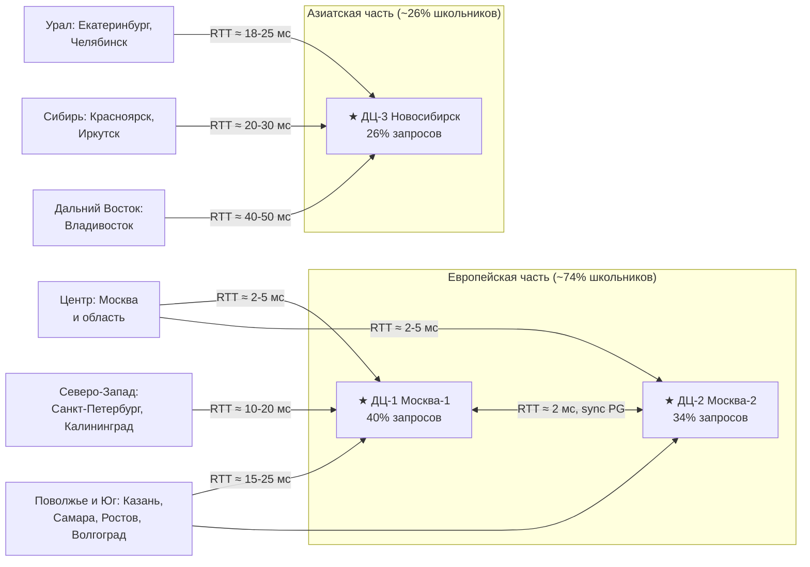
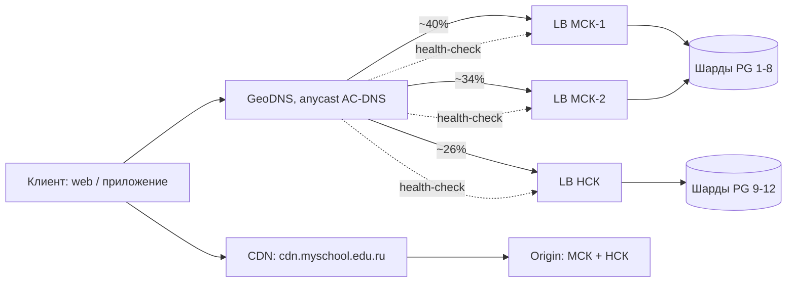
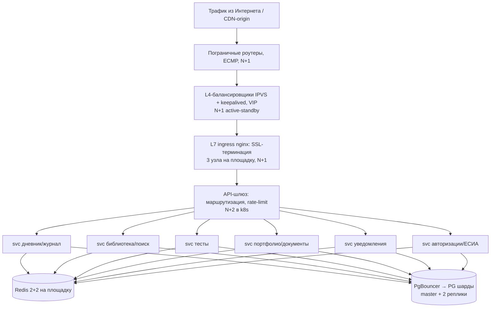
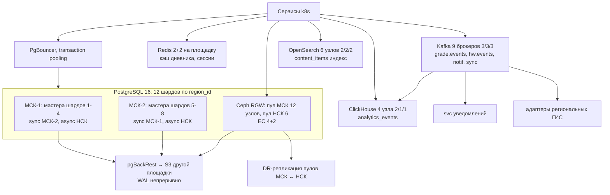
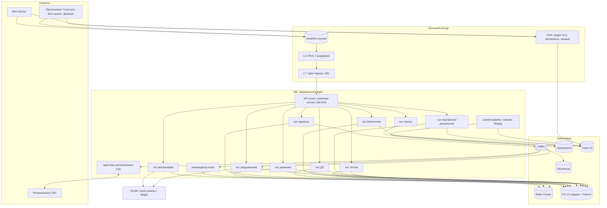

# Расчётно-пояснительная записка

**Дисциплина:** Проектирование высоконагруженных систем

**Тема проекта:** Проектирование бэкенда высоконагруженного G2C-сервиса электронной образовательной среды на примере ФГИС «Моя школа»

---

## Оглавление

1. [Тема и целевая аудитория](#глава-1-тема-и-целевая-аудитория)
2. [Расчет нагрузки](#глава-2-расчет-нагрузки)
3. [Глобальная балансировка нагрузки](#глава-3-глобальная-балансировка-нагрузки)
4. [Локальная балансировка нагрузки](#глава-4-локальная-балансировка-нагрузки)
5. [Логическая схема БД](#глава-5-логическая-схема-бд)
6. [Физическая схема БД](#глава-6-физическая-схема-бд)
7. [Алгоритмы](#глава-7-алгоритмы)
8. [Технологии](#глава-8-технологии)
9. [Обеспечение надёжности](#глава-9-обеспечение-надёжности)
10. [Схема проекта](#глава-10-схема-проекта)
11. [Список серверов](#глава-11-список-серверов)
12. [Список источников](#список-источников)

---

## Глава 1. Тема и целевая аудитория

### 1.1 Тема проекта, рыночная ниша и аналоги

**Выбранная тема:** проектирование бэкенда федеральной государственной информационной системы «Моя школа» - единой цифровой образовательной платформы для школьников, их родителей и учителей, объединяющей электронный дневник и журнал, библиотеку цифрового учебного контента, тесты, портфолио и электронные документы об образовании. Московская электронная школа рассматривается как крупнейший региональный сегмент платформы и её технологическая основа: в сентябре 2022 года было подписано соглашение Москвы, Минцифры и Минпросвещения, по которому МЭШ стала базой для создания федеральной системы [2], [3].

**Реальные аналоги.** Рынок школьных образовательных платформ существует давно и в разных юрисдикциях:

| Аналог | Страна | Масштаб | Что подтверждает |
|---|---|---|---|
| МЭШ (с 2016 г.) | Россия, Москва | 3+ млн зарегистрированных пользователей, 5+ млн обращений к сервисам в день (2026) | устойчивый спрос внутри страны, работоспособность модели на миллионах пользователей |
| ФГИС «Моя школа» (с 2022 г.) | Россия, вся страна | приложение «Госуслуги Моя школа» - 12,2 млн пользователей в 87 регионах (сентябрь 2026) | ниша не ограничивается Москвой, федеральный охват реален |
| Google Classroom | США, глобально | ~150 млн пользователей (2021) | жизнеспособность модели «дневник + задания + материалы» в мировом масштабе |
| PowerSchool | США | SIS с десятками миллионов школьников | коммерческая устойчивость школьных информационных систем как класса ПО |
| «Дневник.ру», "Школьный портал", региональные АИС | Россия | используются в десятках регионов | длительное существование рынка региональных дневников до федерализации |

Источники масштаба: МЭШ и ФГИС - [2], [4], [5]; Google Classroom - [6]; PowerSchool - [7]. Ниша подтверждается государственным заказом на единый федеральный сервис (постановление Правительства РФ № 1241 от 13.07.2022 [8]) и многолетней эксплуатацией аналогичных систем в России и за рубежом.

Отличие проекта от аналогов: это обязательный государственный сервис, пик которого привязан к учебному расписанию (начало уроков по часовым поясам, контрольные недели, 1 сентября), а данные о каждом школьнике копятся в течение всех 11 лет обучения и должны храниться бессрочно (оценки, аттестаты, портфолио).

### 1.2 Целевая аудитория

Целевая аудитория - вся Россия, три группы пользователей, связанных одной школой: школьники, их родители (законные представители) и учителя. Сервис работает там, где есть школы, то есть во всех 89 регионах от Калининграда до Камчатки, в 11 часовых поясах.

Фактические данные об аудитории на момент проектирования (сентябрь 2026):

| Метрика | Значение | Период | Источник |
|---|---|---|---|
| Пользователи приложения «Госуслуги Моя школа» | **12,2 млн в 87 регионах** | сентябрь 2026 | [4] |
| Установки приложения | 1,5 млн в августе 2025, 3 млн в ноябре 2025, 9 млн в марте и 10 млн в апреле 2026 | 2025-2026 | [5], [9], [10], [11] |
| MAU приложения | **4,8 млн** | апрель 2026 | [5] |
| DAU приложения | до 1,5 млн ежедневно | март 2026 | [9] |
| Аудитория МЭШ (Москва + регионы внедрения: Московская, Калужская, Тюменская обл., Татарстан, Дагестан, ЯНАО) | **4,5 млн** человек в 4,4 тыс. школ | апрель 2026 | [2] |
| Пользователи МЭШ (зарегистрированные) | 3+ млн, 5+ млн обращений к сервисам в день | 2026 | [2] |
| Пользователи приложения «Дневник МЭШ» | 3 млн | июнь 2024 | [2] |
| Обращения к московскому электронному дневнику | ~100 млн в месяц | сентябрь 2022 | [2] Собянин |
| Школьников в России | **17,6 млн**, из них 1,5 млн первоклассников, в ~40 тыс. школ | 2026/27 учебный год; школы - Росстат, конец 2022 | [12], [14] |
| Школьников в России, точные данные | 17 988 139 учеников | начало 2024/25 учебного года | [13] |
| Учителей в российских школах | **1 068 989** (всего педработников 1 346 928) | 2024/25 у.г. | [13] |
| Прогноз численности школьников | 17,4 млн в 2026, 16,9 млн в 2027, 16,3 млн в 2028 | прогноз | [14] |
| Проектные требования ТЗ на систему | до 4 млн ежедневно работающих пользователей на первом этапе, масштабирование до 24 млн | тендер 2021 г. | [1] |

Родители — вторая по численности группа: в московском сегменте на 1 млн учеников зарегистрировано около 1 млн родителей [2]. Для проекта принят коэффициент 1,2 аккаунта на школьника.

Прямой расчёт потенциальной базы аккаунтов: школьники 17,6 млн [12] + родители 17,6 × 1,2 = 21,1 млн + учителя 1,07 млн [13] = **39,8 ≈ 40 млн аккаунтов**. Коэффициент 1,2 родителя на школьника — из московского опыта МЭШ: на 1 млн учеников зарегистрировано свыше 1 млн родительских аккаунтов [2]; запас до 1,2 - на семьи, где у ребёнка не один родительский профиль. Это верхняя граница аудитории: в неё входят все участники учебного процесса страны.

### 1.3 Функционал MVP

Для проектирования выделены **7 ключевых функций**, покрывающих ежедневный учебный цикл от выставления оценки учителем до доставки уведомления родителю. Функции вне MVP (видеосвязь «Сферум», оплата питания, геолокация «Где ребёнок», ИИ-репетитор, чаты) упоминаются только как источники будущей нагрузки, их бэкенд не проектируется.

1. **Единая авторизация через ЕСИА.** Собственной регистрации в системе нет: вход только по подтверждённой учётной записи «Госуслуг», выдача JWT-сессий и refresh-токенов, связывание ролей (ученик / родитель / учитель) с профилем школы;
2. **Электронный дневник и журнал.** Расписание, темы уроков, оценки, посещаемость. Учитель ведёт журнал (запись), ученик и родитель читают дневник; данные дневника - самая читаемая часть системы;
3. **Домашние задания.** Учитель выдаёт ДЗ (текст или материал из библиотеки контента), ученик отмечает выполнение, учитель видит статус по классу;
4. **Библиотека цифрового контента.** Федеральная верифицированная библиотека: сценарии уроков, видеоуроки, электронные учебники, тестовые задания, интерактивные приложения. Поиск, просмотр, скачивание, выдача материала как ДЗ. Публикация контента проходит приёмку (антивирус, конвертация, модерация);
5. **Тесты с автопроверкой.** Прохождение теста учеником, автоматический подсчёт результата, попадание результата в дневник и статистику;
6. **Портфолио и электронные документы.** Верифицированные индивидуальные достижения (олимпиады, ГТО, курсы) и электронные документы об образовании (аттестаты, справки), выдача и отображение;
7. **Уведомления.** Событийные push/email/лента-уведомления (оценка, ДЗ, пропуск занятия) родителям и ученикам.

**Ключевые продуктовые решения:**

- **Вход только через ЕСИА** - система не хранит пароли, личность подтверждена заранее, это снимает целый класс задач (восстановление доступа, верификация родителя);
- **Федеральное ядро + интеграция с региональными системами.** До полного перехода регионов дневник части школ живёт в региональной ГИС; федеральный кластер агрегирует данные через API-синхронизацию и выступает источником истины для единых сервисов (библиотека, тесты, портфолио, документы). С 2026 года регионы переходят на федеральное типовое облачное решение (ТОР «Моя школа») [4], [15], поэтому в проекте федеральный кластер принимает весь основной трафик;
- **Контент - федеральный, общий для всех школ.** Материал загружается и верифицируется один раз и доступен учителям всей страны, это разгружает хранилище (нет копий по школам) и даёт эффект масштаба библиотеки;
- **Разделение записи и чтения по ролям.** Журнал пишет только учитель; ученик и родитель - читатели. Это предсказуемая нагрузка: пишущих ~6% дневной аудитории;
- **Многоуровневое хранение истории.** Оценки хранятся бессрочно (11 лет обучения), детальная посещаемость - 2 года с последующей агрегацией, уведомления - 30 дней;
- **Контент раздаётся через CDN**, чтобы пиковый вечерний трафик не ложился на основной сервер.

### 1.4 Источники

Библиографические описания всех источников - в разделе «Список источников» в конце записки; в тексте они обозначены номерами в квадратных скобках.

---

## Глава 2. Расчет нагрузки

Пересчёт аудиторных метрик (глава 1) в **продуктовые** и **технические** метрики.

### 2.1 Продуктовые метрики

#### 2.1.1 Аудитория: факты из источников

| Показатель | Значение | Источник |
|---|---|---|
| Школьники 1-11 классов | 17,6 млн в ~40 тыс. школ | [12], [13], [14] |
| Учителя | 1,07 млн | [13] |
| Родительские аккаунты | ~1 на ученика: в МЭШ на 1 млн учеников зарегистрировано ~1 млн родителей | [2] |
| Пользователи приложения «Госуслуги Моя школа» | 12,2 млн в 87 регионах | [4] |
| MAU приложения | 4,8 млн (апрель 2026, до массового перехода регионов) | [5] |
| DAU приложения | до 1,5 млн | [9] |
| Stickiness приложения | 31% (1,5 / 4,8) | [5], [9] |
| Охват МЭШ в Москве | 3 млн зарегистрированных ≈ весь контингент | [2] |
| Обращения к дневнику МЭШ | ~100 млн в месяц ≈ 3,3 млн в день | [2] |
| ТЗ на систему: DAU первого этапа / предел масштабирования | 4 млн / 24 млн | [1] |

#### 2.1.2 Расчёт MAU и DAU

MAU учебного месяца считается по ролям: `MAU_роли = база × охват месяца`.

17,6 × 0,92 = 16,2; 21 × 0,62 = 13,0; 1,07 × 0,95 = 1,0; итого 30,2 ≈ **30 млн**.

| Роль | База | Охват в учебный месяц | MAU |
|---|---|---|---|
| Школьники | 17,6 млн [12] | 92%: дневник обязателен, но у части младших аккаунтом владеет родитель | 16,2 млн |
| Родители | 21 млн (§1.2) | 62%: московский опыт - аккаунт почти в каждой семье, активность в месяц ниже учеников | 13 млн |
| Учителя | 1,07 млн [13] | 95%: журнал — рабочий инструмент | 1,0 млн |
| **MAU** | | | **~30 млн** |

Сверки: снизу — приложение уже собрало 12,2 млн пользователей за первый год неполного перехода [4]; сверху — MAU не превышает 40 млн аккаунтов; по МЭШ охват ~100% контингента [2], так что принятые 92% консервативны.

DAU учебного дня считается по ролям: `DAU_роли = MAU_роли × частота захода в учебный день`.

16,2 × 0,68 = 11,0; 13 × 0,23 = 3,0; 1,0 × 0,90 = 0,9; итого 14,9 ≈ **15 млн**.

| Роль | MAU | Частота захода | DAU |
|---|---|---|---|
| Школьники | 16,2 млн | 68%: старшие заходят ежедневно, младшие - через родителей | 11,0 млн |
| Родители | 13 млн | 23%: проверяют дневник 1-2 раза в неделю | 3,0 млн |
| Учителя | 1,0 млн | 90%: журнал ведётся на каждом уроке | 0,9 млн |
| **DAU** | | | **~15 млн** |

Stickiness 50% против 31% у приложения [5], [9]: приложение - один канал неполного перехода, тогда как дневник заменяет бумажный журнал и обязателен в учебный день. Сверка по ТЗ: 15 млн лежит в коридоре от 4 млн первого этапа до 24 млн предела масштабирования [1]. В каникулы DAU падает в 4-5 раз - остаются тесты, портфолио и поиск курсов. Пиковый день - 1 сентября и первая учебная неделя: K_день = 1,1, DAU пикового дня 16,5 млн.

Часовые пояса: Россия живёт в 11 поясах от UTC+2 до UTC+12. «Утро перед школой» по местному времени (7:00-9:00) наступает в окне с 21:00 МСК предыдущего дня (Камчатка) до 7:00 МСК (Калининград); вечерние проверки родителей (18:00-21:00 местного) ложатся в окно с 8:00 до 19:00 МСК. Пики разных поясов перекрываются и суммарно сглажены, поэтому отношение пик-часа к среднему по суткам принято K_peak = 4 - по верхней границе для сервиса одного часового пояса.

#### 2.1.3 Средний размер хранилища на пользователя (по типам данных)

| Тип данных | Объём на пользователя | Число объектов на пользователя | Источник / формула |
|---|---|---|---|
| Оценки | 0,4 МБ | 2 600 оценок за 6,5 лет среднего стажа | расчёт §2.2.1: 2 600 × 150 Б ≈ 0,4 МБ (7 ТБ / 17,6 млн); допущения частоты и размера строки — §2.2.1 |
| Портфолио и документы | 1,1 МБ | 5-6 файлов (сертификаты, справки, аттестат) | расчёт §2.2.1: 20 ТБ / 17,6 млн школьников |
| Личные файлы учителя | 47 МБ | ~20 файлов | расчёт §2.2.1: 50 ТБ / 1,07 млн учителей |
| Метаданные дневника (ДЗ, посещаемость, тесты) | 0,7 МБ | ~16 тыс. строк на школьника за стаж | расчёт §2.2.1: 11,6 ТБ / 17,6 млн школьников |
| **Итого** | **~2,5 МБ в среднем на аккаунт** | - | суммарно ~102 ТБ на 40 млн аккаунтов: школьник ~2,2 МБ, учитель ~49 МБ, родитель ~0,1 МБ |

Хранилище сервиса «тонкое»: пользователи не загружают личные медиа, как в облаке или соцсети. Основной объём дают федеральная библиотека контента, общая для всех школ, и личные файлы педагогов. Средний сценарий урока принят равным 5 МБ — конспект с приложениями (презентация, рабочие листы, ссылки); видеоурок - 200 МБ, что соответствует ~20 минутам записи при среднем битрейте ~1,3 Мбит/с (720p); оценка по составу библиотеки МЭШ [2].

#### 2.1.4 Сессии и API-запросы в день

Пользовательское «действие» открывает страницу интерфейса, а страница собирается из нескольких API-запросов, поэтому нагрузка считается в запросах. Модель строится от типового дня каждой роли — поэкранно, с числом запросов на экран.

**Типовой день школьника** (DAU 11,0 млн):
- утро, перед школой: вход через ЕСИА (1), расписание на сегодня (1), лента дневника (2), ДЗ на сегодня (1), уведомления (1) — 6 запросов;
- перемена (в 70% дней): лента (1,5), уведомления (0,5) — 2 запроса;
- вечер, домашка: лента (1), просмотр и отметка ДЗ (1,5), уведомления (1), профиль и прочее (1) — 4,5 запроса;
- фон: refresh-токен (0,8), тесты по мере задания (0,4), библиотека (1) — 2,2 запроса.

Итого ~14,7 запроса в день за 2,7 сессии.

**Типовой день родителя** (DAU 3,0 млн):
- вечер: вход (1), лента и оценки ребёнка (2), ДЗ ребёнка (1,5), уведомления (2), расписание (1), прочее (0,5) — 8 запросов;
- утро (в 50% дней): лента (1), уведомления (1) — 2 запроса.

Итого ~10 запросов в день за 1,5 сессии.

**Типовой день учителя** (DAU 0,9 млн):
- 6 уроков, на каждом: открыть журнал класса (2), батч оценок (1), посещаемость (1), тема урока или выдача ДЗ (1) — 5 запросов на урок, 30 в день;
- утро: вход (1), расписание (1), лента (1), уведомления (1), прочее (1) — 5 запросов;
- день: поиск материалов в библиотеке (2), проверка выполнения ДЗ (2), тесты (1) — 5 запросов.

Итого ~40 запросов в день за 7 сессий.

| Роль | DAU | Сессий в день | Запросов в день на роль |
|---|---|---|---|
| Школьники | 11,0 млн | 2,7 | 162 млн |
| Родители | 3,0 млн | 1,5 | 30 млн |
| Учителя | 0,9 млн | 7,0 | 36 млн |
| **Всего** | **15 млн** | **2,7 на DAU** | **~228 млн** |

~15,2 запроса на активного пользователя в день, ~5,6 запроса на сессию. Чтение доминирует над записью: журнал пишет только учитель (6% DAU). Распределение запросов по типам — в §2.2.3.

### 2.2 Технические метрики

#### 2.2.1 Размер хранения по типам данных

**Метаданные (СУБД), накопленный объём по действующим пользователям.** Объёмы — модельная оценка снизу; внешних публикаций с точными цифрами по ФГИС нет, поэтому все допущения вынесены явно:

- **400 оценок в год на ученика** — примерно 2 оценки в учебный день или 1,3 по предмету в неделю при 8-9 предметах (педагогическая практика журналирования);
- **5 уроков в день** по расписанию — среднее по недельной нагрузке 5-11 классов (29-33 часа при 6-дневной неделе), **25 учеников в классе** — верхняя граница нормативной наполняемости (СанПиН 1.2.3685-21), **210 учебных дней в году** — 34-35 учебных недель × 6 дней;
- **150 байт на строку** — узкая строка PostgreSQL: заголовок, идентификаторы-связки, значение, метка времени; индексы учтены отдельно (×1,5 к итогу);
- **строка статуса ДЗ создаётся при смене состояния** («выполнено», «оценено»): исходное «назначено» хранить не нужно, оно восстанавливается из факта выдачи ДЗ и состава класса, поэтому в объёме учитываются 25% отметок о выполнении от всех выданных заданий;
- **6,5 лет среднего стажа** ученика в системе — среднее по распределению 1-11 классов;
- **0,2 теста в день на ученика** — тесты проводятся не на каждом уроке: порядка одного в учебную неделю в среднем по предметам (17,6 млн × 0,2 × 210 × 3 года ≈ 2,3 млрд попыток).

| Тип данных | Количество, шт. (строк) | Объём, ТБ | Средний размер строки, Б | Формула / источник |
|---|---|---|---|---|
| Оценки | 46 млрд | 7,0 | 150 | 17,6 млн × 6,5 лет × 400 оценок/год = 46 млрд строк; 46 млрд × 150 Б = 6,9 ≈ 7 ТБ |
| Посещаемость (детальные записи, 2 года) | 37 млрд | 3,0 | 80 | 17,6 млн × 5 уроков/день × 210 дней × 2 года; глубже - агрегаты (0,3 ТБ) |
| Статусы выполнения ДЗ | 23 млрд | 4,6 | 200 | 3,7 млрд ДЗ × 25 учеников × 25% сдавших |
| Домашние задания (задания) | 3,7 млрд | 1,9 | 500 | 700 тыс. классов × 5 ДЗ/день × 210 дней × 5 лет (5-11 классы) |
| Уроки: темы, ссылки на материалы | 4,8 млрд | 1,4 | 300 | 700 тыс. классов × 5 уроков/день × 210 дней × 6,5 лет |
| Попытки тестов | 2,3 млрд | 0,7 | 300 | 17,6 млн × 0,2 теста/день × 210 дней × 3 года |
| Уведомления, живут 30 дней | 1,35 млрд | 0,7 | 500 | 3 уведомления × 15 млн DAU × 30 дней |
| Пользователи, школы, классы, расписание, портфолио-метаданные, синхронизация | ~1 млрд | 0,3 | - | 40 млн пользователей × 2 КБ + справочники + расписание 25 млн строк |
| **Итого метаданные** | **~119,2 млрд строк** | **19,6** | - | с индексами (×1,5) ~29 ТБ на диске |

**Файловые данные (S3-хранилище + CDN):**

| Тип данных | Количество, шт. | Объём, ТБ | Средний размер | Источник / формула |
|---|---|---|---|---|
| Сценарии уроков | 360 тыс. | 1,8 | 5 МБ | [2]: 360 тыс. сценариев доступны регионам (2024) |
| Видеоуроки | 50 тыс. | 10,0 | 200 МБ | оценка: 12 тыс. видеоуроков МЭШ [2] + федеральная библиотека |
| Электронные учебники | 344 | 0,2 | 500 МБ | [2]: 344 учебника МЭШ (2026) |
| Интерактивные приложения | 174 тыс. | 0,5 | 3 МБ | [2]: 174 тыс. приложений библиотеки МЭШ (2023) |
| Тестовые задания (библиотека) | 80 тыс. | 0,01 | 100 КБ | [2]: 80 тыс. тестов МЭШ (2023) |
| Личные папки педагогов | 21 млн файлов | 50,0 | 2,4 МБ | оценка: 1,07 млн учителей [13] × 20 файлов × 2,4 МБ |
| Документы об образовании, портфолио (PDF, сканы) | 90 млн | 20,0 | 0,22 МБ | 17,6 млн учеников × 5 документов |
| **Итого файловые** | **~112 млн файлов** | **~82,5** | 0,7 МБ | физический объём = логический 82,5 ТБ × 2,5: EC 4+2 (×1,5) + DR-копия бакетов во втором пуле (×1,0) ≈ 210 ТБ |

**Примечание.** Метаданные прирастают на ~3 ТБ в год: оценки 1,1 ТБ, посещаемость 1,5 ТБ, прочее. Файловые данные - на 4-5 ТБ в год. Посещаемость хранится детально два года, затем агрегируется; уведомления живут 30 дней; личные папки и документы - бессрочно. Контент библиотеки невелик по объёму, но требователен к числу одновременных читателей - это задача CDN, а не дисков.

#### 2.2.2 Сетевой трафик

Разбивка по существенным типам: пиковое потребление - для выбора сетевых интерфейсов и CDN, суточный объём - для оценки стоимости хостинга.

| Тип трафика | Направление | Пиковое, Гбит/с | Суточный объём, ГБ/сутки | Расчёт |
|---|---|---|---|---|
| Видеоуроки (стриминг HLS) | egress (CDN) | 33,3 | 90 000 | 0,3 × 15 млн × 20 МБ: HLS отдаёт сегменты по мере просмотра, в среднем смотрят ~10% ролика (2-3 минуты из 20) |
| Материалы (сценарии, PDF, учебники) | egress (CDN) | 6,7 | 18 000 | 0,3 × 15 млн × 4 МБ |
| Миниатюры и превью | egress (CDN) | 0,42 | 1 125 | 2,5 × 15 млн × 30 КБ (миниатюра ~300×200 JPEG) |
| API (JSON: дневник, журнал, библиотека) | egress | 0,63 | 6 840 | 2 640 RPS × 86 400 × 30 КБ: лента дневника на день - 20-50 КБ JSON (§11), среднее 30 |
| Загрузка контента и файлов педагогами | ingress | 0,12 | 321 | 1,07 млн учителей × 0,03 файла × 10 МБ: файл раз в месяц на учителя (презентации, сканы работ), средний файл 10 МБ |
| **Итого** | - | **~41,2** | **~116 300** | origin принимает ~20% egress после CDN |

**Примечание.** Формулы: `ГБ/сутки = Объектов_в_день × avg_size / 1000`; `Гбит/с_peak = RPS_peak × avg_size × 8 / 1000` при avg_size в МБ, где `RPS_peak = RPS_avg × K_peak`, `K_peak = 4`. Кэш-хит CDN ~80%: рабочее множество дня у образовательного каталога (видео и сценарии текущей недели по программе) - малая доля каталога, его запрашивают десятки раз; для видео-каталогов съём кэша устойчиво лежит в диапазоне 70-90%, принята середина. На origin приходится ~22 ТБ в сутки - 20% тяжёлого трафика (видео 90 + материалы 18 ТБ). Трафик интеграции с региональными системами — около 5 ТБ в сутки в переходный период — и push-уведомления в пиковую оценку не входят и рассчитываются отдельно.

#### 2.2.3 RPS по типам запросов (средний и пиковый)

| Тип запроса | Запросов в сутки, млн | Средний RPS | Пиковый RPS |
|---|---|---|---|
| Дневник: лента оценок | 59,4 | 688 | 2 752 |
| Уведомления: лента, бейджи | 37,4 | 433 | 1 732 |
| Дневник: просмотр ДЗ | 26,5 | 307 | 1 228 |
| Авторизация: вход и refresh (ЕСИА + JWT) | 25,0 | 289 | 1 156 |
| Дневник: расписание | 14,9 | 172 | 688 |
| Прочие запросы интерфейса | 16,3 | 189 | 756 |
| ДЗ: отметка выполнения (ученик) | 5,5 | 64 | 256 |
| Библиотека: выдача файла (signed URL на CDN) | 5,95 | 69 | 276 |
| Журнал: просмотр (учитель) | 9,0 | 104 | 416 |
| Тесты: старт / сдача попытки | 5,3 | 61 | 244 |
| Библиотека: поиск | 4,0 | 46 | 184 |
| Журнал: выставление оценки (учитель, батчами) | 5,4 | 63 | 252 |
| Журнал: отметка посещаемости (учитель, батч на класс) | 4,5 | 52 | 208 |
| Темы уроков (учитель) | 5,4 | 63 | 252 |
| ДЗ: выдача (учитель) | 2,7 | 31 | 124 |
| **Итого** | **~228** | **~2 640** | **~10 550** |

**Примечание.** Каждая строка — сумма одноимённых запросов из маршрутов §2.1.4 по трём ролям; формулы: `RPS_avg = Запросов_в_сутки / 86 400`; `RPS_peak = RPS_avg × K_peak`, `K_peak = 4`; DAU = 15 млн, 15,2 запроса на DAU в день, ~228 млн запросов в сутки. Пиковый день 1 сентября добавляет K_день = 1,1, расчётный максимум входного слоя — ~11 600 RPS. Записи строк в БД — отдельный контур, он шире пользовательского API: посещаемость ~1 020 RPS (учитель отмечает целый класс одним батчем из 25 строк), оценки ~390 (17,6 млн учеников × 400 оценок/210 дней), статусы ДЗ ~255 (3,7 млрд заданий за 5 лет → 3,52 млн заданий/день × 25 учеников × 25%), уроки ~41 (704 тыс. классов × 5 уроков) и выдача ДЗ ~41 (3,52 млн заданий/день), тесты ~51 (~2,2 млн попыток в сутки, по 2 записи на попытку - старт и сдача); сервисные — уведомления 865 (45 млн событий/сут × ~1,7 получателя ≈ 75 млн записей/сут), токены 220 (~19 млн ротаций в сутки, ~1,3 на активного пользователя: вход и обновление сессии), синхронизация 50 (инкрементальная выгрузка изменений журнала в региональные ГИС, ~4 млн событий/сут); итого ~2 970 записей в секунду (§5.2). Кэш закрывает ~85% чтений (§5, §6). Уведомления идут через внутреннюю шину событий: 865 RPS — нагрузка на шлюз push-доставки, а не прямые HTTP-запросы пользователей.

### 2.3 Источники

Численность школ и контингента - [12]–[14], аудитория и сервисы МЭШ - [2], приложение «Госуслуги Моя школа» - [4], [5], [9], [16], проектные требования ТЗ - [1]. Описания - в разделе «Список источников».

---

## Глава 3. Глобальная балансировка нагрузки

### 3.1 Функциональное разбиение по доменам

| Домен | Назначение | Тип трафика |
|---|---|---|
| myschool.edu.ru | веб-портал (SPA) | HTML/JS-статика, далее API |
| api.myschool.edu.ru | API мобильных приложений и портала | JSON, основной пользовательский трафик |
| cdn.myschool.edu.ru | библиотека контента: видео HLS, материалы, превью | тяжёлый egress, раздаётся CDN |
| static.myschool.edu.ru | статика интерфейса | кэшируемая статика |

Внешние системы, с которыми интегрируется платформа; в проект они не входят: ЕСИА для авторизации, push-шлюзы RuStore/FCM/APNs, API региональных ГИС, ФИС ФРДО для документов об образовании.

### 3.2 Карта и расположение ДЦ

Сервис обслуживает всю страну, но размещать инфраструктуру в каждом регионе не нужно: требования к RTT для дневника и API мягкие, до 100 мс приемлемо для интерактивной ленты, тяжёлый контент раздаёт CDN с узлами во всех федеральных округах. Приняты три активные площадки, объединённые в два RTT-кластера - московский и новосибирский:

★ — площадки ДЦ: на L4 каждой развёрнут собственный unicast VIP-префикс (AC-VIP-M1/M2/NSK, три разных /29); anycast-подсеть AC-DNS (GeoDNS) — одна на все площадки — анонсируется из трёх точек МСК-1, МСК-2 и НСК (§3.7). Пунктирные дуги на карте — анонс AC-DNS; стрелки - репликация PG.

| Площадка | Город | Координаты | Роль | Доля запросов |
|---|---|---|---|---|
| ДЦ-1 | Москва | 55.75° с.ш., 37.62° в.д. | активная, полный стек | 40% |
| ДЦ-2 | Москва | 55.75° с.ш., 37.62° в.д. (другой квартал, независимые вводы) | активная, полный стек | 34% |
| ДЦ-3 | Новосибирск | 55.03° с.ш., 82.92° в.д. | активная, полный стек, приём эвакуированного трафика | 26% |

Две московские площадки стоят в разных кварталах с независимыми энерговводами и подключениями к разным магистральным операторам: городская авария - пожар, отключение энергии, залитие - не выводит обе сразу.

### 3.3 Почему именно три площадки

| Вариант | Оценка |
|---|---|
| Одна площадка | Единичная точка отказа для обязательного федерального сервиса: авария или обслуживание оставляют школу без дневника. Отклонено |
| Две площадки | Отказ одной оставляет систему без резерва: выжившая работает на пределе ёмкости, плановые работы убирают резервирование совсем. Отклонено |
| **Три площадки — принято** | Отказ любой одной: две оставшиеся держат 100% пика с утилизацией ~63%; RPO = 0 по всем данным, так как синхронные реплики шардов живы; обслуживание площадки не убирает резерв |
| Четыре и больше | Защита от одновременного отказа двух площадок не окупается для госсервиса; при росте аудитории добавляется блок шардов на существующих или новых площадках |

Правило ёмкости: при отказе любой площадки две оставшиеся обязаны вывезти весь пик, в пиковый день - с K_день = 1,1 (§2.1.2). В двухплощадочной схеме 50/50 это даёт по 110% пика на площадку (суммарно 2 × 110 = 220% ёмкости), в трёхплощадочной с долями 40/34/26 - по 80% (суммарно 3 × 80 = 240%): разница в железе 132 против ~121 сервера (132/121 = 1,09), а взамен отказ любой площадки оставляет систему георезервированной с RPO = 0, и обслуживание площадки не выводит её из резерва.

### 3.4 Обоснование расположения площадок

| Фактор | Москва (ДЦ-1, ДЦ-2) | Новосибирск (ДЦ-3) |
|---|---|---|
| Пользователи | ~66% школьников в радиусе RTT ≤ 25 мс: Центр, Северо-Запад, Юг, Поволжье | ~26% школьников: Урал, Сибирь, ДВ; RTT 20-45 мс вместо 60-95 мс из Москвы |
| Связность | MSK-IX - крупнейшая точка обмена трафиком в стране: пик 8,78 Тбит/с, 636 участников [19] | главный телеком-узел азиатской части, прямой транзит на Иркутск и Владивосток |
| Интеграции | здесь сходятся гос-ИС: ЕСИА, ФИС ФРДО, шлюзы региональных ГИС | зеркалит интеграционный контур на случай отказа Москвы |
| Кадры и эксплуатация | крупнейший рынок ИТ-персонала, круглосуточные смены | региональные ЦОД крупных операторов с круглосуточной сменой |

Доля азиатской части (~26%) следует из статистики Росстата: население УФО (12,3 млн), СФО (15,7 млн) и ДФО (7,9 млн) на 01.01.2025 в сумме даёт 35,9 млн из 146,0 млн (24,6%); у школьников доля немного выше за счёт молодой структуры населения СФО, принимаем 26% с округлением. Оставшиеся ~74% - европейская часть, из них ~66% попадают в радиус RTT ≤ 25 мс от Москвы (остальное - Зауральский Урал и восток Поволжья).

RTT в таблице ниже проверяются физическим пределом распространения света в волокне: RTT_min = 2L/v, v ≈ 200 000 км/с. Магистральные трассы длиннее прямой, маршрутизация добавляет 20-50% - приведённые значения достижимы:

| Регион | Расстояние, км | Физический минимум RTT, мс | RTT до МСК, мс | RTT до НСК, мс | Обслуживает |
|---|---|---|---|---|---|
| Санкт-Петербург | ~700 | 7 | 8-12 | 45-55 | МСК |
| Казань, Самара, Ростов | 800-1 100 | 8-11 | 15-25 | 35-45 | МСК |
| Екатеринбург, Челябинск | ~1 800 | 18 | 30-40 | 18-25 | НСК |
| Красноярск, Иркутск | 3 300-4 100 | 33-41 | 60-75 | 20-30 | НСК |
| Владивосток | 6 400-9 000 (ВОЛС) | 64-90 | 80-95 | 40-50 | НСК |

Требование 152-ФЗ и постановления № 1241 [8]: первичные персональные данные школьников обрабатываются и хранятся на территории РФ - все три площадки и CDN-провайдер находятся в России.

### 3.5 Распределение запросов и равномерность

Доли подобраны близко к равномерным с учётом географии пользователей: европейские ~74% делятся между двумя московскими площадками как 40/34 — МСК-1 несёт чуть больше, на ней полный стек эксплуатации и первая очередь миграций, — азиатские 26% идут в НСК. Максимальная доля одной площадки — 40%: при её отказе оставшиеся две поднимают нагрузку с 60% до 100%, для чего каждая рассчитана на 80% пика (§3.3, §11). CDN-трафик в таблице не указан: его отдают узлы CDN ближе к пользователю, до origin доходит ~20% отдачи контента.

Если ёмкость площадки подобрана под её долю нагрузки, то при отказе самой нагруженной выжившие имеют лишь (1 - d_max) ёмкости пика: при d_max = 0,6 это 40%, и, чтобы вывезти пик, малым площадкам нужен запас ×3,3 и ×10 к их обычной нагрузке - фактически по 50% ёмкости каждой, простаивающей в обычные дни. Здесь сделано наоборот: все три площадки одинаковой ёмкости 80% пика (§11), а доли следуют за географией пользователей (40/34/26). Отказ любой площадки оставляет паре ёмкость 160% на 100% трафика, утилизация ~63% (проверка ниже), и отдельного «резерва на случай аварии» не требуется. Резерв размазан по всем площадкам равномерно, а не сосредоточен в недогруженной третьей.

| Площадка | Доля запросов | RPS API (пик) | Egress API, Гбит/с | Origin CDN, Гбит/с | Мастера шардов PG |
|---|---|---|---|---|---|
| МСК-1 | 40% | ~4 220 | ~1,1 | ~3,2 | 4 |
| МСК-2 | 34% | ~3 590 | ~0,9 | ~2,7 | 4 |
| НСК | 26% | ~2 740 | ~0,7 | ~2,1 | 4 |
| **Итого** | 100% | **~10 550** | **~2,6** | **~8,0** | **12** |

Проверка отказной устойчивости по каждой площадке:

| Отказавшая площадка | Держат оставшиеся | Суммарная ёмкость | Утилизация |
|---|---|---|---|
| МСК-1 (40%) | МСК-2 + НСК | 160% пика | ~63% |
| МСК-2 (34%) | МСК-1 + НСК | 160% пика | ~63% |
| НСК (26%) | МСК-1 + МСК-2 | 160% пика | ~63% |

При эвакуации трафика первично деградируют тяжёлые вторичные функции - фасетный поиск по библиотеке, конвертация контента, аналитические выгрузки; критичный контур дневника и журнала не затрагивается. Видео в эвакуацию не входит: его продолжает отдавать CDN.

### 3.6 Схема DNS-балансировки

GeoDNS возвращает A-записи с IP ближайших работающих площадок по гео-зоне клиента, доступность каждой проверяется автоматически. Для DNS-серверов применён anycast: один IP анонсируется из нескольких точек, запрос уходит на ближайший DNS-узел.

Клиент мобильного приложения не обращается к DNS на каждый запрос: соединения долгоживущие, смена площадки происходит при переподключении, поэтому переключение занимает минуты, а не секунды.

### 3.7 Anycast-подсети

Anycast применяется там, где он не рискует разорвать пользовательские сессии - на stateless-сервисах:

| Подсеть | Сервис | Анонсируется из |
|---|---|---|
| AC-DNS, 203.0.113.0/24 | GeoDNS-серверы | 3 точки: МСК-1, МСК-2, НСК |
| AC-VIP-M1, 203.0.113.8/29 | VIP L4-балансировщиков МСК-1, ECMP с двух роутеров площадки (§4.1) | только МСК-1 |
| AC-VIP-M2, 203.0.113.16/29 | VIP L4-балансировщиков МСК-2, ECMP с двух роутеров площадки (§4.1) | только МСК-2 |
| AC-VIP-NSK, 203.0.113.24/29 | VIP L4-балансировщиков НСК, ECMP с двух роутеров площадки (§4.1) | только НСК |

Внутри площадки каждый VIP анонсируется обоими пограничными роутерами, отказ роутера не заметен для трафика. AC-DNS - единственная по-настоящему anycast-подсеть: DNS без состояния и короткие UDP-транзакции, разрыв анонса безвреден. Пользовательский трафик API и портала идёт unicast: три VIP-префикса площадок разные, они перечислены в A-записях GeoDNS с весами и гео-зонами (§3.6, §3.9) - это даёт управляемое распределение 40/34/26, которого BGP-анycast не обеспечивает. Диапазоны из TEST-NET-3 указаны как документационные; в эксплуатации им соответствуют PI-сети проекта.

### 3.8 Почему именно такая балансировка

- Для маршрутизации между площадками выбран GeoDNS со взвешенными A-записями: BGP-anycast прикладного слоя рвёт TCP-сессии при смене анонса, а веса там управляются маршрутной политикой; DNS-перекос меняется одной записью и плавен по построению - 10% → 50% → 100% при вводе и выводе площадки.
- DNS держим собственный, без глобального LB-провайдера: в госсегменте с персональными данными школьников сторонний сервис в критическом пути недопустим.
- Все три площадки активные, без холодного резерва. Резерв простаивает и не добавляет ёмкости, активные распределяют между собой и пиковый трафик, и плановое обслуживание.
- L4/L7 локальны в каждой площадке, anycast остаётся только на входе: сессия пользователя живёт внутри одной площадки, межплощадочная координация - DNS-веса и репликация данных (§6.3), распределённое состояние из пути запроса убрано.

### 3.9 Механизм регулировки трафика между площадками

| Механизм | Как работает |
|---|---|
| Weighted DNS | веса A-записей меняются поэтапно, 10% → 50% → 100%: ввод площадки в работу, вывод на обслуживание, перелив трафика при деградации |
| Health-check DNS | 3 провала подряд с интервалом 10 с - площадка исключается из ответов автоматически |
| Лимиты на ingress | per-region rate-limit на API-шлюзе: аномальный рост трафика одного региона не затягивает остальные |
| Сезонная регулировка | в каникулы часть вычислительных узлов выводится, пик 1 сентября встречается полным парком |
| Деградация в аварию | при недоступности площадки две оставшиеся принимают весь трафик: суммарная ёмкость 160% пика (§4.2, §11); первично деградируют тяжёлые функции |

Расчётный случай - утренний пик 1 сентября. Утренний максимум Камчатки (7-9 утра местного, UTC+12) наступает в 21:00-23:00 МСК предыдущего дня, московский - около 6:00 МСК; максимумы разделены часами, поэтому суммарный пик ниже, чем у сервиса одного часового пояса (§2.1.2). Пиковый день учтён коэффициентом K_день = 1,1.

---

## Глава 4. Локальная балансировка нагрузки

### 4.1 Схема балансировки и резервирования

Четыре уровня за входом в ДЦ - пограничные роутеры, L4, L7 и API-шлюз. Формулы резервирования указаны для каждого уровня: потеря любого одного узла не снижает ёмкость ниже расчётного пика.

| Уровень | Технология | Схема | Формула резервирования |
|---|---|---|---|
| Пограничные роутеры | 2 × BGP-роутера | ECMP | N+1 |
| L4 | IPVS/keepalived, VIP | active-standby с синхронизацией conntrack | N+1 |
| L7 ingress | nginx (SSL-терминация, HTTP/2) | active-active | N+1 (3 узла на площадку) |
| API-шлюз и сервисы | k8s, HPA | active-active | N+2 по ёмкости |

### 4.2 Расчёт количества балансировщиков

**SSL-терминация (CPS).** Сессий в системе - 2,7 на пользователя в день (§2.1.4), всего ~40 млн TLS-сессий/сутки = 470/с в среднем, 1 870/с в пиковый час. Мобильные клиенты переподключаются при смене сети и держат фоновые каналы для push, что даёт ещё ×2: расчётный максимум ~3 750 CPS. По тесту 2017 года nginx удерживает 10 274 CPS по HTTPS на узле (24 CPU, RSA-2048 + ECDHE, OpenSSL 1.0.1f) [17]; там же отмечено, что OpenSSL 1.0.2 даёт ~×2, эллиптические кривые ×2-3, Hyper-Threading +50% - то есть на современном стеке реальная ёмкость узла в 2-3 раза выше. Расчёт ведётся по «сырой» цифре теста: запас ×2,7 на площадку даже до учёта современных ускорений. Требование резервирования определяет количество: **3 узла L7 на каждой площадке (N+1)**.

**Пропускная способность запросов (TPS).** Пиковый пользовательский трафик 10 550 RPS (§2.2.3) плюс ~15% интеграционных и внутренних запросов = ~12 100 TPS. Поправка 15% - межсервисные вызовы поверх пользовательских: проверка сессии в шлюзе, подтягивание метаданных библиотекой, обмен журнал-дневник, шина событий; по карте вызовов §11 это 10-20%, принята середина. По тесту ingress controller 2019 года узел с 48 ядрами удерживает 58,1 тыс. TPS с SSL-терминацией [18], то есть ~1,2 тыс. TPS на ядро; экстраполяция на узел 16 vCPU даёт ~19 тыс. TPS. Принята консервативная проектная ёмкость 10 тыс. TPS (запас ×2). Нормальная доля площадки - до 4 220 TPS, при отказе соседа - до ~6 050: хватает одного узла, берём **3 узла L7 на площадку** (16 vCPU, 32 ГБ каждый) ради N+1 и запаса на пиковый день (K_день = 1,1).

**L4.** Одновременных TCP-соединений до ~1,5 млн: 12 млн устройств с keep-alive, часть офлайн. IPVS-узел с 16 ГБ памяти держит требуемый объём conntrack; active-standby схема с синхронизацией conntrackd: **2 узла L4 (N+1) на каждой площадке**.

**Сеть.** Пиковый API-трафик ДЦ - 0,5-1,4 Гбит/с, отдача контента с origin - до ~5 Гбит/с в Москве. Полоса 2×25 Гбит/с на узле ingress покрывает эти значения с запасом, лимитирующий фактор - TLS и TPS, что и отражено в расчёте выше.

### 4.3 Источники

Тесты производительности NGINX/NGINX Plus 2017 года по CPS и NGINX Ingress Controller 2019 года по TPS - [17], [18] в разделе «Список источников».

---

## Глава 5. Логическая схема БД

### 5.1 Схема данных

Схема без привязки к конкретным СУБД и шардированию. Опущены служебные поля времени создания и обновления. Русские описания полей - в таблице §5.2.

```mermaid
erDiagram
    REGIONS ||--o{ SCHOOLS : "включает"
    SCHOOLS ||--o{ CLASSES : "имеет"
    SCHOOLS ||--o{ USERS : "обучает"
    CLASSES ||--o{ CLASS_MEMBERS : "состав"
    USERS ||--o{ CLASS_MEMBERS : "состав класса"
    CLASSES ||--o{ SCHEDULE : "расписание"
    SUBJECTS ||--o{ SCHEDULE : "предмет"
    USERS ||--o{ TEACHER_ASSIGNMENTS : "ведёт"
    SCHEDULE ||--o{ TEACHER_ASSIGNMENTS : "назначение"
    SCHEDULE ||--o{ LESSONS : "проведённые уроки"
    LESSONS ||--o{ GRADES : "оценки за урок"
    LESSONS ||--o{ ATTENDANCE : "посещаемость"
    LESSONS ||--o{ HOMEWORK : "задания"
    USERS ||--o{ GRADES : "получает"
    USERS ||--o{ ATTENDANCE : "отметки"
    HOMEWORK ||--o{ HOMEWORK_STATUS : "выполнение"
    USERS ||--o{ HOMEWORK_STATUS : "статусы"
    CONTENT_ITEMS ||--o{ CONTENT_FILES : "файлы"
    CONTENT_ITEMS ||--o{ HOMEWORK : "материал ДЗ"
    CONTENT_ITEMS ||--o{ TEST_ATTEMPTS : "тест"
    USERS ||--o{ TEST_ATTEMPTS : "проходит"
    USERS ||--o{ PORTFOLIO_ITEMS : "достижения"
    USERS ||--o{ DOCUMENTS : "документы"
    USERS ||--o{ NOTIFICATIONS : "получает"
    USERS ||--o{ REFRESH_TOKENS : "сессии"
    USERS ||--o{ STUDENT_PARENTS : "семья"
    USERS ||--o{ FINAL_MARKS : "итоговые оценки"
    SUBJECTS ||--o{ FINAL_MARKS : "предмет"
    REGIONS ||--o{ SYNC_QUEUE : "обмен с регионом"

    USERS {
        bigint id PK
        bigint region_id FK
        string esia_id UK
        string role "student / parent / teacher"
        bigint school_id FK
        bigint current_class_id FK
        string fio
        date birth_date
    }
    GRADES {
        bigint id PK
        bigint lesson_id FK
        bigint student_id FK
        int value "2-5, зачёт"
        string kind "урок / контрольная"
        timestamptz created_at
    }
    ATTENDANCE {
        bigint id PK
        bigint lesson_id FK
        bigint student_id FK
        string status "present / absent / late / reason"
    }
    LESSONS {
        bigint id PK
        bigint class_id FK
        int subject_id FK
        bigint teacher_id FK
        date lesson_date
        string topic
    }
    HOMEWORK {
        bigint id PK
        bigint class_id FK
        int subject_id FK
        bigint teacher_id FK
        bigint content_item_id FK "материал из библиотеки"
        string text
        date due_date
    }
    HOMEWORK_STATUS {
        bigint id PK
        bigint homework_id FK
        bigint student_id FK
        string status "assigned / done / graded"
        int grade
    }
    CONTENT_ITEMS {
        bigint id PK
        string type "lesson_script / video / e_textbook / test / interactive"
        string title
        int subject_id FK
        int grade_min
        int grade_max
        bool verified
        bigint author_id FK
        int downloads_count "денормализация"
    }
    CONTENT_FILES {
        bigint id PK
        bigint content_item_id FK
        string s3_key
        bigint size_bytes
        string mime
        string checksum_sha256
    }
    TEST_ATTEMPTS {
        bigint id PK
        bigint user_id FK
        bigint content_item_id FK
        int score
        jsonb answers
        timestamptz finished_at
    }
    SCHEDULE {
        bigint id PK
        bigint class_id FK
        int subject_id FK
        int weekday
        int lesson_no
        string room
    }
    NOTIFICATIONS {
        bigint id PK
        bigint user_id FK
        string type "grade / homework / attendance / docs"
        jsonb payload "снапшот текста"
        timestamptz read_at
    }
    DOCUMENTS {
        bigint id PK
        bigint user_id FK
        string type "attestat / certificate / reference"
        string external_reg_id UK
        string s3_key
        string status "issued / revoked"
    }
    PORTFOLIO_ITEMS {
        bigint id PK
        bigint user_id FK
        string type "olympiad / gto / course / volunteer"
        bool verified
        string s3_key "сертификат"
    }
    SYNC_QUEUE {
        bigint id PK
        bigint region_id FK
        string entity "grades / classes / schedule"
        string external_id
        int version
        string status
    }
    STUDENT_PARENTS {
        bigint student_id FK
        bigint parent_id FK
        string role "мать / отец / иной представитель"
    }
    FINAL_MARKS {
        bigint id PK
        bigint student_id FK
        int subject_id FK
        int value "2-5"
        int academic_year_id
        int period_id "аттестационный период"
        bool attested
    }
```

### 5.2 Описание таблиц, размеры и нагрузки

QPS чтения указаны на уровне приложения; QPS к самой БД ниже за счёт кэша. Попадание ~85% на чтение дневника: один класс - это ~25 учеников и их родители, дневник класса за день читают десятки раз, а меняют один-два раза; после первой отдачи дня данные класса остаются горячими в Redis, промах - только первая выдача дня и чтение после инвалидации. Для read-heavy лент с таким соотношением попадание 80-90% - принято 85% (см. §6). Консистентность: **strong** - read-your-writes для учителя и автора действия; **near-1s** - чтение через реплику с лагом < 1 с для учеников и родителей; **eventual** - индексы поиска, аналитика, уведомления (at-least-once, идемпотентность по id).

| Таблица | Что хранит | Строк (объём) | QPS зап. | QPS чт. (БД) | Консистентность | Ключ распределения |
|---|---|---|---|---|---|---|
| users | аккаунты, роли, связь с ЕСИА | 40 млн (80 ГБ) | 5 | 1 500 → 225 | strong | region_id |
| schools, classes, regions, subjects | справочники школ и классов | ~2 млн (8 ГБ) | <1 | 900 → 135 | near-1s | region_id |
| schedule | недельное расписание классов | 25 млн (12 ГБ) | 1 | 690 → 104 | near-1s | region_id |
| teacher_assignments | привязка учителей к предметам/классам | 12 млн (4 ГБ) | 1 | 100 → 15 | strong | region_id |
| lessons | проведённые уроки, темы | 4,8 млрд (1,4 ТБ) | 41 | 560 → 85 | strong | region_id, партиции по месяцам |
| grades | оценки | 46 млрд (7 ТБ) | 388 | 630 → 95 | strong (учитель), near-1s (родитель) | region_id, партиции по месяцам |
| attendance | посещаемость | 37 млрд (3 ТБ) | 1 018 | 150 → 23 | strong (учитель), near-1s (родитель) | region_id, партиции по месяцам |
| homework | задания учителей | 3,7 млрд (1,9 ТБ) | 41 | 380 → 57 | strong | region_id, партиции по месяцам |
| homework_status | выполнение ДЗ | 23 млрд (4,6 ТБ) | 255 | 310 → 47 | strong | region_id, партиции по месяцам |
| content_items | метаданные библиотеки, включая ~96 тыс. прочих типов | 760 тыс. (0,5 ГБ) | 3 | 120 → 36 | eventual | федеральная, не шардирована |
| content_files | файлы контента: ключи S3, хэши | 112 млн (12 ГБ) | 3 | 52 → 8 | eventual | федеральная, не шардирована |
| test_attempts | попытки тестов, ответы | 2,3 млрд (0,7 ТБ) | 51 | 68 → 14 | strong | region_id, партиции по месяцам |
| portfolio_items | достижения, сертификаты | 90 млн (20 ГБ) | 1 | 31 → 5 | near-1s | region_id |
| documents | электронные документы | 90 млн (18 ГБ) | 0,5 | 19 → 3 | strong | region_id |
| notifications | уведомления (TTL 30 дней) | 1,35 млрд (0,7 ТБ) | 865 | 1 060 → 160 | eventual, at-least-once | region_id пользователя |
| refresh_tokens | refresh-токены сессий | 24 млн живых (6 ГБ) | 220 | 350 → 0 (Redis) | strong | region_id |
| final_marks | итоговые оценки за аттестационный период | ~700 млн (0,05 ТБ) | 5 (волны до ~150 в конце периодов) | 40 → 6 | strong | region_id |
| student_parents | связь «ученик ↔ родитель»: адресат уведомлений и доступ к дневнику | ~21 млн (2 ГБ) | 1 | 60 → 9 | strong | region_id |
| sync_queue | очередь обмена с региональными ГИС | ротация 7 дней (0,1 ТБ) | 50 | 50 | eventual | region_id |
| **Итого** | - | **~119,2 млрд строк, ~19,6 ТБ** | **~2 970 зап.** | **~6 900 → ~1 060** | - | - |

Таблицы final_marks и student_parents повторяют сущности реального журнала МЭШ (итоговые оценки за аттестационный период и родители ученика в профиле школьника); вместе они добавляют ~0,7 млрд строк и <0,1 ТБ, поэтому в итогах не учтены.

**Кэши и буферы (не таблицы, но часть данных):**

| Структура | Что хранит | Объём | TTL / политика |
|---|---|---|---|
| Кэш дневника (Redis) | собранный дневник класса на дату: оценки, ДЗ, темы | 700 тыс. классов × 20 КБ = 14 ГБ | 5 мин + событийная инвалидация по Kafka (§7.1) |
| Кэш расписаний (Redis) | расписание класса на неделю | 700 тыс. × 5 КБ = 3,5 ГБ | 1 час, инвалидация по изменению |
| Сессии и токены (Redis) | JWT-состояние, rate-limit счётчики | 12 млн × 1 КБ = 12 ГБ | до конца сессии |
| Signed URL (Redis) | одноразовые ссылки на CDN | до 1 ГБ | 10 мин |
| Буфер записей журнала (приложение) | микробатчинг оценок и посещаемости | ~1000 записей | 100 мс flush |

**Особенности распределения нагрузки по ключам:**

- Основной ключ - `region_id`: в дневной активности регион почти не пересекается с другими (школьник читает свой дневник), поэтому шарды по регионам изолируют и пиковые классы друг от друга. Москва (~1,5 млн школьников с МО) получает отдельный шард, мелкие регионы объединяются по 4-6 в шард;
- внутри шарда горячие данные последних недель: партиционирование по дате держит рабочую выборку в кэше ОС и в hot-индексах;
- `content_items` - единственная глобальная (не шардированная) таблица: библиотека одна на страну, читается всеми, пишется центром верификации;
- перекос пишущей нагрузки: учителя ставят оценки и посещаемость в конце урока (волны каждые 45 минут) и в конце дня — усреднённые 388 RPS записей оценок и 1 018 RPS посещаемости превращаются в пики 4-5 тысяч RPS на контур, что учтено в очередях микробатчинга.

---

## Глава 6. Физическая схема БД

### 6.1 Размещение таблиц по СУБД и шардирование

Выбор СУБД:

| Таблицы | СУБД | Почему |
|---|---|---|
| users, journal, grades, attendance, homework, tests, portfolio, documents, notifications, tokens | PostgreSQL 16 | целостность и транзакции для журнала; задание тендера 2021 г. прямо предусматривало платформу на Linux + PostgreSQL [1]; зрелые средства партиционирования и репликации |
| кэш дневника, сессии, rate-limit | TarantoolDB (vshard) | микросекундные чтения горячих данных дневника, событийная инвалидация через pub/sub |
| поиск по библиотеке | OpenSearch 2 | морфология русского языка, фасетные фильтры (предмет/класс/тип), релевантность; tsvector в PostgreSQL не тянет фасеты и ранжирование на этой нагрузке |
| аналитика, статистика для учителей, аудит | ClickHouse | агрегации по миллиардам событий дневника без влияния на OLTP |
| файлы контента, личные папки, документы | Ceph RGW (S3 API) | EC 4+2 дешевле реплик при объёмах ~210 ТБ физических, стандартный S3 API для CDN |
| события между сервисами | Apache Kafka | буфер пиков записей журнала, fan-out уведомлений, интеграция с регионами |

### 6.2 Индексы и денормализация

Все индексы журнала - B-tree (единственный тип, подходящий для точечных выборок и диапазонов по сортированным ключам); исключения оговорены явно: частичные индексы (WHERE) для коротких живых подмножеств, BRIN для монотонно растущих временных колонок, GIN не используется - jsonb answers в test_attempts только читается целиком по первичному ключу попытки.

| Таблица | Индексы (тип) | Денормализация |
|---|---|---|
| users | UNIQUE B-tree(esia_id), B-tree(school_id, role), B-tree(current_class_id) | current_class_id обновляется при переводе, снимает JOIN при входе |
| grades | B-tree(lesson_id), B-tree(student_id, created_at DESC), B-tree(class_id, subject_id, created_at DESC) | class_id, subject_id, teacher_id копируются из lesson: дневник и отчёты учителя строятся без JOIN на партициях |
| attendance | B-tree(lesson_id), B-tree(student_id, lesson_date DESC), BRIN(lesson_date) | то же + lesson_date |
| lessons | B-tree(class_id, lesson_date), B-tree(teacher_id, lesson_date) | - |
| homework | B-tree(class_id, due_date), B-tree(teacher_id, created_at DESC) | subject_id, class_id дублируются |
| homework_status | UNIQUE B-tree(homework_id, student_id), частичный B-tree(student_id, status) WHERE status != 'assigned' | частичный индекс по несданным |
| schedule | B-tree(class_id, weekday) | - |
| content_items | B-tree(subject_id, type, verified), B-tree(downloads_count DESC) | downloads_count обновляется батчем, чтобы не писать на каждый просмотр |
| test_attempts | B-tree(user_id, finished_at DESC), B-tree(content_item_id, score DESC) | answers в jsonb без GIN: запросов по содержимому ответов нет, читается попытка целиком |
| notifications | B-tree(user_id, created_at DESC), частичный B-tree(user_id) WHERE read_at IS NULL | payload - снапшот текста, без JOIN на источник |
| final_marks | B-tree(student_id, period_id), UNIQUE B-tree(student_id, subject_id, academic_year_id, period_id) | - |
| documents | B-tree(user_id, type), UNIQUE B-tree(external_reg_id) | - |

**Размер индексов.** Методика: запись в листе B-tree PostgreSQL занимает выровненный ключ + TID (6 Б) + заголовок элемента (8 Б); практические значения при fill factor ~90% - 20 Б на запись для одного bigint, ~28 Б для пары (bigint + bigint/date), ~36 Б для трёх колонок. BRIN хранит сводку по диапазонам из 128 страниц (8 КБ): таблица 3 ТБ даёт ~2,9 млн диапазонов по ~100 Б, то есть ~0,3 ГБ независимо от числа строк. Частичные индексы масштабируются долей строк, попадающих под условие. Размеры посчитаны по числу строк из §5.2:

| Таблица (строк) | Индекс | Тип | Расчёт | Размер |
|---|---|---|---|---|
| grades (46 млрд) | PK id | B-tree | 46 млрд × 20 Б | 0,92 ТБ |
| | (lesson_id) | B-tree | 46 млрд × 20 Б | 0,92 ТБ |
| | (student_id, created_at) | B-tree | 46 млрд × 28 Б | 1,29 ТБ |
| | (class_id, subject_id, created_at) | B-tree | 46 млрд × 36 Б | 1,66 ТБ |
| attendance (37 млрд) | PK id | B-tree | 37 × 20 Б | 0,74 ТБ |
| | (lesson_id) | B-tree | 37 × 20 Б | 0,74 ТБ |
| | (student_id, lesson_date) | B-tree | 37 × 28 Б | 1,04 ТБ |
| | (lesson_date) | BRIN | 3 ТБ / 128 стр. × ~100 Б | ~0,3 ГБ |
| homework_status (23 млрд) | UNIQUE(homework_id, student_id) | B-tree | 23 × 32 Б | 0,74 ТБ |
| | (student_id, status) WHERE status != 'assigned' | partial B-tree | 23 × 25% × 28 Б | 0,16 ТБ |
| lessons (4,8 млрд) | PK + два индекса | B-tree | 4,8 × (20 + 28 + 28) Б | 0,36 ТБ |
| homework (3,7 млрд) | PK + два индекса | B-tree | 3,7 × (20 + 28 + 28) Б | 0,28 ТБ |
| test_attempts (2,3 млрд) | PK + два индекса | B-tree | 2,3 × (20 + 28 + 28) Б | 0,18 ТБ |
| notifications (1,35 млрд) | PK + (user_id, created_at) | B-tree | 1,35 × (20 + 28) Б | 0,07 ТБ |
| | (user_id) WHERE read_at IS NULL | partial B-tree | 10% непрочитанных × 1,35 млрд × 20 Б | 3 ГБ |
| users (40 млн) | PK + esia_id + 2 индекса | B-tree | 40 млн × (20 + 50 + 28 + 20) Б | ~4,7 ГБ |
| final_marks (700 млн) | PK + два индекса | B-tree | 0,7 млрд × (20 + 28 + 36) Б | ~59 ГБ |
| documents, portfolio_items, content_files (90-112 млн) | PK + по 1-2 индекса | B-tree | 0,1 млрд × 50-90 Б | ~18 ГБ |
| schedule, content_items, sync_queue | PK + рабочие индексы | B-tree | - | < 2 ГБ |
| **Итого** | | | **9,2 ТБ на 19,6 ТБ данных = ×1,47** | **~9,2 ТБ** |

Итог подтверждает коэффициент ×1,5 к хранению метаданных из §2.2.1 (~29 ТБ на диске): три четверти всех индексов дают оценки и посещаемость, поэтому при росте числа индексов в этих таблицах коэффициент нужно пересчитывать, а не наследовать.

### 6.3 Шардирование, резервирование, обслуживание

| Аспект | Решение |
|---|---|
| Шардирование PG | 12 шардов по region_id с равной ёмкостью по школьникам; мастера распределены по площадкам 4/4/4 (МСК-1/МСК-2/НСК); роутинг на уровне приложения (маппинг region → шард в конфиге); кросс-шардовые запросы не нужны: все запросы дневника регионально локальны |
| Партиционирование | grades, attendance, homework, homework_status, lessons, test_attempts, notifications - партиции по месяцам; старшие партиции посещаемости (> 2 лет) сворачиваются в агрегаты |
| Резервирование PG | на каждый шард master + 2 реплики (Patroni, DCS etcd): синхронная - на второй площадке, асинхронная - на третьей; RPO = 0 при отказе любой одной площадки; для новосибирских мастеров синхронный коммит идёт по каналу ~35 мс - приемлемо при микробатчинге журнала (§7.1) |
| Балансировка запросов / мультиплексирование | PgBouncer в transaction pooling на каждом шард-хосте: ~100 тыс. клиентских соединений сервисов сжимаются до сотен соединений к БД; чтения дневника идут на реплики через HAProxy с маршрутизацией по роли, запись - на master; сильная консистентность только там, где она нужна (§5.2) |
| Клиентские библиотеки | Go: pgx (pool), go-redis, franz-go (Kafka), opensearch-go, aws-sdk-go-v2 (S3); единый слой репозиториев в приложении |
| Резервирование Redis | на каждой площадке кластер 2 мастера + 2 реплики со шардированием по слотам; потеря кэша площадки нештатна, но допустима: перегрев БД выживших гасится rate-limit на 10-15 мин пересборки |
| Резервирование Kafka | 9 брокеров, 3/3/3 по площадкам, RF = 3, min.insync.replicas = 2, retention 7 дней; у каждой партиции есть копии минимум на двух площадках |
| Резервирование OpenSearch | 6 data-узлов, 2 на площадку, 1 реплика шарда; snapshot ежедневно в S3. Потеря кластера восстанавливается переиндексацией из PG (источник истины) |
| Резервирование ClickHouse | 2 реплики + ежедневный backup в S3 |
| Резервирование S3/Ceph | два пула: МСК 12 узлов на двух площадках и НСК 6 узлов, EC 4+2; асинхронная DR-репликация бакетов между пулами |
| Бэкапы PG | pgBackRest: полный бэкап раз в неделю, инкрементальный - ежедневно, WAL-архив непрерывно в S3 другой площадки; RPO ≤ 5 мин, RTO ≤ 1 ч (восстановление шарда из бэкапа + WAL); тестовое восстановление - ежемесячно |
| Бэкапы прочих | OpenSearch и ClickHouse - snapshot ежедневно; Ceph - DR-репликация (бэкап не нужен как таковой); конфигурация и схема - в Git |
| Ретеншн | детальная посещаемость 2 года (дальше агрегаты в ClickHouse), уведомления 30 дней, refresh-токены до конца сессии + 30 дней, sync_queue 7 дней; оценки, документы, портфолио - бессрочно |

---

## Глава 7. Алгоритмы

Ниже разобраны пять блоков, чья реализация напрямую определяет профиль нагрузки, схему данных и взаимодействие сервисов. Функции, реализуемые стандартно (CRUD справочников, авторизация через ЕСИА по OAuth 2.0, отправка email), не рассматриваются.

### 7.1 Сборка дневника с событийной инвалидацией кэша

**Блок:** сервис дневника/журнала, самый читаемый контур системы — около 1 300 RPS чтения на уровне приложения.

**Постановка задачи.** Дневник класса на дату собирается из пяти источников: расписание, уроки с темами, оценки, посещаемость, ДЗ. Читают его постоянно (школьник 3 раза в день, родитель вечером, учитель 10 раз в день), меняют точечно (учитель поставил 25 оценок за урок). Наивная сборка на каждый запрос - 5 запросов к партициям БД; нужно отдавать дневник за < 100 мс при пике.

**Исходные данные, ограничения, требования.** 700 тыс. классов, дневник класса на день ~20 КБ в собранном виде; изменения вносят только учителя этого класса; родитель и ученик видят одинаковую выборку; требование к свежести: учитель видит свои записи сразу (read-your-writes), остальные - с задержкой не более пары минут.

**Последовательность работы.** 1) Запрос дневника: ключ `diary:{class_id}:{date}`, попадание в Redis - ответ сразу. 2) Промах: сборка из БД (4 параметризованных запроса по партициям), помещение в кэш с TTL 5 минут. 3) Запись оценки/посещаемости/ДЗ: сервис журнала пишет в БД (микробатч ~100 мс), затем публикует событие в Kafka-топик `journal.events`. 4) Инвалидатор потребляет поток и удаляет ключи затронутых классов за текущий день и впереди стоящие даты ДЗ. 5) Записи учителя помечаются в его сессии (`dirty:{class_id}`), поэтому его собственные последующие запросы на 2 минуты обходят кэш и идут в БД.

**Структуры данных:** Redis hash на дневник класса-дня, Kafka-лог событий, счётчики dirty-флагов в Redis.

**Альтернативы:** (а) только TTL 5 минут без событий - проще, но родитель видит оценку до 5 минут поздно, а рабочая партиция дёргается лишними пересборками; (б) write-through кэширование с полной сборкой при записи - переносит пик на запись, при волне уроков (конец урока каждые 45 минут) кэш переписывается 25 оценками по одной; (в) материализованное представление в БД - гонки обновлений и нагрузка на мастер.

**Обоснование выбора.** Событийная инвалидация даёт свежесть, сопоставимую с write-through, при малой цене записи; комбинация с dirty-флагом закрывает read-your-writes для учителя без сильной консистентности кэша. TTL 5 минут остаётся страховкой от потери события.

**Влияние на проект.** Требует Kafka между сервисом журнала и инвалидатором (§6.1), Redis Cluster суммарно ~30 ГБ (дневники, расписания, сессии — §5.2), снижает чтение с БД на ~85% (630 → 95 RPS на оценки). Именно поэтому QPS БД в §5.2 заметно ниже прикладного RPS.

### 7.2 Поиск и ранжирование в библиотеке контента

**Блок:** сервис библиотеки, поиск по федеральному каталогу (~760 тыс. материалов).

**Постановка задачи.** Учитель ищет материал под урок: по теме («смачиваемость», «урок по Достоевскому»), с фильтрами по предмету, классу, типу; выдача должна ставить вперёд верифицированное и востребованное. Поиск на русском с морфологией; результат - до 20 карточек за < 300 мс.

**Исходные данные, ограничения, требования.** Каталог (по максимуму опубликованных значений МЭШ за 2023-2026): 360 тыс. сценариев (2024), 50 тыс. видео, 344 учебника, 80 тыс. тестов (2023), 174 тыс. интерактивных приложений (2023), плюс ~96 тыс. прочих типов - всего ~760 тыс.; записи добавляются десятками в день; поиск 46 RPS в среднем, 185 в пик (~4 млн поисков в сутки, ~0,27 на активного пользователя: подготовка урока и проверка ДЗ); содержимое ищется по названию, описанию, предмету и теме урока.

**Последовательность работы.** 1) Запрос: разбор на токены, снятие морфологии (стеммер). 2) Запрос в OpenSearch: bool-запрос с bool_prefix по полям title/description/subject, фильтры фасетов (subject_id, grade, type, verified), буст `verified ^ 2` и полевой буст title. 3) Ранжирование: score BM25 × вес верификации + функциональный буст от downloads_count (лог-шкала) и свежести. 4) Топ-20 карточек подтягиваются метаданными из PG (источник истины). 5) Ноль результатов - релаксация: снятие фильтра класса, потом типа.

**Структуры данных:** инвертированный индекс OpenSearch с русским анализатором, денормализованный документ `content_items` (title, description, subject, grades, type, verified, downloads_count, updated_at); счётчик скачиваний в PG обновляется батчем раз в минуту и переиндексируется асинхронно.

**Альтернативы:** (а) полнотекстовый поиск PostgreSQL (tsvector + GIN): справляется с текстом, но фасетные агрегации, бусты и стабильная латентность на 185 RPS проще и предсказуемее в специализированном движке; (б) LIKE/trigram: не выдержит морфологию и ранжирование; (в) внешний SaaS-поиск недопустим: данные должны лежать в РФ, вариант отпадает сам.

**Обоснование выбора.** Профиль поиска (фасеты + морфология + функциональное ранжирование) - типовой случай OpenSearch; нагрузка мала по объёму, но капризна по качеству. Отдельный кластер изолирует всплески (конец августа - начало года) от OLTP.

**Влияние на проект.** Добавляет кластер OpenSearch (6 узлов) и конвейер индексации из PG через Kafka; чтения content_items в PG падают до ~36 RPS (карточки кэшируются в Redis по id). Латентность поиска не влияет на пиковый расчёт API (205 RPS ±).

### 7.3 Приёмка и обработка контента (антивирус, конвертация, HLS)

**Блок:** контент-пайплайн библиотеки, фоновая обработка файлов.

**Постановка задачи.** Материал (сценарий, видео, учебник) загружается автором/редакцией, должен пройти антивирус, получить web-превью и (для видео) адаптивные HLS-плейлисты, и только после верификации появиться в каталоге. Пользователи не должны ждать конвертацию; пиковая отдача контента не должна зависеть от форматов исходников.

**Исходные данные, ограничения, требования.** ~25 тыс. новых/обновлённых материалов в сутки в среднем (1,07 млн учителей [13], активные авторы ~2%, по одному-два материала в день; большая часть - сценарии по 5 МБ, видео редки и тяжелы, до 500 МБ); задержка приёмки не критична (авторская нагрузка распределена по дням), но каталог должен обновляться за минуты. Обработка вне пикового контура чтения.

**Последовательность работы.** 1) Загрузка: multipart-upload прямо в S3 (Ceph) по short-lived креденшелу, метаданные - в PG (`content_files`, статус `uploaded`). 2) Событие в Kafka `content.pipeline`. 3) Воркер: ClamAV-скан; вирус - материал помечается, файл в карантинный бакет. 4) Конвертация: PDF/презентация → web-превью + миниатюры; видео → ffmpeg HLS (4 битрейта, сегменты 6 с) в отдельный префикс бакета. 5) Извлечение текста для поиска (PDF/PPTX → текст) и публикация документа в индекс (§7.2). 6) Смена статуса `ready`, уведомление автору. Ретраи через Kafka DLQ, идемпотентность по (content_file_id, step).

**Структуры данных:** Kafka-очереди по шагам, статусная машина в PG, S3-бакеты (incoming, quarantine, ready + HLS-префиксы).

**Альтернативы:** (а) синхронная обработка при загрузке - несовместимо с интерактивностью и пиками; (б) cron-батч раз в час - удлиняет цикл публикации до часов; (в) тяжёлые видео-воркеры в общем k8s-пуле - риск урезать CPU сервисам дневника, поэтому воркеры изолированы в отдельный node-pool и ночью масштабируются свободно.

**Обоснование выбора.** Асинхронный пайплайн на очереди - стандартный ответ, когда стоимость шага (конвертация) на порядки выше стоимости запроса; отдельный пул узлов исключает взаимное влияние с пиковым чтением.

**Влияние на проект.** Даёт постоянный фоновый трафик ingress ~0,3 ТБ/сутки (25 тыс. материалов × ~12 МБ в среднем: сценарии по 5 МБ, тяжёлые видео редки) (§2.2.2), отдельный node-pool из 4 узлов (§11), статусы в PG (3 записи на файл), DLQ-мониторинг. Из-за HLS отдача видео идёт с CDN сегментами, что и формирует оценку «20 МБ на просмотр» в §2.2.2.

### 7.4 Fan-out уведомлений

**Блок:** сервис уведомлений, доставка событий родителям и ученикам.

**Постановка задачи.** Событие журнала (оценка, ДЗ, пропуск) должно превратиться в push/email для 1-3 получателей (ученик + родители) без задержек в пути записи журнала и без потери при недоступности push-шлюза. Событий 45 млн в сутки, пики совпадают с волнами уроков.

**Исходные данные, ограничения, требования.** Источник - Kafka `journal.events`; получатели - школьник и его родители из состава класса; дубли недопустимы, идемпотентность по notification_id; push-шлюзы сторонние, с лимитами и отказами; «тихие часы» 22:00-7:00 местного времени - только некритичные события копятся в ленте.

**Последовательность работы.** 1) Потребление события, материализация получателей по кэшу состава класса. 2) Дедупликация: события одного класса агрегируются в окне 60 секунд - 25 оценок за урок дают одну push-сводку «5 новых оценок» и полные записи в ленте. 3) Запись в PG (notifications) со статусом pending, idempotency-ключ. 4) Диспетчер по расписанию получателя с учётом часового пояса региона: push через внешние шлюзы RuStore/APNs/FCM с ретраями по экспоненте, статусы sent/read. 5) Недоставленное за 24 ч помечается missed, остаётся в ленте.

**Структуры данных:** Kafka-топики (journal.events → notifications), PG-таблица notifications с частичным индексом по непрочитанным, кэш состава семей в Redis (14 ГБ общий).

**Альтернативы:** (а) синхронная отправка из сервиса журнала - связывает ключевой путь записи с внешними шлюзами, исключено; (б) опрос клиентами без push - рост RPS чтения и латентность доставки; (в) без окно-агрегации - push-шторм на каждый штамп оценки, лимиты шлюзов нарушаются на пике.

**Обоснование выбора.** Fan-out через очередь стандартен; окно-агрегация - предметная специфика школы (волны оценок), она снижает outbound push до ~30% от числа событий и держит внешние лимиты.

**Влияние на проект.** 865 RPS записи уведомлений и TTL 30 дней (§5.2), отдельный пул воркеров, зависимость от внешних шлюзов требует RTO-плана (§9): при отказе шлюза события копятся в очереди и раздаются после восстановления — лента не теряется.

### 7.5 Синхронизация с региональными ГИС (переходный период)

**Блок:** интеграционный шлюз ФГИС ↔ региональные системы (в переходный период, пока регионы не перешли на ТОР; целевое состояние - только исходящая репликация).

**Постановка задачи.** Часть школ до полного перехода ведёт журнал в региональной ГИС; федеральный сервис должен показывать их дневник и собирать изменения в обе стороны (состав классов, расписание, оценки), не допуская расхождений и двойной записи.

**Исходные данные, ограничения, требования.** До 15% школ с региональными дневниками в переходный период; каналы - API регионов с разной латентностью (от 50 мс до секунд); сеть нестабильна; объём ~5 ТБ/сутки обмена и ~50 RPS событий; конфликт данных должен решаться детерминированно.

**Последовательность работы.** 1) Исходящие: события journal.events, отфильтрованные по школам-источникам, попадают в per-region очереди. 2) Адаптер региона пушит батчами по 100 с backoff по лимитам региона. 3) Входящие: регион присылает батч изменений; адаптер нормализует в канонический формат (schema registry), валидирует, ставит в Kafka `regional.inbound`. 4) Записывающий сервис применяет изменения идемпотентно: внешние (region_id, external_id, version) в `sync_queue`, версия выше - применяем, ниже - игнорируем, равная - чек-сумма. 5) Правило конфликта: состав классов и расписание - источник истина регион до момента его миграции на ТОР, журнал оценок - источник истина ФГИС после включения школы в федеральный журнал; статус переключения хранится на школе и исключает двустороннюю запись одного блока.

**Структуры данных:** sync_queue (per-region, TTL 7 дней), schema registry, маппинг внешних идентификаторов, статусные флаги школы (журнал: федеральный/региональный).

**Альтернативы:** (а) немедленное переключение всех регионов на федеральный журнал - реалистично как цель, но одномоментная миграция ~40 тыс. школ неуправляема, нужен переходный режим; (б) двусторонняя репликация без правила источника истины - расхождения гарантированы; (в) федеративный доступ без копий (проксирование в регион) - добавляет зависимость дневника от доступности региональной платформы, недопустимо для пика 1 сентября.

**Обоснование выбора.** Идемпотентный конвейер с версиями и детерминированным правилом источника истины позволяет переводить школы по одной, сохраняя работоспособность обеих сторон на каждом шаге, что и происходит в 2025-2026 годах [4], [15].

**Влияние на проект.** Таблица sync_queue с TTL (§5.2), топик regional.inbound, пул адаптеров по регионам (§11), нагрузка интеграционного контура ~15% от пользовательского (учтено в §4.2). При завершении миграции контур сокращается до односторонней репликации отчётности.

---

## Глава 8. Технологии

| Технология | Область применения | Мотивация |
|---|---|---|
| Linux | ОС всех серверов | требование тендера 2021 г.: платформа «Моя школа» проектируется на Linux + PostgreSQL [1]; единый контур открытого/отечественного ПО |
| PostgreSQL 16 | основная СУБД: журнал, дневник, пользователи, документы | транзакционная целостность журнала оценок, декларативное партиционирование, зрелая репликация; требование ТЗ [1] |
| Patroni + etcd | HA-кластеры PG | автоматический failover master, синхронная реплика внутри ДЦ |
| PgBouncer + HAProxy | пул соединений и маршрутизация чтений | сжатие ~100 тыс. клиентских соединений до сотен, разделение записи и чтений |
| Redis 7 (Cluster) | кэш дневника, расписаний, сессий, rate-limit | суб-миллисекундные ответы на горячие данные; pub/sub для событийной инвалидации (§7.1) |
| Apache Kafka | событийная шина: journal.events, notifications, content.pipeline, regional.inbound | буферизация пиков записей журнала, fan-out уведомлений, интеграция с регионами, фундамент для аналитики |
| OpenSearch 2 | поиск по библиотеке, логи приложений | морфология русского, фасеты, релевантность (§7.2) |
| ClickHouse | аналитика ЦОС, статистика учителей, агрегаты посещаемости | агрегации по миллиардам строк без влияния на OLTP |
| Ceph RGW (S3 API) | контент библиотеки, личные папки, документы, портфолио, бэкапы | EC 4+2 дешевле трёх реплик при ~210 ТБ физических, S3 API совместим с CDN |
| Nginx | L7 ingress, SSL-терминация | подтверждённая производительность CPS/TPS [17], [18], гибкая маршрутизация и лимиты |
| IPVS + keepalived | L4-балансировка, VIP | отказоустойчивый вход с синхронизацией conntrack |
| Kubernetes | оркестрация сервисов, HPA | декларативное масштабирование пиков (1 сентября), изоляция node-pool конвертации контента |
| Go | язык backend-сервисов | статическая типизация, низкий CPU на запрос (20 мс в расчёте §11), pgx/franz-go — производительные клиенты PG и Kafka |
| OAuth 2.0 / ЕСИА SDK, JWT | авторизация | обязательный вход через Госуслуги (§1.3), stateless-сессии с refresh-токенами |
| КриптоПро CSP | подпись запросов к ЕСИА/ФРДО, СКЗИ | обязательная криптография для госсегмента |
| CDN (мультипровайдерный, РФ) | раздача видео и материалов | съём ~80% тяжёлого egress (§3.5), второй провайдер - резерв по DNS |
| ClamAV, ffmpeg | антивирус, конвертация, HLS | пайплайн приёмки контента (§7.3), открытые инструменты без лицензионных рисков |
| pgBackRest | резервное копирование PG | инкрементальные бэкапы + непрерывный WAL-архив, RPO ≤ 5 мин (§6.3) |
| Prometheus + Grafana + Loki | метрики, дашборды, логи | стандартный стек наблюдаемости под k8s, алерты по SLO дневника |
| HashiCorp Vault | секреты, краткосрочные креденшелы S3 | ротация ключей, signed-выдача для загрузки контента |
| Terraform + Ansible | инфраструктура как код | воспроизводимость ДЦ и DR-контура, аудит изменений (госсегмент) |

---

## Глава 9. Обеспечение надёжности

| Компонент | Способ резервирования | Формула | RTO / RPO |
|---|---|---|---|
| GeoDNS | anycast-кластер из 3 точек, health-check площадок | N+1 | секунды / — |
| L4-балансировщики | 2 узла active-standby на площадку, VIP, conntrackd | N+1 | < 10 с / - |
| L7 ingress nginx | 3 узла на площадку, active-active | N+1 | < 10 с / - |
| API-шлюз и backend-сервисы | k8s, HPA, поды по площадкам | N+2 по ёмкости | секунды (restart) / - |
| PostgreSQL (каждый шард) | master + 2 реплики (Patroni): синхронная на второй площадке, асинхронная на третьей | N+2, георезерв | auto-failover ~30 с; RPO = 0 при отказе любой площадки, ≤ 5 мин при отказе двух |
| Redis | кластер 2+2 на площадку | N+1 по слотам | секунды / кэш площадки пересобирается, деградация на 10-15 мин учтена rate-limit |
| Kafka | 9 брокеров, 3/3/3 по площадкам, RF = 3, min.insync.replicas = 2 | отказ 1 брокера и одной площадки без пауз | минуты / RPO = 0 (ack=all) |
| OpenSearch | 6 узлов, 2 на площадку, 1 реплика; snapshot ежедневно | N+1 | минуты / потеря кластера восстанавливается переиндексацией из PG |
| ClickHouse | 4 узла (2/1/1), реплики | N+1 | минуты / ≤ 1 ч |
| Ceph S3 | пул МСК 12 узлов + пул НСК 6 узлов, EC 4+2, DR-репликация между пулами | отказ 2 носителей без потерь; отказ пула: RPO ≤ 15 мин | минуты / ≤ 15 мин (DR) |
| CDN | 2 провайдера, переключение весами DNS | N+1 | минуты / - |
| Уведомления | очередь Kafka, at-least-once, DLQ, ретраи | дублирование пути доставки | минуты / RPO = 0 (события копятся в очереди) |
| Авторизация ЕСИА | кэш валидных JWT; при недоступности ЕСИА активные сессии продолжают работать, новые входы ставятся в очередь | graceful degradation | - / - |
| Отказ площадки (любой из трёх) | Weighted DNS переводит долю на две оставшиеся: суммарная ёмкость 160% пика (§3.5); RPO = 0 — синхронные реплики шардов живы | N+1 на уровне площадок | < 15 мин (DNS-переключение) / RPO = 0 |
| Бэкапы | pgBackRest (недельный полный + дневной инкремент + WAL) в S3 другой площадки; тестовые восстановления ежемесячно | RPO ≤ 5 мин, RTO ≤ 1 ч на шард | - |

Самый дорогой сценарий — «1 сентября + недоступность одной площадки». Две оставшиеся держат полный пик с утилизацией ~63% (§3.5); смягчение сезонного пика достигается тем, что волна запросов 1 сентября растянута 11 часовыми поясами (§2.1.2).

---

## Глава 10. Схема проекта

**Потоки данных:**

1. **Чтение дневника - основной поток, ~70% RPS.** Клиент через GeoDNS попадает на ближний ДЦ, проходит L4 и L7 nginx с SSL-терминацией, затем API-шлюз, где проверяется сессия по кэшу Redis и работают rate-limit'ы. svc дневника отвечает из кэша Redis с попаданием ~85%, промах собирается из партиций PG по region_id. Ответ - 20-50 КБ JSON;
2. **Запись журнала.** Учитель → svc журнала → микробатч 100 мс → master PG шарда → событие в Kafka `journal.events`. Дальше параллельно: инвалидатор чистит кэш дневников класса (§7.1), svc уведомлений материализует push (§7.4), ClickHouse накапливает статистику. Обмен с региональными ГИС описан в §7.5;
3. **Контент.** При просмотре клиент получает от svc библиотеки signed URL на CDN; отдачу ведут узлы CDN с ~80% кэш-хитов, origin - Ceph. Загрузка идёт multipart в Ceph по краткосрочным креденшелам Vault, затем content-pipeline выполняет антивирус, конвертацию и HLS, индексирует материал в OpenSearch и ставит статус `ready` в PG;
4. **Уведомления.** События Kafka → svc уведомлений → PG, лента с семантикой at-least-once → внешние push-шлюзы с ретраями; «тихие часы» выставляются по часовому поясу региона;
5. **Балансировка.** Внешняя - GeoDNS по гео-зонам 40/34/26 и CDN по всей стране. Внутренняя - ECMP на роутерах, VIP на L4, active-active на nginx, распределение по подам в k8s с HPA по CPU/RPS; PgBouncer и HAProxy раскидывают чтения по репликам шарда;
6. **Аналитика.** События из Kafka оседают в ClickHouse - статистика учителя, отчёты школ, агрегаты посещаемости после двухлетнего ретеншена - без нагрузки на OLTP.

---

## Глава 11. Список серверов

Конфигурации подобраны по расчётам §4.2 (ingress), §5.2 (QPS БД) и §7 (пайплайны). Приложению требуется ~240 vCPU на пике (~12 100 TPS × 20 мс CPU на запрос; 20 мс - консервативно против 1-5 мс у чисто кэш-отдающего сервиса, запас покрывает сериализацию JSON, проверку сессии и rate-limit'ы; большинство запросов — кэш-хиты дневника); правило площадок — каждая держит 80% пика, любые две 160% (§3.3).

| Роль | Конфигурация | МСК-1 | МСК-2 | НСК |
|---|---|---|---|---|
| L4-балансировщики | 8 vCPU, 16 ГБ, 2×10 Гбит/с | 2 | 2 | 2 |
| L7 ingress | 16 vCPU, 32 ГБ, 2×25 Гбит/с | 3 | 3 | 3 |
| k8s worker (сервисы) | 32 vCPU, 64 ГБ, NVMe 960 ГБ | 6 | 6 | 6 |
| k8s worker (content-pipeline) | 16 vCPU, 32 ГБ | 2 | 2 | 2 |
| k8s infra (Prometheus, Grafana, Loki, Vault, CI) | 16 vCPU, 32 ГБ | 4 | 2 | 2 |
| PostgreSQL | 16 vCPU, 64 ГБ, 2×1,92 ТБ NVMe | 12 | 12 | 12 |
| Redis | 8 vCPU, 32 ГБ | 4 | 4 | 4 |
| Kafka | 16 vCPU, 32 ГБ, 2×1,92 ТБ NVMe | 3 | 3 | 3 |
| OpenSearch | 16 vCPU, 64 ГБ, 2×1,92 ТБ NVMe | 2 | 2 | 2 |
| ClickHouse | 16 vCPU, 64 ГБ, 2×1,92 ТБ NVMe | 2 | 1 | 1 |
| Ceph S3 | 16 vCPU, 64 ГБ, 12×8 ТБ HDD + 2×NVMe | 6 | 6 | 6 |
| **Итого серверов** | | **46** | **43** | **43** |

Всего 132 сервера — примерно на десятую часть больше двухплощадочной схемы, это цена правила N+1 на уровне ДЦ (§3.3).

На площадке 12 PG-хостов: 4 мастера своих шардов, 4 синхронные реплики шардов соседней площадки и 4 асинхронные третьей; при отказе площадки синхронные копии повышаются до мастеров на выживших без добавления железа, на каждом хосте работает PgBouncer. Ceph: пул МСК 12 узлов на двух московских площадках (12 × 96 ТБ raw, EC 4+2 → ~770 ТБ usable) и пул НСК 6 узлов (~380 ТБ). Ёмкость app площадки — 6 × 32 = 192 vCPU, или 80% пика: именно это число закрывает правило N+1.

**Аллокация подов суммарно по трём площадкам; раскладка пропорциональна доле трафика — requests на площадку ~58 vCPU (МСК-1), ~49 (МСК-2), ~38 (НСК):**

| Сервис (deployment) | Поды × (CPU / RAM) | Зона |
|---|---|---|
| api-gateway | 4 × (2 vCPU / 2 ГБ) | общий пул |
| auth-svc | 4 × (1 / 1) | общий пул |
| diary-svc | 12 × (2 / 4) | общий пул |
| journal-svc | 8 × (2 / 4) | общий пул |
| homework-svc | 6 × (2 / 2) | общий пул |
| library-svc | 6 × (2 / 4) | общий пул |
| search-svc | 3 × (2 / 2) | общий пул |
| test-svc | 4 × (2 / 2) | общий пул |
| portfolio-svc | 3 × (2 / 2) | общий пул |
| notification-svc | 6 × (2 / 2) | общий пул |
| invalidator | 3 × (1 / 1) | общий пул |
| sync-adapter | 6 × (2 / 4) | общий пул |
| content-pipeline | 6 × (4 / 8) | отдельный node-pool |

Суммарные requests ~145 vCPU / ~240 ГБ; ёмкость app каждой площадки - 192 vCPU / 384 ГБ: запас под HPA на пик 1 сентября и под обслуживание узлов без снижения резерва. Приём трафика отказавшей соседки посчитан от requests: отказ МСК-1 (58 vCPU) распределяется на выжившие в пропорции их долей 34/26 - МСК-2 принимает +33 vCPU (итого 82), НСК +25 (итого 63); оба значения далеки от предела 192 vCPU.

---

## Список источников

1. Моя школа (ГИС) // TAdviser : [сайт]. - URL: https://www.tadviser.ru/index.php/Продукт:Моя_школа_(ГИС) (дата обращения: 18.09.2026). - Текст : электронный.
2. Проект «Московская электронная школа» // TAdviser : [сайт]. - URL: https://www.tadviser.ru/index.php/Статья:Проект_%22Московская_электронная_школа%22 (дата обращения: 18.09.2026). - Текст : электронный.
3. Госуслуги Моя школа // TAdviser : [сайт]. - URL: https://www.tadviser.ru/index.php/Продукт:Госуслуги_Моя_школа (дата обращения: 18.09.2026). - Текст : электронный.
4. Минцифры: приложением «Госуслуги Моя школа» пользуются более 12 млн человек // CNews : [сайт]. - 01.09.2026. - URL: https://www.cnews.ru/news/line/2026-09-01_mintsifry_prilozheniem_gosuslugi (дата обращения: 18.09.2026). - Текст : электронный.
5. Аудитория приложения «Госуслуги Моя школа» превысила 4,8 млн человек // YaMobi : [сайт]. - 29.04.2026. - URL: https://yamobi.ru/posts/auditoriya_prilojeniya_gosuslugi_moya_shkola_prevyisila_48_mln_c.html (дата обращения: 18.09.2026). - Текст : электронный.
6. Google Classroom // Википедия : свободная энциклопедия : [сайт]. - URL: https://en.wikipedia.org/wiki/Google_Classroom (дата обращения: 18.09.2026). - Текст : электронный.
7. PowerSchool Mobile // Google Play : [сайт]. - URL: https://play.google.com/store/apps/details?id=com.powerschool.portal (дата обращения: 18.09.2026). - Текст : электронный.
8. О федеральной государственной информационной системе «Моя школа» : постановление Правительства Российской Федерации от 13.07.2022 № 1241 // ФГИС «Моя школа» : [сайт]. - URL: https://myschool.eduprosvet.ru/system/ (дата обращения: 18.09.2026). - Текст : электронный.
9. Приложение «Госуслуги Моя школа» установили более 9 млн человек // FB.ru : [сайт]. - 18.03.2026. - URL: https://fb.ru/news/ai/2026/3/18/452677 (дата обращения: 18.09.2026). - Текст : электронный.
10. Аудитория приложения «Госуслуги Моя школа» превысила 3 млн человек // Агентство «Москва» : [сайт]. - 10.11.2025. - URL: https://www.mskagency.ru/materials/3522643 (дата обращения: 18.09.2026). - Текст : электронный.
11. Приложение «Госуслуги Моя школа» установили 1,5 млн человек // Объясняем.рф : [сайт]. - 27.08.2025. - URL: https://объясняем.рф/articles/news/prilozhenie-gosuslugi-moya-shkola-ustanovili-1-5-mln-chelovek/ (дата обращения: 18.09.2026). - Текст : электронный.
12. Порядка 17,6 млн школьников сядут за парты 1 сентября // Интерфакс : [сайт]. - 01.09.2026. - URL: https://www.interfax.ru/russia/1111976 (дата обращения: 18.09.2026). - Текст : электронный.
13. Минпросвещения сообщило количество педагогов в российских школах // РИА «Кузбасс» : [сайт]. - 13.05.2025. - URL: https://kuzbass.media/2025/05/13/98130.html (дата обращения: 18.09.2026). - Текст : электронный.
14. Школьное образование в России // TAdviser : [сайт]. - URL: https://www.tadviser.ru/index.php/Статья:Школьное_образование_в_России (дата обращения: 18.09.2026). - Текст : электронный.
15. Сервис «Госуслуги Моя школа» // СПРОСИ.ДОМ.РФ : [сайт]. - URL: https://xn--h1alcedd.xn--d1aqf.xn--p1ai/instructions/servis-gosuslugi-moya-shkola (дата обращения: 18.09.2026). - Текст : электронный.
16. 61 тыс. жителей Татарстана используют «Госуслуги Моя школа» // Реальное время : [сайт]. - 2026. - URL: https://realnoevremya.ru/news/406078 (дата обращения: 18.09.2026). - Текст : электронный.
17. Testing the Performance of NGINX and NGINX Plus Web Servers // NGINX Blog : [сайт]. - 2017. - URL: https://blog.nginx.org/blog/testing-the-performance-of-nginx-and-nginx-plus-web-servers (дата обращения: 18.09.2026). - Текст : электронный.
18. Testing Performance of NGINX Ingress Controller for Kubernetes // NGINX Blog : [сайт]. - 2019. - URL: https://blog.nginx.org/blog/testing-performance-nginx-ingress-controller-kubernetes (дата обращения: 18.09.2026). - Текст : электронный.
19. MSK-IX : официальный сайт : [сайт]. - URL: https://www.msk-ix.ru/ (дата обращения: 22.10.2026). - Текст : электронный. Пиковый трафик платформы Internet Exchange - 8,78 Тбит/с, 636 уникальных участников.
20. Численность населения Российской Федерации по муниципальным образованиям на 1 января 2025 года // Федеральная служба государственной статистики : [сайт]. - URL: https://rosstat.gov.ru/compendium/document/50801 (дата обращения: 22.10.2026). - Текст : электронный.
