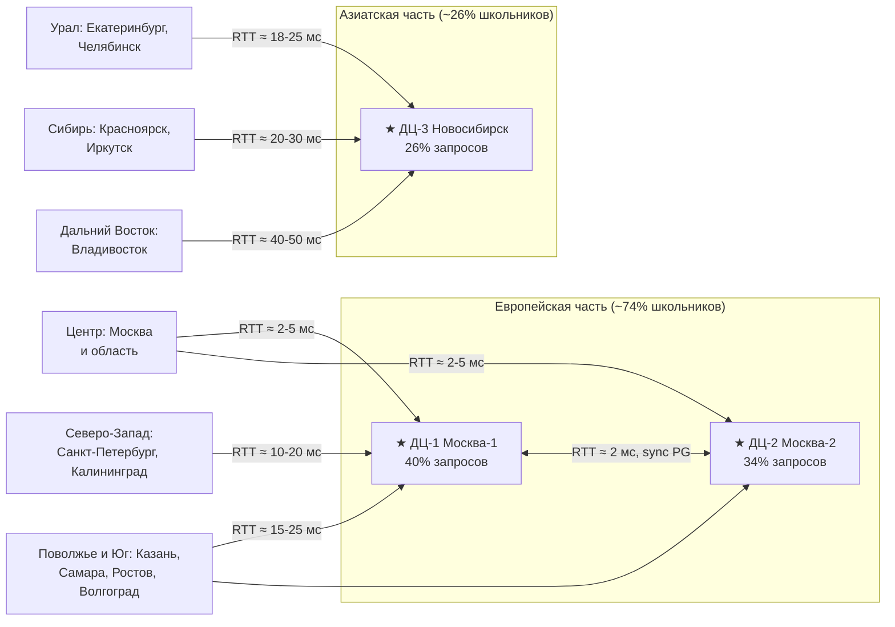
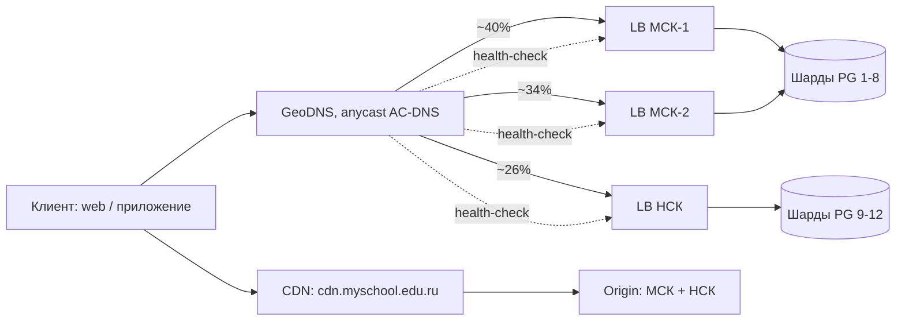
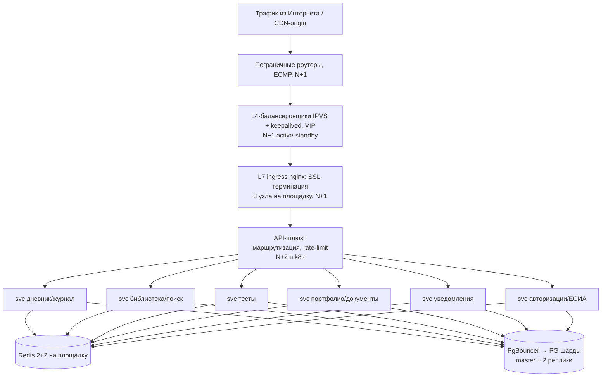
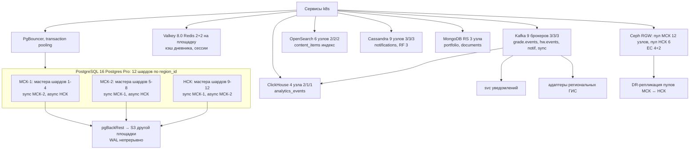
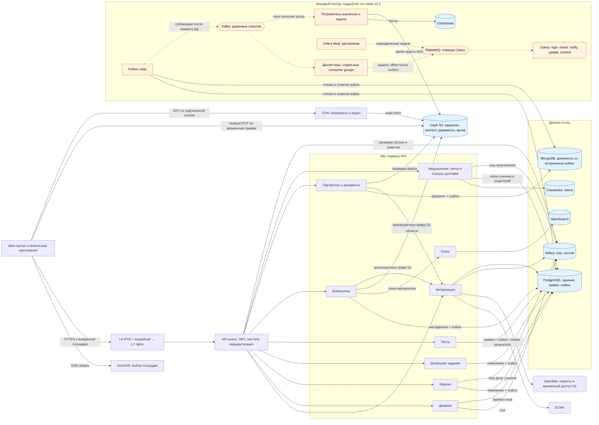
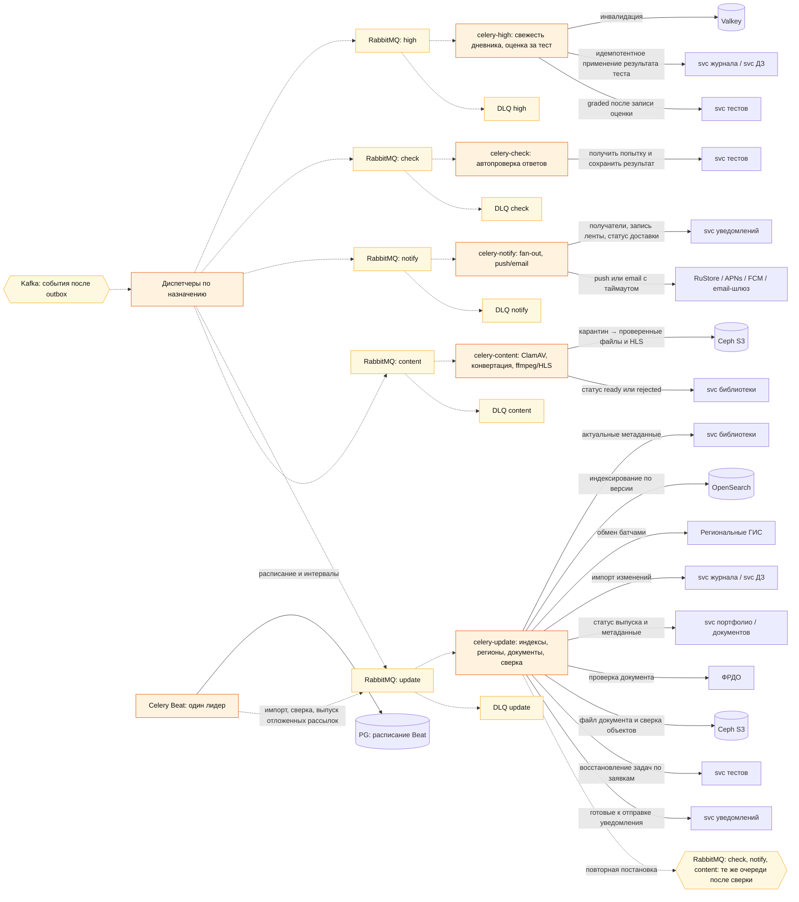

# Расчётно-пояснительная записка

**Дисциплина:** Проектирование высоконагруженных систем

**Тема проекта:** Проектирование бэкенда высоконагруженного G2C-сервиса электронной образовательной среды на примере ФГИС «Моя школа»

---

## Оглавление

1. [Тема и целевая аудитория](#глава-1-тема-и-целевая-аудитория)
2. [Расчет нагрузки](#глава-2-расчет-нагрузки)
3. [Глобальная балансировка нагрузки](#глава-3-глобальная-балансировка-нагрузки)
4. [Локальная балансировка нагрузки](#глава-4-локальная-балансировка-нагрузки)
5. [Логическая схема БД](#глава-5-логическая-схема-бд)
6. [Физическая схема БД](#глава-6-физическая-схема-бд)
7. [Алгоритмы](#глава-7-алгоритмы)
8. [Технологии](#глава-8-технологии)
9. [Обеспечение надёжности](#глава-9-обеспечение-надёжности)
10. [Схема проекта](#глава-10-схема-проекта)
11. [Список серверов](#глава-11-список-серверов)
12. [Список источников](#список-источников)

---

## Глава 1. Тема и целевая аудитория

### 1.1 Тема проекта, рыночная ниша и аналоги

**Выбранная тема:** проектирование бэкенда федеральной государственной информационной системы «Моя школа» - единой цифровой образовательной платформы для школьников, их родителей и учителей, объединяющей электронный дневник и журнал, библиотеку цифрового учебного контента, тесты, портфолио и электронные документы об образовании. Московская электронная школа рассматривается как крупнейший региональный сегмент платформы и её технологическая основа: в сентябре 2022 года было подписано соглашение Москвы, Минцифры и Минпросвещения, по которому МЭШ стала базой для создания федеральной системы [2], [3].

**Реальные аналоги.** Рынок школьных образовательных платформ существует давно и в разных юрисдикциях:

| Аналог | Страна | Масштаб | Что подтверждает |
|---|---|---|---|
| МЭШ (с 2016 г.) | Россия, Москва | 3+ млн зарегистрированных пользователей, 5+ млн обращений к сервисам в день (2026) | устойчивый спрос внутри страны, работоспособность модели на миллионах пользователей |
| ФГИС «Моя школа» (с 2022 г.) | Россия, вся страна | приложение «Госуслуги Моя школа» - 12,2 млн пользователей в 87 регионах (сентябрь 2026) | ниша не ограничивается Москвой, федеральный охват реален |
| Google Classroom | США, глобально | ~150 млн пользователей (2021) | жизнеспособность модели «дневник + задания + материалы» в мировом масштабе |
| PowerSchool | США | SIS с десятками миллионов школьников | коммерческая устойчивость школьных информационных систем как класса ПО |
| «Дневник.ру», "Школьный портал", региональные АИС | Россия | используются в десятках регионов | длительное существование рынка региональных дневников до федерализации |

Источники масштаба: МЭШ и ФГИС - [2], [4], [5]; Google Classroom - [6]; PowerSchool - [7]. Ниша подтверждается государственным заказом на единый федеральный сервис (постановление Правительства РФ № 1241 от 13.07.2022 [8]) и многолетней эксплуатацией аналогичных систем в России и за рубежом.

Отличие проекта от аналогов: это обязательный государственный сервис, пик которого привязан к учебному расписанию (начало уроков по часовым поясам, контрольные недели, 1 сентября), а данные о каждом школьнике копятся в течение всех 11 лет обучения и должны храниться бессрочно (оценки, аттестаты, портфолио).

### 1.2 Целевая аудитория

Целевая аудитория - вся Россия, три группы пользователей, связанных одной школой: школьники, их родители (законные представители) и учителя. Сервис работает там, где есть школы, то есть во всех 89 регионах от Калининграда до Камчатки, в 11 часовых поясах.

Фактические данные об аудитории на момент проектирования (сентябрь 2026):

| Метрика | Значение | Период | Источник |
|---|---|---|---|
| Пользователи приложения «Госуслуги Моя школа» | **12,2 млн в 87 регионах** | сентябрь 2026 | [4] |
| Установки приложения | 1,5 млн в августе 2025, 3 млн в ноябре 2025, 9 млн в марте и 10 млн в апреле 2026 | 2025-2026 | [5], [9], [10], [11] |
| MAU приложения | **4,8 млн** | апрель 2026 | [5] |
| DAU приложения | до 1,5 млн ежедневно | март 2026 | [9] |
| Аудитория МЭШ (Москва + регионы внедрения: Московская, Калужская, Тюменская обл., Татарстан, Дагестан, ЯНАО) | **4,5 млн** человек в 4,4 тыс. школ | апрель 2026 | [2] |
| Пользователи МЭШ (зарегистрированные) | 3+ млн, 5+ млн обращений к сервисам в день | 2026 | [2] |
| Пользователи приложения «Дневник МЭШ» | 3 млн | июнь 2024 | [2] |
| Обращения к московскому электронному дневнику | ~100 млн в месяц | сентябрь 2022 | [2] Собянин |
| Школьников в России | **17,6 млн**, из них 1,5 млн первоклассников, в ~40 тыс. школ | 2026/27 учебный год; школы - Росстат, конец 2022 | [12], [14] |
| Школьников в России, точные данные | 17 988 139 учеников | начало 2024/25 учебного года | [13] |
| Учителей в российских школах | **1 068 989** (всего педработников 1 346 928) | 2024/25 у.г. | [13] |
| Прогноз численности школьников | 17,4 млн в 2026, 16,9 млн в 2027, 16,3 млн в 2028 | прогноз | [14] |
| Проектные требования ТЗ на систему | до 4 млн ежедневно работающих пользователей на первом этапе, масштабирование до 24 млн | тендер 2021 г. | [1] |

Родители — вторая по численности группа: в московском сегменте на 1 млн учеников зарегистрировано около 1 млн родителей [2]. Для проекта принят коэффициент 1,2 аккаунта на школьника.

Прямой расчёт потенциальной базы аккаунтов: школьники 17,6 млн [12] + родители 17,6 × 1,2 = 21,1 млн + учителя 1,07 млн [13] = **39,8 ≈ 40 млн аккаунтов**. Коэффициент 1,2 родителя на школьника — из московского опыта МЭШ: на 1 млн учеников зарегистрировано свыше 1 млн родительских аккаунтов [2]; запас до 1,2 - на семьи, где у ребёнка не один родительский профиль. Это верхняя граница аудитории: в неё входят все участники учебного процесса страны.

### 1.3 Функционал MVP

Для проектирования выделены **7 ключевых функций**, покрывающих ежедневный учебный цикл от выставления оценки учителем до доставки уведомления родителю. Функции вне MVP (видеосвязь «Сферум», оплата питания, геолокация «Где ребёнок», ИИ-репетитор, чаты) упоминаются только как источники будущей нагрузки, их бэкенд не проектируется.

1. **Единая авторизация через ЕСИА.** Собственной регистрации в системе нет: вход только по подтверждённой учётной записи «Госуслуг», выдача JWT-сессий и refresh-токенов, связывание ролей (ученик / родитель / учитель) с профилем школы;
2. **Электронный дневник и журнал.** Расписание, темы уроков, оценки, посещаемость. Учитель ведёт журнал (запись), ученик и родитель читают дневник; данные дневника - самая читаемая часть системы;
3. **Домашние задания.** Учитель выдаёт ДЗ (текст или материал из библиотеки контента), ученик отмечает выполнение, учитель видит статус по классу;
4. **Библиотека цифрового контента.** Федеральная верифицированная библиотека: сценарии уроков, видеоуроки, электронные учебники, тестовые задания, интерактивные приложения. Поиск, просмотр, скачивание, выдача материала как ДЗ. Публикация контента проходит приёмку (антивирус, конвертация, модерация);
5. **Тесты с автопроверкой.** Прохождение теста учеником, автоматический подсчёт результата, попадание результата в дневник и статистику;
6. **Портфолио и электронные документы.** Верифицированные индивидуальные достижения (олимпиады, ГТО, курсы) и электронные документы об образовании (аттестаты, справки), выдача и отображение;
7. **Уведомления.** Событийные push/email/лента-уведомления (оценка, ДЗ, пропуск занятия) родителям и ученикам.

**Ключевые продуктовые решения:**

- **Вход только через ЕСИА** - система не хранит пароли, личность подтверждена заранее, это снимает целый класс задач (восстановление доступа, верификация родителя);
- **Федеральное ядро + интеграция с региональными системами.** До полного перехода регионов дневник части школ живёт в региональной ГИС; федеральный кластер агрегирует данные через API-синхронизацию и выступает источником истины для единых сервисов (библиотека, тесты, портфолио, документы). С 2026 года регионы переходят на федеральное типовое облачное решение (ТОР «Моя школа») [4], [15], поэтому в проекте федеральный кластер принимает весь основной трафик;
- **Контент - федеральный, общий для всех школ.** Материал загружается и верифицируется один раз и доступен учителям всей страны, это разгружает хранилище (нет копий по школам) и даёт эффект масштаба библиотеки;
- **Разделение записи и чтения по ролям.** Журнал пишет только учитель; ученик и родитель - читатели. Это предсказуемая нагрузка: пишущих ~6% дневной аудитории;
- **Многоуровневое хранение истории.** Оценки хранятся бессрочно (11 лет обучения), детальная посещаемость - 2 года с последующей агрегацией, уведомления - 30 дней;
- **Контент раздаётся через CDN**, чтобы пиковый вечерний трафик не ложился на основной сервер.

### 1.4 Источники

Библиографические описания всех источников - в разделе «Список источников» в конце записки; в тексте они обозначены номерами в квадратных скобках.

---

## Глава 2. Расчет нагрузки

Пересчёт аудиторных метрик (глава 1) в **продуктовые** и **технические** метрики.

### 2.1 Продуктовые метрики

#### 2.1.1 Аудитория: факты из источников

| Показатель | Значение | Источник |
|---|---|---|
| Школьники 1-11 классов | 17,6 млн в ~40 тыс. школ | [12], [13], [14] |
| Учителя | 1,07 млн | [13] |
| Родительские аккаунты | ~1 на ученика: в МЭШ на 1 млн учеников зарегистрировано ~1 млн родителей | [2] |
| Пользователи приложения «Госуслуги Моя школа» | 12,2 млн в 87 регионах | [4] |
| MAU приложения | 4,8 млн (апрель 2026, до массового перехода регионов) | [5] |
| DAU приложения | до 1,5 млн | [9] |
| Stickiness приложения | 31% (1,5 / 4,8) | [5], [9] |
| Охват МЭШ в Москве | 3 млн зарегистрированных ≈ весь контингент | [2] |
| Обращения к дневнику МЭШ | ~100 млн в месяц ≈ 3,3 млн в день | [2] |
| ТЗ на систему: DAU первого этапа / предел масштабирования | 4 млн / 24 млн | [1] |

#### 2.1.2 Расчёт MAU и DAU

MAU учебного месяца считается по ролям: `MAU_роли = база × охват месяца`.

17,6 × 0,92 = 16,2; 21 × 0,62 = 13,0; 1,07 × 0,95 = 1,0; итого 30,2 ≈ **30 млн**.

| Роль | База | Охват в учебный месяц | MAU |
|---|---|---|---|
| Школьники | 17,6 млн [12] | 92%: дневник обязателен, но у части младших аккаунтом владеет родитель | 16,2 млн |
| Родители | 21 млн (§1.2) | 62%: московский опыт - аккаунт почти в каждой семье, активность в месяц ниже учеников | 13 млн |
| Учителя | 1,07 млн [13] | 95%: журнал — рабочий инструмент | 1,0 млн |
| **MAU** | | | **~30 млн** |

Сверки: снизу — приложение уже собрало 12,2 млн пользователей за первый год неполного перехода [4]; сверху — MAU не превышает 40 млн аккаунтов; по МЭШ охват ~100% контингента [2], так что принятые 92% консервативны.

DAU учебного дня считается по ролям: `DAU_роли = MAU_роли × частота захода в учебный день`.

16,2 × 0,68 = 11,0; 13 × 0,23 = 3,0; 1,0 × 0,90 = 0,9; итого 14,9 ≈ **15 млн**.

| Роль | MAU | Частота захода | DAU |
|---|---|---|---|
| Школьники | 16,2 млн | 68%: старшие заходят ежедневно, младшие - через родителей | 11,0 млн |
| Родители | 13 млн | 23%: проверяют дневник 1-2 раза в неделю | 3,0 млн |
| Учителя | 1,0 млн | 90%: журнал ведётся на каждом уроке | 0,9 млн |
| **DAU** | | | **~15 млн** |

Дневной охват 50% от месячной аудитории — модельная оценка по назначению сервиса: дневник заменяет бумажный журнал и обязателен в учебный день. Прямых публикаций DAU приложения нет: за первый год «Госуслуги Моя школа» набрали 10 млн установок при 4,8 млн месячной аудитории [5] - один канал неполного перехода, его дневной охват официально не публиковался. Оценка 50% проверена снизу (MAU приложения 4,8 млн [5], всего пользователей 12,2 млн [4]) и сверху (MAU не превышает 40 млн аккаунтов); по ТЗ 15 млн DAU лежит в коридоре от 4 млн первого этапа до 24 млн предела масштабирования [1]. В каникулы DAU падает в 4-5 раз - остаются тесты, портфолио и поиск курсов. Пиковый день - 1 сентября и первая учебная неделя: K_день = 1,1, DAU пикового дня 16,5 млн.

Часовые пояса: Россия живёт в 11 поясах от UTC+2 до UTC+12. «Утро перед школой» по местному времени (7:00-9:00) наступает в окне с 21:00 МСК предыдущего дня (Камчатка) до 7:00 МСК (Калининград); вечерние проверки родителей (18:00-21:00 местного) ложатся в окно с 8:00 до 19:00 МСК. Пики разных поясов перекрываются и суммарно сглажены, поэтому отношение пик-часа к среднему по суткам принято K_peak = 4 - по верхней границе для сервиса одного часового пояса.

#### 2.1.3 Средний размер хранилища на пользователя (по типам данных)

| Тип данных | Объём на пользователя | Число объектов на пользователя | Источник / формула |
|---|---|---|---|
| Оценки | 0,4 МБ | 2 600 оценок за 6,5 лет среднего стажа | расчёт §2.2.1: 2 600 × 150 Б ≈ 0,4 МБ (7 ТБ / 17,6 млн); допущения частоты и размера строки — §2.2.1 |
| Портфолио и документы | 1,1 МБ | 5-6 файлов (сертификаты, справки, аттестат) | расчёт §2.2.1: 20 ТБ / 17,6 млн школьников |
| Личные файлы учителя | 47 МБ | ~20 файлов | расчёт §2.2.1: 50 ТБ / 1,07 млн учителей |
| Метаданные дневника (уроки, ДЗ, посещаемость, тесты) | 1,1 МБ | ~6,6 тыс. строк на школьника за стаж (оценки 2,6 тыс., посещаемость 2,1 тыс., статусы ДЗ 1,3 тыс., уроки 0,3 тыс., ДЗ 0,2 тыс., тесты 0,1 тыс.) | расчёт §2.2.1: 19,2 ТБ журнальных таблиц / 17,6 млн школьников |
| **Итого** | **~2,5 МБ в среднем на аккаунт** | - | суммарно ~102 ТБ на 40 млн аккаунтов: школьник ~2,6 МБ, учитель ~49 МБ, родитель ~0,1 МБ |

Хранилище сервиса «тонкое»: пользователи не загружают личные медиа, как в облаке или соцсети. Основной объём дают федеральная библиотека контента, общая для всех школ, и личные файлы педагогов. Средний сценарий урока принят равным 5 МБ — конспект с приложениями (презентация, рабочие листы, ссылки); видеоурок - 200 МБ, что соответствует ~20 минутам записи при среднем битрейте ~1,3 Мбит/с (720p); оценка по составу библиотеки МЭШ [2].

#### 2.1.4 Сессии и API-запросы в день

Пользовательское «действие» открывает страницу интерфейса, а страница собирается из нескольких API-запросов, поэтому нагрузка считается в запросах. Модель строится от типового дня каждой роли — поэкранно, с числом запросов на экран.

**Типовой день школьника** (DAU 11,0 млн):
- утро, перед школой: вход через ЕСИА (1), расписание на сегодня (1), лента дневника (2), ДЗ на сегодня (1), уведомления (1) — 6 запросов;
- перемена (в 70% дней): лента (1,5), уведомления (0,5) — 2 запроса;
- вечер, домашка: лента (1), просмотр и отметка ДЗ (1,5), уведомления (1), профиль и прочее (1) — 4,5 запроса;
- фон: refresh-токен (0,8), тесты по мере задания (0,4), библиотека (1) — 2,2 запроса.

Итого ~14,7 запроса в день за 2,7 сессии.

**Типовой день родителя** (DAU 3,0 млн):
- вечер: вход (1), лента и оценки ребёнка (2), ДЗ ребёнка (1,5), уведомления (2), расписание (1), прочее (0,5) — 8 запросов;
- утро (в 50% дней): лента (1), уведомления (1) — 2 запроса.

Итого ~10 запросов в день за 1,5 сессии.

**Типовой день учителя** (DAU 0,9 млн):
- 6 уроков, на каждом: открыть журнал класса (2), батч оценок (1), посещаемость (1), тема урока или выдача ДЗ (1) — 5 запросов на урок, 30 в день;
- утро: вход (1), расписание (1), лента (1), уведомления (1), прочее (1) — 5 запросов;
- день: поиск материалов в библиотеке (2), проверка выполнения ДЗ (2), тесты (1) — 5 запросов.

Итого ~40 запросов в день за 7 сессий.

| Роль | DAU | Сессий в день | Запросов в день на роль |
|---|---|---|---|
| Школьники | 11,0 млн | 2,7 | 162 млн |
| Родители | 3,0 млн | 1,5 | 30 млн |
| Учителя | 0,9 млн | 7,0 | 36 млн |
| **Всего** | **15 млн** | **2,7 на DAU** | **~228 млн** |

~15,2 запроса на активного пользователя в день, ~5,6 запроса на сессию. Чтение доминирует над записью: журнал пишет только учитель (6% DAU). Распределение запросов по типам — в §2.2.3.

### 2.2 Технические метрики

#### 2.2.1 Размер хранения по типам данных

**Метаданные (СУБД), накопленный объём по действующим пользователям.** Объёмы — модельная оценка снизу; внешних публикаций с точными цифрами по ФГИС нет, поэтому все допущения вынесены явно:

- **400 оценок в год на ученика** — примерно 2 оценки в учебный день или 1,3 по предмету в неделю при 8-9 предметах (педагогическая практика журналирования);
- **5 уроков в день** по расписанию — среднее по недельной нагрузке 5-11 классов (29-33 часа при 6-дневной неделе), **25 учеников в классе** — верхняя граница нормативной наполняемости (СанПиН 1.2.3685-21), **210 учебных дней в году** — 34-35 учебных недель × 6 дней;
- **4 группы на класс** — 2 подгруппы по иностранным языкам и 2 внеурочных объединения; внеурочная деятельность ~6 ч/нед (ФГОС допускает до 10) — даёт ~1 млрд занятий за стаж и 44 млн членств в группах;
- **150-160 байт на строку** — узкая строка PostgreSQL: заголовок, идентификаторы-связки, значение, created_at/updated_at (16 Б на пару, есть в каждой сущности §5.1); в оценке 158 Б для оценок учтены teacher_id и обе метки; индексы учтены отдельно (×1,5 к итогу);
- **строка статуса ДЗ создаётся при смене состояния** («выполнено», «оценено»): исходное «назначено» хранить не нужно, оно восстанавливается из факта выдачи ДЗ и состава класса, поэтому в объёме учитываются 25% отметок о выполнении от всех выданных заданий;
- **6,5 лет среднего стажа** ученика в системе — среднее по распределению 1-11 классов;
- **0,2 теста в день на ученика** — тесты проводятся не на каждом уроке: порядка одного в учебную неделю в среднем по предметам (17,6 млн × 0,2 × 210 × 3 года ≈ 2,3 млрд попыток).

| Тип данных | Количество, шт. (строк) | Объём, ТБ | Средний размер строки, Б | Формула / источник |
|---|---|---|---|---|
| Оценки | 46 млрд | 7,3 | 158 | 17,6 млн × 6,5 лет × 400 оценок/год = 46 млрд строк; 46 млрд × 158 Б = 7,3 ТБ (+8 Б на teacher_id - кто выставил) |
| Посещаемость (детальные записи, 2 года) | 37 млрд | 3,0 | 80 | 17,6 млн × 5 уроков/день × 210 дней × 2 года; глубже - агрегаты (0,3 ТБ) |
| Статусы выполнения ДЗ | 23 млрд | 4,6 | 200 | 3,7 млрд ДЗ × 25 учеников × 25% сдавших |
| Домашние задания (задания) | 3,7 млрд | 1,9 | 500 | 700 тыс. классов × 5 ДЗ/день × 210 дней × 5 лет (5-11 классы) |
| Уроки и занятия внеурочек: темы, материалы | 5,8 млрд | 1,7 | 300 | 704 тыс. классов × (5 уроков + 6 ч/нед внеурочек × 35 нед) × 210 дней × 6,5 лет: урочная 4,8 млрд + внеурочки ~1 млрд |
| Попытки тестов | 2,3 млрд | 0,7 | 300 | 17,6 млн × 0,2 теста/день × 210 дней × 3 года |
| Уведомления, живут 30 дней | 1,35 млрд | 0,7 | 500 | 3 уведомления × 15 млн DAU × 30 дней |
| Пользователи, школы, классы, расписание, портфолио-метаданные, синхронизация | ~1 млрд | 0,3 | - | 40 млн пользователей × 2 КБ + справочники + расписание 25 млн строк |
| **Итого метаданные** | **~120,3 млрд строк** | **20,2** | - | с индексами (×1,5) ~30 ТБ на диске |

**Файловые данные (S3-хранилище + CDN):**

| Тип данных | Количество, шт. | Объём, ТБ | Средний размер | Источник / формула |
|---|---|---|---|---|
| Сценарии уроков | 360 тыс. | 1,8 | 5 МБ | [2]: 360 тыс. сценариев доступны регионам (2024) |
| Видеоуроки | 50 тыс. | 10,0 | 200 МБ | оценка: 12 тыс. видеоуроков МЭШ [2] + федеральная библиотека |
| Электронные учебники | 344 | 0,2 | 500 МБ | [2]: 344 учебника МЭШ (2026) |
| Интерактивные приложения | 174 тыс. | 0,5 | 3 МБ | [2]: 174 тыс. приложений библиотеки МЭШ (2023) |
| Тестовые задания (библиотека) | 80 тыс. | 0,01 | 100 КБ | [2]: 80 тыс. тестов МЭШ (2023) |
| Личные папки педагогов | 21 млн файлов | 50,0 | 2,4 МБ | оценка: 1,07 млн учителей [13] × 20 файлов × 2,4 МБ |
| Документы об образовании, портфолио (PDF, сканы) | 90 млн | 20,0 | 0,22 МБ | 17,6 млн учеников × 5 документов |
| **Итого файловые** | **~112 млн файлов** | **~82,5** | 0,7 МБ | физический объём = логический 82,5 ТБ × 2,5: EC 4+2 (×1,5) + DR-копия бакетов во втором пуле (×1,0) ≈ 210 ТБ |

**Примечание.** Метаданные прирастают на ~3 ТБ в год: оценки 1,1 ТБ, посещаемость 1,5 ТБ, прочее. Файловые данные - на 4-5 ТБ в год. Посещаемость хранится детально два года, затем агрегируется; уведомления живут 30 дней; личные папки и документы - бессрочно. Контент библиотеки невелик по объёму, но требователен к числу одновременных читателей - это задача CDN, а не дисков.

#### 2.2.2 Сетевой трафик

Разбивка по существенным типам: пиковое потребление - для выбора сетевых интерфейсов и CDN, суточный объём - для оценки стоимости хостинга.

| Тип трафика | Направление | Пиковое, Гбит/с | Суточный объём, ГБ/сутки | Расчёт |
|---|---|---|---|---|
| Видеоуроки (стриминг HLS) | egress (CDN) | 33,3 | 90 000 | 0,3 × 15 млн × 20 МБ: HLS отдаёт сегменты по мере просмотра, в среднем смотрят ~10% ролика (2-3 минуты из 20) |
| Материалы (сценарии, PDF, учебники) | egress (CDN) | 6,7 | 18 000 | 0,3 × 15 млн × 4 МБ |
| Миниатюры и превью | egress (CDN) | 0,42 | 1 125 | 2,5 × 15 млн × 30 КБ (миниатюра ~300×200 JPEG) |
| API (JSON: дневник, журнал, библиотека) | egress | 0,63 | 6 840 | 2 640 RPS × 86 400 × 30 КБ: лента дневника на день - 20-50 КБ JSON (§11), среднее 30 |
| Загрузка контента и файлов педагогами | ingress | 0,12 | 321 | 1,07 млн учителей × 0,03 файла × 10 МБ: файл раз в месяц на учителя (презентации, сканы работ), средний файл 10 МБ |
| **Итого** | - | **~41,2** | **~116 300** | origin принимает ~20% egress после CDN |

**Примечание.** Формулы: `ГБ/сутки = Объектов_в_день × avg_size / 1000`; `Гбит/с_peak = RPS_peak × avg_size × 8 / 1000` при avg_size в МБ, где `RPS_peak = RPS_avg × K_peak`, `K_peak = 4`. Кэш-хит CDN ~80%: рабочее множество дня у образовательного каталога (видео и сценарии текущей недели по программе) - малая доля каталога, его запрашивают десятки раз; для видео-каталогов съём кэша устойчиво лежит в диапазоне 70-90%, принята середина. На origin приходится ~22 ТБ в сутки - 20% тяжёлого трафика (видео 90 + материалы 18 ТБ). Трафик интеграции с региональными системами — около 5 ТБ в сутки в переходный период — и push-уведомления в пиковую оценку не входят и рассчитываются отдельно.

#### 2.2.3 RPS по типам запросов (средний и пиковый)

| Тип запроса | Запросов в сутки, млн | Средний RPS | Пиковый RPS |
|---|---|---|---|
| Дневник: лента оценок | 59,4 | 688 | 2 752 |
| Уведомления: лента, бейджи | 37,4 | 433 | 1 732 |
| Дневник: просмотр ДЗ | 26,5 | 307 | 1 228 |
| Авторизация: вход и refresh (ЕСИА + JWT) | 25,0 | 289 | 1 156 |
| Дневник: расписание | 14,9 | 172 | 688 |
| Прочие запросы интерфейса | 16,3 | 189 | 756 |
| ДЗ: отметка выполнения (ученик) | 5,5 | 64 | 256 |
| Библиотека: выдача файла (signed URL на CDN) | 5,95 | 69 | 276 |
| Журнал: просмотр (учитель) | 9,0 | 104 | 416 |
| Тесты: старт / сдача попытки | 5,3 | 61 | 244 |
| Библиотека: поиск | 4,0 | 46 | 184 |
| Журнал: выставление оценки (учитель, батчами) | 5,4 | 63 | 252 |
| Журнал: отметка посещаемости (учитель, батч на класс) | 4,5 | 52 | 208 |
| Темы уроков (учитель) | 5,4 | 63 | 252 |
| ДЗ: выдача (учитель) | 2,7 | 31 | 124 |
| **Итого** | **~228** | **~2 640** | **~10 550** |

**Примечание.** Каждая строка — сумма одноимённых запросов из маршрутов §2.1.4 по трём ролям; формулы: `RPS_avg = Запросов_в_сутки / 86 400`; `RPS_peak = RPS_avg × K_peak`, `K_peak = 4`; DAU = 15 млн, 15,2 запроса на DAU в день, ~228 млн запросов в сутки. Пиковый день 1 сентября добавляет K_день = 1,1, расчётный максимум входного слоя — ~11 600 RPS. Записи строк в БД — отдельный контур, он шире пользовательского API: посещаемость ~1 020 RPS (учитель отмечает целый класс одним батчем из 25 строк), оценки ~390 (17,6 млн учеников × 400 оценок/210 дней), статусы ДЗ ~255 (3,7 млрд заданий за 5 лет → 3,52 млн заданий/день × 25 учеников × 25%), уроки ~41 и внеурочки ~9 (704 тыс. классов × 5 уроков + ~6 ч/нед внеурочек), выдача ДЗ ~41 (3,52 млн заданий/день), тесты ~51 (~2,2 млн попыток в сутки, по 2 записи на попытку - старт и сдача); сервисные — уведомления 865 (45 млн событий/сут × ~1,7 получателя ≈ 75 млн записей/сут), токены 220 (~19 млн ротаций в сутки, ~1,3 на активного пользователя: вход и обновление сессии), синхронизация 50 (инкрементальная выгрузка изменений журнала в региональные ГИС, ~4 млн событий/сут); итого ~2 980 записей в секунду (§5.2). Кэш закрывает ~85% чтений (§5, §6). Уведомления идут через внутреннюю шину событий: 865 RPS — нагрузка на шлюз push-доставки, а не прямые HTTP-запросы пользователей.

### 2.3 Источники

Численность школ и контингента - [12]–[14], аудитория и сервисы МЭШ - [2], приложение «Госуслуги Моя школа» - [4], [5], [9], [16], проектные требования ТЗ - [1]. Описания - в разделе «Список источников».

---

## Глава 3. Глобальная балансировка нагрузки

### 3.1 Функциональное разбиение по доменам

| Домен | Назначение | Тип трафика |
|---|---|---|
| myschool.edu.ru | веб-портал (SPA) | HTML/JS-статика, далее API |
| api.myschool.edu.ru | API мобильных приложений и портала | JSON, основной пользовательский трафик |
| cdn.myschool.edu.ru | библиотека контента: видео HLS, материалы, превью | тяжёлый egress, раздаётся CDN |
| static.myschool.edu.ru | статика интерфейса | кэшируемая статика |

Внешние системы, с которыми интегрируется платформа; в проект они не входят: ЕСИА для авторизации, push-шлюзы RuStore/FCM/APNs, API региональных ГИС, ФИС ФРДО для документов об образовании.

### 3.2 Карта и расположение ДЦ

Сервис обслуживает всю страну, но размещать инфраструктуру в каждом регионе не нужно: требования к RTT для дневника и API мягкие, до 100 мс приемлемо для интерактивной ленты, тяжёлый контент раздаёт CDN с узлами во всех федеральных округах. Приняты три активные площадки, объединённые в два RTT-кластера - московский и новосибирский:

★ — площадки ДЦ: на L4 каждой развёрнут собственный unicast VIP-префикс (AC-VIP-M1/M2/NSK, три разных /29); anycast-подсеть AC-DNS (GeoDNS) — одна на все площадки — анонсируется из трёх точек МСК-1, МСК-2 и НСК (§3.7). Пунктирные дуги на карте — анонс AC-DNS; стрелки - репликация PG.

| Площадка | Город | Координаты | Роль | Доля запросов |
|---|---|---|---|---|
| ДЦ-1 | Москва | 55.75° с.ш., 37.62° в.д. | активная, полный стек | 40% |
| ДЦ-2 | Москва | 55.75° с.ш., 37.62° в.д. (другой квартал, независимые вводы) | активная, полный стек | 34% |
| ДЦ-3 | Новосибирск | 55.03° с.ш., 82.92° в.д. | активная, полный стек, приём эвакуированного трафика | 26% |

Две московские площадки стоят в разных кварталах с независимыми энерговводами и подключениями к разным магистральным операторам: городская авария - пожар, отключение энергии, залитие - не выводит обе сразу.

### 3.3 Почему именно три площадки

| Вариант | Оценка |
|---|---|
| Одна площадка | Единичная точка отказа для обязательного федерального сервиса: авария или обслуживание оставляют школу без дневника. Отклонено |
| Две площадки | Отказ одной оставляет систему без резерва: выжившая работает на пределе ёмкости, плановые работы убирают резервирование совсем. Отклонено |
| **Три площадки — принято** | Отказ любой одной: две оставшиеся держат 100% пика с утилизацией ~63%; RPO = 0 по всем данным, так как синхронные реплики шардов живы; обслуживание площадки не убирает резерв |
| Четыре и больше | Защита от одновременного отказа двух площадок не окупается для госсервиса; при росте аудитории добавляется блок шардов на существующих или новых площадках |

Правило ёмкости: при отказе любой площадки две оставшиеся обязаны вывезти весь пик, в пиковый день - с K_день = 1,1 (§2.1.2). В двухплощадочной схеме 50/50 это даёт по 110% пика на площадку (суммарно 2 × 110 = 220% ёмкости), в трёхплощадочной с долями 40/34/26 - по 80% (суммарно 3 × 80 = 240%): разница в железе 141 против ~130 серверов (141/130 = 1,08), а взамен отказ любой площадки оставляет систему георезервированной с RPO = 0, и обслуживание площадки не выводит её из резерва.

### 3.4 Обоснование расположения площадок

| Фактор | Москва (ДЦ-1, ДЦ-2) | Новосибирск (ДЦ-3) |
|---|---|---|
| Пользователи | ~66% школьников в радиусе RTT ≤ 25 мс: Центр, Северо-Запад, Юг, Поволжье | ~26% школьников: Урал, Сибирь, ДВ; RTT 20-45 мс вместо 60-95 мс из Москвы |
| Связность | MSK-IX - крупнейшая точка обмена трафиком в стране: пик 8,78 Тбит/с, 636 участников [19] | главный телеком-узел азиатской части, прямой транзит на Иркутск и Владивосток |
| Интеграции | здесь сходятся гос-ИС: ЕСИА, ФИС ФРДО, шлюзы региональных ГИС | зеркалит интеграционный контур на случай отказа Москвы |
| Кадры и эксплуатация | крупнейший рынок ИТ-персонала, круглосуточные смены | региональные ЦОД крупных операторов с круглосуточной сменой |

Доля азиатской части (~26%) следует из статистики Росстата: население УФО (12,3 млн), СФО (15,7 млн) и ДФО (7,9 млн) на 01.01.2025 в сумме даёт 35,9 млн из 146,0 млн (24,6%); у школьников доля немного выше за счёт молодой структуры населения СФО, принимаем 26% с округлением. Оставшиеся ~74% - европейская часть, из них ~66% попадают в радиус RTT ≤ 25 мс от Москвы (остальное - Зауральский Урал и восток Поволжья).

RTT в таблице ниже проверяются физическим пределом распространения света в волокне: RTT_min = 2L/v, v ≈ 200 000 км/с. Магистральные трассы длиннее прямой, маршрутизация добавляет 20-50% - приведённые значения достижимы:

| Регион | Расстояние, км | Физический минимум RTT, мс | RTT до МСК, мс | RTT до НСК, мс | Обслуживает |
|---|---|---|---|---|---|
| Санкт-Петербург | ~700 | 7 | 8-12 | 45-55 | МСК |
| Казань, Самара, Ростов | 800-1 100 | 8-11 | 15-25 | 35-45 | МСК |
| Екатеринбург, Челябинск | ~1 800 | 18 | 30-40 | 18-25 | НСК |
| Красноярск, Иркутск | 3 300-4 100 | 33-41 | 60-75 | 20-30 | НСК |
| Владивосток | 6 400-9 000 (ВОЛС) | 64-90 | 80-95 | 40-50 | НСК |

Требование 152-ФЗ и постановления № 1241 [8]: первичные персональные данные школьников обрабатываются и хранятся на территории РФ - все три площадки и CDN-провайдер находятся в России.

### 3.5 Распределение запросов и равномерность

Доли подобраны близко к равномерным с учётом географии пользователей: европейские ~74% делятся между двумя московскими площадками как 40/34 — МСК-1 несёт чуть больше, на ней полный стек эксплуатации и первая очередь миграций, — азиатские 26% идут в НСК. Максимальная доля одной площадки — 40%: при её отказе оставшиеся две поднимают нагрузку с 60% до 100%, для чего каждая рассчитана на 80% пика (§3.3, §11). CDN-трафик в таблице не указан: его отдают узлы CDN ближе к пользователю, до origin доходит ~20% отдачи контента.

Если ёмкость площадки подобрана под её долю нагрузки, то при отказе самой нагруженной выжившие имеют лишь (1 - d_max) ёмкости пика: при d_max = 0,6 это 40%, и, чтобы вывезти пик, малым площадкам нужен запас ×3,3 и ×10 к их обычной нагрузке - фактически по 50% ёмкости каждой, простаивающей в обычные дни. Здесь сделано наоборот: все три площадки одинаковой ёмкости 80% пика (§11), а доли следуют за географией пользователей (40/34/26). Отказ любой площадки оставляет паре ёмкость 160% на 100% трафика, утилизация ~63% (проверка ниже), и отдельного «резерва на случай аварии» не требуется. Резерв размазан по всем площадкам равномерно, а не сосредоточен в недогруженной третьей.

| Площадка | Доля запросов | RPS API (пик) | Egress API, Гбит/с | Origin CDN, Гбит/с | Мастера шардов PG |
|---|---|---|---|---|---|
| МСК-1 | 40% | ~4 220 | ~1,1 | ~3,2 | 4 |
| МСК-2 | 34% | ~3 590 | ~0,9 | ~2,7 | 4 |
| НСК | 26% | ~2 740 | ~0,7 | ~2,1 | 4 |
| **Итого** | 100% | **~10 550** | **~2,6** | **~8,0** | **12** |

Проверка отказной устойчивости по каждой площадке:

| Отказавшая площадка | Держат оставшиеся | Суммарная ёмкость | Утилизация |
|---|---|---|---|
| МСК-1 (40%) | МСК-2 + НСК | 160% пика | ~63% |
| МСК-2 (34%) | МСК-1 + НСК | 160% пика | ~63% |
| НСК (26%) | МСК-1 + МСК-2 | 160% пика | ~63% |

При эвакуации трафика первично деградируют тяжёлые вторичные функции - фасетный поиск по библиотеке, конвертация контента, аналитические выгрузки; критичный контур дневника и журнала не затрагивается. Видео в эвакуацию не входит: его продолжает отдавать CDN.

### 3.6 Схема DNS-балансировки

GeoDNS возвращает A-записи с IP ближайших работающих площадок по гео-зоне клиента, доступность каждой проверяется автоматически. Для DNS-серверов применён anycast: один IP анонсируется из нескольких точек, запрос уходит на ближайший DNS-узел.

Клиент мобильного приложения не обращается к DNS на каждый запрос: соединения долгоживущие, смена площадки происходит при переподключении, поэтому переключение занимает минуты, а не секунды.

### 3.7 Anycast-подсети

Anycast применяется там, где он не рискует разорвать пользовательские сессии - на stateless-сервисах:

| Подсеть | Сервис | Анонсируется из |
|---|---|---|
| AC-DNS, 203.0.113.0/24 | GeoDNS-серверы | 3 точки: МСК-1, МСК-2, НСК |
| AC-VIP-M1, 203.0.113.8/29 | VIP L4-балансировщиков МСК-1, ECMP с двух роутеров площадки (§4.1) | только МСК-1 |
| AC-VIP-M2, 203.0.113.16/29 | VIP L4-балансировщиков МСК-2, ECMP с двух роутеров площадки (§4.1) | только МСК-2 |
| AC-VIP-NSK, 203.0.113.24/29 | VIP L4-балансировщиков НСК, ECMP с двух роутеров площадки (§4.1) | только НСК |

Внутри площадки каждый VIP анонсируется обоими пограничными роутерами, отказ роутера не заметен для трафика. AC-DNS - единственная по-настоящему anycast-подсеть: DNS без состояния и короткие UDP-транзакции, разрыв анонса безвреден. Пользовательский трафик API и портала идёт unicast: три VIP-префикса площадок разные, они перечислены в A-записях GeoDNS с весами и гео-зонами (§3.6, §3.9) - это даёт управляемое распределение 40/34/26, которого BGP-анycast не обеспечивает. Диапазоны из TEST-NET-3 указаны как документационные; в эксплуатации им соответствуют PI-сети проекта.

### 3.8 Почему именно такая балансировка

- Для маршрутизации между площадками выбран GeoDNS со взвешенными A-записями: BGP-anycast прикладного слоя рвёт TCP-сессии при смене анонса, а веса там управляются маршрутной политикой; DNS-перекос меняется одной записью и плавен по построению - 10% → 50% → 100% при вводе и выводе площадки.
- DNS держим собственный, без глобального LB-провайдера: в госсегменте с персональными данными школьников сторонний сервис в критическом пути недопустим.
- Все три площадки активные, без холодного резерва. Резерв простаивает и не добавляет ёмкости, активные распределяют между собой и пиковый трафик, и плановое обслуживание.
- L4/L7 локальны в каждой площадке, anycast остаётся только на входе: сессия пользователя живёт внутри одной площадки, межплощадочная координация - DNS-веса и репликация данных (§6.3), распределённое состояние из пути запроса убрано.

### 3.9 Механизм регулировки трафика между площадками

| Механизм | Как работает |
|---|---|
| Weighted DNS | веса A-записей меняются поэтапно, 10% → 50% → 100%: ввод площадки в работу, вывод на обслуживание, перелив трафика при деградации |
| Health-check DNS | 3 провала подряд с интервалом 10 с - площадка исключается из ответов автоматически |
| Лимиты на ingress | per-region rate-limit на API-шлюзе: аномальный рост трафика одного региона не затягивает остальные |
| Сезонная регулировка | в каникулы часть вычислительных узлов выводится, пик 1 сентября встречается полным парком |
| Деградация в аварию | при недоступности площадки две оставшиеся принимают весь трафик: суммарная ёмкость 160% пика (§4.2, §11); первично деградируют тяжёлые функции |

Расчётный случай - утренний пик 1 сентября. Утренний максимум Камчатки (7-9 утра местного, UTC+12) наступает в 21:00-23:00 МСК предыдущего дня, московский - около 6:00 МСК; максимумы разделены часами, поэтому суммарный пик ниже, чем у сервиса одного часового пояса (§2.1.2). Пиковый день учтён коэффициентом K_день = 1,1.

---

## Глава 4. Локальная балансировка нагрузки

### 4.1 Схема балансировки и резервирования

Четыре уровня за входом в ДЦ - пограничные роутеры, L4, L7 и API-шлюз. Формулы резервирования указаны для каждого уровня: потеря любого одного узла не снижает ёмкость ниже расчётного пика.

| Уровень | Технология | Схема | Формула резервирования |
|---|---|---|---|
| Пограничные роутеры | 2 × BGP-роутера | ECMP | N+1 |
| L4 | IPVS/keepalived, VIP | active-standby с синхронизацией conntrack | N+1 |
| L7 ingress | nginx (SSL-терминация, HTTP/2) | active-active | N+1 (3 узла на площадку) |
| API-шлюз и сервисы | k8s, HPA | active-active | N+2 по ёмкости |

### 4.2 Расчёт количества балансировщиков

**SSL-терминация (CPS).** Сессий в системе - 2,7 на пользователя в день (§2.1.4), всего ~40 млн TLS-сессий/сутки = 470/с в среднем, 1 870/с в пиковый час. Мобильные клиенты переподключаются при смене сети и держат фоновые каналы для push, что даёт ещё ×2: расчётный максимум ~3 750 CPS. По тесту 2017 года nginx удерживает 10 274 CPS по HTTPS на узле (24 CPU, RSA-2048 + ECDHE, OpenSSL 1.0.1f) [17]; там же отмечено, что OpenSSL 1.0.2 даёт ~×2, эллиптические кривые ×2-3, Hyper-Threading +50% - то есть на современном стеке реальная ёмкость узла в 2-3 раза выше. Расчёт ведётся по «сырой» цифре теста: запас ×2,7 на площадку даже до учёта современных ускорений. Требование резервирования определяет количество: **3 узла L7 на каждой площадке (N+1)**.

**Пропускная способность запросов (TPS).** Пиковый пользовательский трафик 10 550 RPS (§2.2.3) плюс ~15% интеграционных и внутренних запросов = ~12 100 TPS. Поправка 15% - межсервисные вызовы поверх пользовательских: проверка сессии в шлюзе, подтягивание метаданных библиотекой, обмен журнал-дневник, шина событий; по карте вызовов §11 это 10-20%, принята середина. По тесту ingress controller 2019 года узел с 48 ядрами удерживает 58,1 тыс. TPS с SSL-терминацией [18], то есть ~1,2 тыс. TPS на ядро; экстраполяция на узел 16 vCPU даёт ~19 тыс. TPS. Принята консервативная проектная ёмкость 10 тыс. TPS (запас ×2). Нормальная доля площадки - до 4 220 TPS, при отказе соседа - до ~6 050: хватает одного узла, берём **3 узла L7 на площадку** (16 vCPU, 32 ГБ каждый) ради N+1 и запаса на пиковый день (K_день = 1,1).

**L4.** Одновременных TCP-соединений до ~1,5 млн: 12 млн устройств с keep-alive, часть офлайн. IPVS-узел с 16 ГБ памяти держит требуемый объём conntrack; active-standby схема с синхронизацией conntrackd: **2 узла L4 (N+1) на каждой площадке**.

**Сеть.** Пиковый API-трафик ДЦ - 0,5-1,4 Гбит/с, отдача контента с origin - до ~5 Гбит/с в Москве. Полоса 2×25 Гбит/с на узле ingress покрывает эти значения с запасом, лимитирующий фактор - TLS и TPS, что и отражено в расчёте выше.

### 4.3 Источники

Тесты производительности NGINX/NGINX Plus 2017 года по CPS и NGINX Ingress Controller 2019 года по TPS - [17], [18] в разделе «Список источников».

---

## Глава 5. Логическая схема БД

### 5.1 Схема данных

Схема без привязки к конкретным СУБД и шардированию. Каждая сущность, включая связки (class_members, group_members, student_parents), несёт служебные поля created_at и updated_at (timestamptz): они нужны для аудита изменений журнала (кто и когда - в событиях Kafka, §7.5) и для инкрементальной синхронизации с региональными ГИС по watermark'у updated_at. Русские описания полей - в таблице §5.2.

```mermaid
erDiagram
    REGIONS ||--o{ SCHOOLS : "включает"
    SCHOOLS ||--o{ CLASSES : "имеет"
    SCHOOLS ||--o{ USERS : "обучает"
    CLASSES ||--o{ CLASS_MEMBERS : "состав"
    USERS ||--o{ CLASS_MEMBERS : "состав класса"
    CLASSES ||--o{ GROUPS : "группы: подгруппы и внеурочки"
    GROUPS ||--o{ GROUP_MEMBERS : "состав группы"
    USERS ||--o{ GROUP_MEMBERS : "участники"
    GROUPS ||--o{ SCHEDULE : "расписание группы"
    USERS ||--o{ TEACHER_ASSIGNMENTS : "ведёт"
    GROUPS ||--o{ TEACHER_ASSIGNMENTS : "назначение"
    GROUPS ||--o{ LESSONS : "проведённые занятия"
    LESSONS ||--o{ GRADES : "оценки за урок"
    LESSONS ||--o{ ATTENDANCE : "посещаемость"
    LESSONS ||--o{ HOMEWORK : "задания"
    USERS ||--o{ GRADES : "получает"
    USERS ||--o{ ATTENDANCE : "отметки"
    HOMEWORK ||--o{ HOMEWORK_STATUS : "выполнение"
    USERS ||--o{ HOMEWORK_STATUS : "статусы"
    CONTENT_ITEMS ||--o{ CONTENT_FILES : "файлы"
    CONTENT_ITEMS ||--o{ HOMEWORK : "материал ДЗ"
    CONTENT_ITEMS ||--o{ TEST_ATTEMPTS : "тест"
    USERS ||--o{ TEST_ATTEMPTS : "проходит"
    USERS ||--o{ PORTFOLIO_ITEMS : "достижения"
    USERS ||--o{ DOCUMENTS : "документы"
    USERS ||--o{ NOTIFICATIONS : "получает"
    USERS ||--o{ REFRESH_TOKENS : "сессии"
    USERS ||--o{ STUDENT_PARENTS : "семья"
    USERS ||--o{ FINAL_MARKS : "итоговые оценки"
    SUBJECTS ||--o{ FINAL_MARKS : "предмет"
    REGIONS ||--o{ SYNC_QUEUE : "обмен с регионом"

    REGIONS {
        bigint id PK
        string name
        int timezone_utc "UTC+2..+12"
        bool journal_federal "источник истины журнала (§7.5)"
        timestamptz created_at
        timestamptz updated_at
    }
    SCHOOLS {
        bigint id PK
        bigint region_id FK
        string name
        string external_reg_id "код в региональной ГИС"
        timestamptz created_at
        timestamptz updated_at
    }
    CLASSES {
        bigint id PK
        bigint school_id FK
        int grade_level "1-11"
        string letter "А, Б, ..."
        int academic_year_id
        bigint tutor_id FK "классный руководитель"
        timestamptz created_at
        timestamptz updated_at
    }
    CLASS_MEMBERS {
        bigint class_id FK
        bigint student_id FK
        timestamptz created_at
        timestamptz updated_at
    }
    SUBJECTS {
        int id PK
        string name
        string federal_code
        timestamptz created_at
        timestamptz updated_at
    }
    GROUPS {
        bigint id PK
        bigint class_id FK "владеющий класс"
        int subject_id FK "null для внеурочек"
        string name
        string kind "подгруппа / внеурочка"
        bigint teacher_id FK
        int student_count "денормализация"
        int academic_year_id
        timestamptz created_at
        timestamptz updated_at
    }
    GROUP_MEMBERS {
        bigint group_id FK
        bigint student_id FK
        timestamptz created_at
        timestamptz updated_at
    }
    TEACHER_ASSIGNMENTS {
        bigint id PK
        bigint teacher_id FK
        bigint group_id FK
        int subject_id FK
        string role "ведёт / замещает"
        int academic_year_id
        timestamptz created_at
        timestamptz updated_at
    }
    USERS {
        bigint id PK
        bigint region_id FK
        string esia_id UK
        string role "student / parent / teacher"
        bigint school_id FK
        bigint current_class_id FK
        string fio
        date birth_date
        timestamptz created_at
        timestamptz updated_at
    }
    REFRESH_TOKENS {
        bigint id PK
        bigint user_id FK
        string token_hash UK "SHA-256: сырой токен не хранится"
        string device "user-agent, активное устройство"
        timestamptz expires_at "сессия + 30 дней"
        timestamptz revoked_at "ротация или выход"
        timestamptz created_at
        timestamptz updated_at
    }
    GRADES {
        bigint id PK
        bigint lesson_id FK
        bigint student_id FK
        bigint teacher_id FK "кто выставил (копия из lesson)"
        int value "2-5, зачёт"
        string kind "урок / контрольная"
        timestamptz created_at
        timestamptz updated_at
    }
    ATTENDANCE {
        bigint id PK
        bigint lesson_id FK
        bigint student_id FK
        string status "present / absent / late / reason"
        timestamptz created_at
        timestamptz updated_at
    }
    LESSONS {
        bigint id PK
        bigint group_id FK
        string kind "урок / внеурочка"
        int subject_id FK
        bigint teacher_id FK
        date lesson_date
        string topic
        timestamptz created_at
        timestamptz updated_at
    }
    HOMEWORK {
        bigint id PK
        bigint group_id FK
        int subject_id FK
        bigint teacher_id FK
        bigint content_item_id FK "материал из библиотеки"
        string text
        date due_date
        timestamptz created_at
        timestamptz updated_at
    }
    HOMEWORK_STATUS {
        bigint id PK
        bigint homework_id FK
        bigint student_id FK
        string status "assigned / done / graded"
        int grade
        timestamptz created_at
        timestamptz updated_at
    }
    CONTENT_ITEMS {
        bigint id PK
        string type "lesson_script / video / e_textbook / test / interactive"
        string title
        int subject_id FK
        int grade_min
        int grade_max
        bool verified
        bigint author_id FK
        int downloads_count "денормализация"
        timestamptz created_at
        timestamptz updated_at
    }
    CONTENT_FILES {
        bigint id PK
        bigint content_item_id FK
        string s3_key
        bigint size_bytes
        string mime
        string checksum_sha256
        timestamptz created_at
        timestamptz updated_at
    }
    TEST_ATTEMPTS {
        bigint id PK
        bigint user_id FK
        bigint content_item_id FK
        int score
        jsonb answers
        timestamptz finished_at
        timestamptz created_at
        timestamptz updated_at
    }
    SCHEDULE {
        bigint id PK
        bigint group_id FK
        int weekday
        int lesson_no
        string room
        timestamptz created_at
        timestamptz updated_at
    }
    NOTIFICATIONS {
        bigint id PK
        bigint user_id FK
        string type "grade / homework / attendance / docs"
        jsonb payload "снапшот текста"
        timestamptz read_at
        timestamptz created_at
        timestamptz updated_at
    }
    DOCUMENTS {
        bigint id PK
        bigint user_id FK
        string type "attestat / certificate / reference"
        string external_reg_id UK
        string s3_key
        string status "issued / revoked"
        timestamptz created_at
        timestamptz updated_at
    }
    PORTFOLIO_ITEMS {
        bigint id PK
        bigint user_id FK
        string type "olympiad / gto / course / volunteer"
        bool verified
        string s3_key "сертификат"
        timestamptz created_at
        timestamptz updated_at
    }
    SYNC_QUEUE {
        bigint id PK
        bigint region_id FK
        string entity "grades / classes / schedule"
        string external_id
        int version
        string status
        timestamptz created_at
        timestamptz updated_at
    }
    STUDENT_PARENTS {
        bigint student_id FK
        bigint parent_id FK
        string role "мать / отец / иной представитель"
        timestamptz created_at
        timestamptz updated_at
    }
    FINAL_MARKS {
        bigint id PK
        bigint student_id FK
        int subject_id FK
        int value "2-5"
        int academic_year_id
        int period_id "аттестационный период"
        bool attested
        timestamptz created_at
        timestamptz updated_at
    }
```

### 5.2 Описание таблиц, размеры и нагрузки

QPS чтения указаны на уровне приложения; QPS к самой БД ниже за счёт кэша. Попадание ~85% на чтение дневника: один класс - это ~25 учеников и их родители, дневник класса за день читают десятки раз, а меняют один-два раза; после первой отдачи дня данные класса остаются горячими в Redis, промах - только первая выдача дня и чтение после инвалидации. Для read-heavy лент с таким соотношением попадание 80-90% - принято 85% (см. §6). Консистентность: **strong** - read-your-writes для учителя и автора действия; **near-1s** - чтение через реплику с лагом < 1 с для учеников и родителей; **eventual** - индексы поиска, аналитика, уведомления (at-least-once, идемпотентность по id).

| Таблица | Что хранит | Строк (объём) | QPS зап. | QPS чт. (БД) | Консистентность | Распределение / шардирование (§6.3) |
|---|---|---|---|---|---|---|
| users | аккаунты, роли, связь с ЕСИА | 40 млн (80 ГБ) | 5 | 1 500 → 225 | strong | region_id, колокация - критерий шардирования не выполняется (индексы ~5 ГБ) |
| schools, classes, regions, subjects | справочники школ и классов | ~2 млн (8 ГБ) | <1 | 900 → 135 | near-1s | region_id, колокация (< 10 ГБ) |
| schedule | недельное расписание групп | 25 млн (12 ГБ) | 1 | 690 → 104 | near-1s | region_id, колокация (12 ГБ) |
| teacher_assignments | привязка учителей к группам и предметам | 12 млн (4 ГБ) | 1 | 100 → 15 | strong | region_id, колокация |
| groups | группы (прослойка между уроками и классами): подгруппы по языкам и внеурочные объединения; по МЭШ ДЗ, оценки и расписание привязаны к группе, а не к классу | ~3 млн (0,6 ГБ) | <1 | 250 → 38 | near-1s | region_id, колокация |
| group_members | состав групп: подгруппы делят класс-комплект, внеурочки собирают учеников нескольких классов | 44 млн (2 ГБ) | 2 | 180 → 27 | near-1s | region_id, колокация |
| lessons | проведённые уроки и занятия внеурочек (kind) | 5,8 млрд (1,7 ТБ) | 50 | 560 → 85 | strong | region_id, колокация (горячие индексы ~68 ГБ), партиции по месяцам |
| grades | оценки | 46 млрд (7,3 ТБ) | 388 | 630 → 95 | strong (учитель), near-1s (родитель) | region_id, **шард** - горячие индексы ~0,9 ТБ > ОЗУ узла, партиции по месяцам |
| attendance | посещаемость | 37 млрд (3 ТБ) | 1 018 | 150 → 23 | strong (учитель), near-1s (родитель) | region_id, **шард** - горячие индексы ~1,25 ТБ > ОЗУ узла, партиции по месяцам |
| homework | задания учителей | 3,7 млрд (1,9 ТБ) | 41 | 380 → 57 | strong | region_id, колокация (горячие индексы ~56 ГБ), партиции по месяцам |
| homework_status | выполнение ДЗ | 23 млрд (4,6 ТБ) | 255 | 310 → 47 | strong | region_id, **шард** - на границе критерия, в контуре grades (§6.3), партиции по месяцам |
| content_items | метаданные библиотеки, включая ~96 тыс. прочих типов | 760 тыс. (0,5 ГБ) | 3 | 120 → 36 | eventual | федеральная, без шардирования |
| content_files | файлы контента: ключи S3, хэши | 112 млн (12 ГБ) | 3 | 52 → 8 | eventual | федеральная, без шардирования |
| test_attempts | попытки тестов, ответы | 2,3 млрд (0,7 ТБ) | 51 | 68 → 14 | strong | region_id, колокация (горячие индексы ~60 ГБ), партиции по месяцам |
| portfolio_items | достижения, сертификаты (MongoDB) | 90 млн (20 ГБ) | 1 | 31 → 5 | near-1s | MongoDB RS, без шардирования |
| documents | электронные документы (MongoDB) | 90 млн (18 ГБ) | 0,5 | 19 → 3 | strong | MongoDB RS, без шардирования |
| notifications | уведомления (TTL 30 дней, Cassandra) | 1,35 млрд (0,7 ТБ) | 865 | 1 060 → 160 | eventual, at-least-once | partition key user_id, Cassandra |
| refresh_tokens | refresh-токены сессий: 24 млн живых = 1,6 активных устройства на DAU (телефон + веб) | 24 млн живых (6 ГБ) | 220 | 350 → 0 (Redis) | strong | region_id, колокация |
| final_marks | итоговые оценки за аттестационный период | ~700 млн (0,05 ТБ) | 5 (волны до ~150 в конце периодов) | 40 → 6 | strong | region_id, колокация |
| student_parents | связь «ученик ↔ родитель»: адресат уведомлений и доступ к дневнику | ~21 млн (2 ГБ) | 1 | 60 → 9 | strong | region_id, колокация |
| sync_queue | очередь обмена с региональными ГИС | ротация 7 дней (0,1 ТБ) | 50 | 50 | eventual | region_id, колокация |
| **Итого** | - | **~120,3 млрд строк, ~20,2 ТБ** (PG ~19,5 + Cassandra 0,7 + MongoDB 0,04) | **~2 980 зап.** | **~6 900 → ~1 060** | - | - |

Таблицы final_marks и student_parents повторяют сущности реального журнала МЭШ (итоговые оценки за аттестационный период и родители ученика в профиле школьника); вместе они добавляют ~0,7 млрд строк и <0,1 ТБ. Сущность группы - тоже из реального журнала МЭШ: ДЗ, оценки, посещаемость и расписание в API привязаны к группе (IGroup: subject_id, class_unit_id, student_ids), а не к классу напрямую; подгруппы делят класс-комплект (иностранные языки), внеурочки собирают учеников нескольких классов - поэтому lessons, homework, schedule ссылаются на group_id, а состав группы живёт в group_members.

Маркировка распределения (критерий - §6.3): **шард** - шардируется вынужденно, горячие индексы не помещаются в ОЗУ одного узла; **колокация** - лежит на шарде своего региона ради локальности JOIN'ов, но по критерию шардирования не нуждается (горячие индексы влезают в ОЗУ); **федеральная** - одна логическая копия, реплицируется на все площадки; notifications (Cassandra) и portfolio/documents (MongoDB) распределяются нативными средствами СУБД.

**Кэши и буферы (не таблицы, но часть данных):**

| Структура | Что хранит | Объём | TTL / политика |
|---|---|---|---|
| Кэш дневника (Redis) | собранный дневник класса на дату: оценки, ДЗ, темы | 700 тыс. классов × 20 КБ = 14 ГБ | 5 мин + событийная инвалидация по Kafka (§7.1) |
| Кэш расписаний (Redis) | расписание класса на неделю | 700 тыс. × 5 КБ = 3,5 ГБ | 1 час, инвалидация по изменению |
| Сессии и токены (Redis) | JWT-состояние, rate-limit счётчики | 12 млн × 1 КБ = 12 ГБ | до конца сессии |
| Signed URL (Redis) | одноразовые ссылки на CDN | до 1 ГБ | 10 мин |
| Буфер записей журнала (приложение) | микробатчинг оценок и посещаемости | ~1000 записей | 100 мс flush |

**Особенности распределения нагрузки по ключам:**

- Основной ключ - `region_id`: в дневной активности регион почти не пересекается с другими (школьник читает свой дневник), поэтому шарды по регионам изолируют и пиковые классы друг от друга. Москва (~1,5 млн школьников с МО) получает отдельный шард, мелкие регионы объединяются по 4-6 в шард;
- внутри шарда горячие данные последних недель: партиционирование по дате держит рабочую выборку в кэше ОС и в hot-индексах;
- `content_items` и `content_files` - федеральные (не шардированные) таблицы: библиотека одна на страну, читается всеми, пишется центром верификации;
- перекос пишущей нагрузки: учителя ставят оценки и посещаемость в конце урока (волны каждые 45 минут) и в конце дня — усреднённые 388 RPS записей оценок и 1 018 RPS посещаемости превращаются в пики 4-5 тысяч RPS на контур, что учтено в очередях микробатчинга.

---

## Глава 6. Физическая схема БД

### 6.1 Размещение таблиц по СУБД и шардирование

Выбор СУБД по умолчанию - PostgreSQL: он закреплён ТЗ тендера [1] и покрывает реляционный журнальный контур. СУБД других моделей допускаются там, где модель данных или профиль нагрузки дают измеримый выигрыш; для каждого исключения ниже указан выигрыш и проверка по правилу шардирования (§6.3).

| Таблицы | СУБД | Почему |
|---|---|---|
| журнальный контур: users, справочники, schedule, groups, teacher_assignments, lessons, grades, attendance, homework, homework_status, test_attempts, refresh_tokens, final_marks, student_parents, sync_queue | Postgres Pro Enterprise 16.4 (сборка PostgreSQL 16) | реляционная целостность журнала, декларативные партиции, частичные индексы; ТЗ прямо требует платформу на Linux + PostgreSQL [1]; сертификация ФСТЭК для госконтура, совместимость с vanilla PostgreSQL 16 как путь отхода |
| notifications | Apache Cassandra 4.1 | write-heavy fan-out: 865 RPS записи, 75 млн записей/сут; нативный TTL 30 дней; лента пользователя = одна партиция по user_id (чтение - срез партиции, JOIN не нужны); дубли допустимы (at-least-once); RF = 3, по реплике в каждом ДЦ - чтение и запись локальны, отказ ДЦ записи не останавливает |
| portfolio_items, documents | Percona Server for MongoDB 8.0 (replica set) | документная модель: типы достижений и документов разнородны и пополняются (новые виды грамот, справок) - эволюция схемы без миграций; многодокументные транзакции не нужны; 38 ГБ данных - шардирование не требуется по правилу §6.3 |
| кэш дневника, сессии, rate-limit | Valkey 8.0 (кластер) | микросекундные чтения горячих данных дневника, pub/sub для событийной инвалидации (§7.1); Redis-совместимый протокол (клиент go-redis без изменений), BSD-лицензия без рисков смены лицензии у Redis; далее по тексту упоминается как Redis |
| поиск по библиотеке | OpenSearch 2.17 | морфология русского языка, фасетные фильтры (предмет/класс/тип), BM25-ранжирование; tsvector в PostgreSQL не тянет фасеты и стабильную латентность на этой нагрузке |
| аналитика, статистика для учителей, аудит | ClickHouse 24.8 LTS | агрегации по миллиардам событий дневника без влияния на OLTP |
| файлы контента, личные папки, документы | Ceph 19.2 RGW (S3 API) | EC 4+2 дешевле реплик при объёмах ~210 ТБ физических, стандартный S3 API для CDN |
| события между сервисами | Apache Kafka 3.8 (KRaft) | буфер пиков записей журнала, fan-out уведомлений, интеграция с регионами; KRaft - без ZooKeeper |

### 6.2 Индексы и денормализация

Все индексы журнала - B-tree (единственный тип, подходящий для точечных выборок и диапазонов по сортированным ключам); исключения оговорены явно: частичные индексы (WHERE) для коротких живых подмножеств, BRIN для монотонно растущих временных колонок, GIN не используется - jsonb answers в test_attempts только читается целиком по первичному ключу попытки.

**Денормализация - только там, где снимается JOIN или подсчёт на горячем пути; у каждой копии указан владелец и путь обновления:**

| Копия | Владелец (источник) | Когда обновляется | Что снимает |
|---|---|---|---|
| grades.class_id, .subject_id, .teacher_id | lesson (заполняются при создании оценки) | никогда - урок после проведения неизменяем | JOIN на партиции lessons в дневнике и отчётах учителя |
| attendance.lesson_date | lesson | никогда | выборка посещаемости ученика за период без обратного JOIN |
| homework.subject_id, .group_id | группа/урок плана | при выдаче ДЗ (один раз) | JOIN при ленте ДЗ класса |
| groups.student_count | group_members | триггерно при изменении состава | подсчёт COUNT(*) в списке групп учителя |
| content_items.downloads_count | события просмотров | батчем раз в минуту | запись в PG на каждый просмотр; потеря точности допустима |
| users.current_class_id | class_members / переводы | 1-2 раза в год (перевод) | JOIN при каждом входе пользователя |
| notifications.payload (Cassandra) | событие журнала | при записи, никогда после | чтение источника при показе ленты |

| Таблица | Индексы (тип) | Денормализация |
|---|---|---|
| users | UNIQUE B-tree(esia_id), B-tree(school_id, role), B-tree(current_class_id) | current_class_id обновляется при переводе, снимает JOIN при входе |
| grades | B-tree(lesson_id), B-tree(student_id, created_at DESC), B-tree(class_id, subject_id, created_at DESC), B-tree(teacher_id, created_at DESC) | class_id, subject_id, teacher_id копируются из lesson: дневник, отчёты учителя и разбор спорных оценок строятся без JOIN на партициях |
| attendance | B-tree(lesson_id), B-tree(student_id, lesson_date DESC), BRIN(lesson_date) | то же + lesson_date |
| lessons | B-tree(group_id, lesson_date), B-tree(teacher_id, lesson_date) | - |
| homework | B-tree(group_id, due_date), B-tree(teacher_id, created_at DESC) | subject_id, group_id дублируются |
| homework_status | UNIQUE B-tree(homework_id, student_id), частичный B-tree(student_id, status) WHERE status != 'assigned' | частичный индекс по несданным |
| schedule | B-tree(group_id, weekday) | - |
| content_items | B-tree(subject_id, type, verified), B-tree(downloads_count DESC) | downloads_count обновляется батчем, чтобы не писать на каждый просмотр |
| test_attempts | B-tree(user_id, finished_at DESC), B-tree(content_item_id, score DESC) | answers в jsonb без GIN: запросов по содержимому ответов нет, читается попытка целиком |
| notifications (Cassandra) | партиция user_id, clustering created_at DESC | вторичные индексы не нужны: лента = срез партиции; payload - снапшот текста, без JOIN на источник |
| final_marks | B-tree(student_id, period_id), UNIQUE B-tree(student_id, subject_id, academic_year_id, period_id) | - |
| documents | B-tree(user_id, type), UNIQUE B-tree(external_reg_id) | - |

**Размер индексов.** Методика: запись в листе B-tree PostgreSQL занимает выровненный ключ + TID (6 Б) + заголовок элемента (8 Б); практические значения при fill factor ~90% - 20 Б на запись для одного bigint, ~28 Б для пары (bigint + bigint/date), ~36 Б для трёх колонок. BRIN хранит сводку по диапазонам из 128 страниц (8 КБ): таблица 3 ТБ даёт ~2,9 млн диапазонов по ~100 Б, то есть ~0,3 ГБ независимо от числа строк. Частичные индексы масштабируются долей строк, попадающих под условие. Размеры посчитаны по числу строк из §5.2:

| Таблица (строк) | Индекс | Тип | Расчёт | Размер |
|---|---|---|---|---|
| grades (46 млрд) | PK id | B-tree | 46 млрд × 20 Б | 0,92 ТБ |
| | (lesson_id) | B-tree | 46 млрд × 20 Б | 0,92 ТБ |
| | (student_id, created_at) | B-tree | 46 млрд × 28 Б | 1,29 ТБ |
| | (class_id, subject_id, created_at) | B-tree | 46 млрд × 36 Б | 1,66 ТБ |
| | (teacher_id, created_at) | B-tree | 46 млрд × 20 Б | 0,92 ТБ |
| attendance (37 млрд) | PK id | B-tree | 37 × 20 Б | 0,74 ТБ |
| | (lesson_id) | B-tree | 37 × 20 Б | 0,74 ТБ |
| | (student_id, lesson_date) | B-tree | 37 × 28 Б | 1,04 ТБ |
| | (lesson_date) | BRIN | 3 ТБ / 128 стр. × ~100 Б | ~0,3 ГБ |
| homework_status (23 млрд) | UNIQUE(homework_id, student_id) | B-tree | 23 × 28 Б | 0,64 ТБ |
| | (student_id, status) WHERE status != 'assigned' | partial B-tree | 23 × 25% × 28 Б | 0,16 ТБ |
| lessons (5,8 млрд) | PK + два индекса | B-tree | 5,8 × (20 + 28 + 28) Б | 0,44 ТБ |
| homework (3,7 млрд) | PK + два индекса | B-tree | 3,7 × (20 + 28 + 28) Б | 0,28 ТБ |
| test_attempts (2,3 млрд) | PK + два индекса | B-tree | 2,3 × (20 + 28 + 28) Б | 0,18 ТБ |
| notifications (1,35 млрд, Cassandra) | партиция user_id + clustering created_at DESC | широкая партиция | 1,35 млрд / 40 млн пользователей ≈ 34 записи на ленту | - |
| users (40 млн) | PK + esia_id + 2 индекса | B-tree | 40 млн × (20 + 50 + 28 + 20) Б | ~4,7 ГБ |
| final_marks (700 млн) | PK + два индекса | B-tree | 0,7 млрд × (20 + 28 + 36) Б | ~59 ГБ |
| content_files (112 млн) | PK + индекс content_item_id | B-tree | 0,11 млрд × 60 Б | ~7 ГБ |
| refresh_tokens (24 млн живых) | PK + UNIQUE(token_hash) + (user_id, expires_at) | B-tree | 24 млн × (20 + 50 + 28) Б | ~2,4 ГБ |
| schedule, groups, group_members, content_items, sync_queue | PK + рабочие индексы | B-tree | - | < 2 ГБ |
| **Итого** | | | **10,0 ТБ на 19,5 ТБ данных PG = ×1,51** | **~10,0 ТБ** |

Итог подтверждает коэффициент ×1,5 к хранению метаданных из §2.2.1 (~30 ТБ на диске): четыре пятых всех индексов дают оценки и посещаемость, поэтому при росте числа индексов в этих таблицах коэффициент нужно пересчитывать, а не наследовать.

### 6.3 Шардирование, резервирование, обслуживание

**Правило шардирования - по размеру индекса:** таблица шардируется, только если её горячие индексы не помещаются в ОЗУ одного узла. Узел PG - 32 vCPU / 256 ГБ RAM: shared_buffers 64 ГБ и ~190 ГБ page cache под горячие данные и индексы. Проверка по расчёту §6.2 (горячая часть - данные текущего учебного года):

- **шардируются вынужденно:** grades - полные индексы 5,7 ТБ, горячие за год ~0,9 ТБ > 190 ГБ; attendance - 2,5 ТБ, горячие ~1,25 ТБ; homework_status - 0,8 ТБ, горячие ~0,16 ТБ - формально в ОЗУ помещается, но на границе: +0,16 ТБ индексов в год выводит за критерий через два учебных года, поэтому таблица оставлена в шардированном контуре ради одинаковой раскладки с grades;
- **критерий не выполняется** (горячие индексы влезают): lessons ~68 ГБ, test_attempts ~60 ГБ, homework ~56 ГБ, users ~5 ГБ, остальные < 10 ГБ. Эти таблицы распределены по region_id вместе с шардом региона ради колокации с дневником (JOIN'ы регионально локальны), а не из-за масштаба: при изменении профиля нагрузки их можно вынести на отдельный одинарный кластер без смены модели;
- **федеральные** content_items/content_files - без шардирования, реплики на всех площадках;
- notifications - Cassandra: распределение по partition key user_id нативно;
- portfolio_items/documents - MongoDB replica set: индексы < 1 ГБ, шардирование не требуется.

| Аспект | Решение |
|---|---|
| Шардирование PG | журнальный контур - 12 шардов по region_id с равной ёмкостью по школьникам; мастера распределены по площадкам 4/4/4 (МСК-1/МСК-2/НСК); роутинг на уровне приложения (маппинг region → шард в конфиге); кросс-шардовые запросы не нужны: все запросы дневника регионально локальны |
| Партиционирование | grades, attendance, homework, homework_status, lessons, test_attempts, notifications - партиции по месяцам; старшие партиции посещаемости (> 2 лет) сворачиваются в агрегаты |
| Резервирование PG | на каждый шард master + 2 реплики (Patroni, DCS etcd): синхронная - на второй площадке, асинхронная - на третьей; RPO = 0 при отказе любой одной площадки; для новосибирских мастеров синхронный коммит идёт по каналу ~35 мс - приемлемо при микробатчинге журнала (§7.1) |
| Балансировка запросов / мультиплексирование | PgBouncer в transaction pooling на каждом шард-хосте: ~100 тыс. клиентских соединений сервисов сжимаются до сотен соединений к БД; чтения дневника идут на реплики через HAProxy с маршрутизацией по роли, запись - на master; сильная консистентность только там, где она нужна (§5.2) |
| Клиентские библиотеки | Go: pgx (pool), go-redis, franz-go (Kafka), opensearch-go, aws-sdk-go-v2 (S3); единый слой репозиториев в приложении |
| Резервирование Redis | на каждой площадке кластер 2 мастера + 2 реплики со шардированием по слотам; потеря кэша площадки нештатна, но допустима: перегрев БД выживших гасится rate-limit на 10-15 мин пересборки |
| Резервирование Kafka | 9 брокеров, 3/3/3 по площадкам, RF = 3, min.insync.replicas = 2, retention 7 дней; у каждой партиции есть копии минимум на двух площадках |
| Резервирование OpenSearch | 6 data-узлов, 2 на площадку, 1 реплика шарда; snapshot ежедневно в S3. Потеря кластера восстанавливается переиндексацией из PG (источник истины) |
| Резервирование ClickHouse | 2 реплики + ежедневный backup в S3 |
| Резервирование S3/Ceph | два пула: МСК 12 узлов на двух площадках и НСК 6 узлов, EC 4+2; асинхронная DR-репликация бакетов между пулами |
| Бэкапы PG | pgBackRest: полный бэкап раз в неделю, инкрементальный - ежедневно, WAL-архив непрерывно в S3 другой площадки; RPO ≤ 5 мин, RTO ≤ 1 ч (восстановление шарда из бэкапа + WAL); тестовое восстановление - ежемесячно |
| Бэкапы прочих | OpenSearch и ClickHouse - snapshot ежедневно; Ceph - DR-репликация (бэкап не нужен как таковой); конфигурация и схема - в Git |
| Аудит-логи журнала | событийный поток Kafka journal.audit → ClickHouse (горячий год: «кто поставил/изменил оценку») + экспорт в S3 c Object Lock (WORM, 5 лет); запись append-only, редактирование исключено правами бакета |
| Ретеншн | детальная посещаемость 2 года (дальше агрегаты в ClickHouse), уведомления 30 дней, refresh-токены до конца сессии + 30 дней, sync_queue 7 дней, аудит-логи журнала 5 лет (S3 Object Lock); оценки, документы, портфолио - бессрочно |

---

## Глава 7. Алгоритмы

### 7.1 Досрочное обновление кэша дневника

Сервис дневника обрабатывает около 1 300 запросов на чтение в секунду. В Valkey хранится собранный дневник на класс и дату: около 20 КБ на запись, срок жизни 5 минут. Если запись истечёт в момент, когда её открывают 30 учеников и родителей, все 30 запросов получат промах. Без защиты каждый из них начнёт заново собирать тот же дневник из PostgreSQL. XFetch даёт шанс обновить запись до того, как она исчезнет из кэша.

Под ключом `diary:{class_id}:{date}` сервис сохраняет дневник, длительность последней сборки в секундах (Δ) и время истечения записи (`expiry`). Пока запись есть, при каждом чтении сервис независимо выбирает случайное число U с равномерным распределением между 0 и 1, не включая границы. Затем проверяет условие XFetch [43]:

$$
now - \Delta \cdot \beta \cdot \ln U \ge expiry.
$$

`now` и `expiry` выражены в секундах. Начальное значение β равно 1. Если до истечения осталось t секунд, вероятность, что формула предложит обновление при одном чтении, равна `p = exp(−t / (Δ × β))`. Например, если последняя сборка заняла 0,2 с, за секунду до истечения шанс составляет 0,67%, а за 0,2 с до истечения уже 36,8%. Чем дольше собирался дневник и чем меньше времени осталось, тем выше вероятность обновления. При увеличении β сервис начинает предлагать обновление раньше.

При попадании в кэш пользователь получает текущий дневник. Если формула сработала, сервис пробует поставить блокировку на ключ на 5 секунд. Блокировка содержит токен, по которому сервис узнаёт её владельца. Условие может выполниться сразу для нескольких запросов, но задачу в очередь `update` ставит только запрос, получивший блокировку [44].

Воркер вызывает внутренний метод сервиса дневника. Сервис проверяет токен и срок блокировки, затем четырьмя запросами в одной транзакции с согласованным снимком читает из основной базы PostgreSQL расписание с уроками и темами, оценки, посещаемость и задания. В кэш сохраняются новый дневник, длительность сборки и новый срок истечения. В исходном XFetch сборку выполняет сам запрос. В нашем проекте при попадании в кэш её выполняет фоновый воркер [43].

Если учитель выставил 25 оценок и обработчик очереди `high` уже удалил ключ, XFetch применять не к чему. Запрос, получивший блокировку, собирает дневник синхронно. Остальные ждут до своего дедлайна: либо читают заполненный кэш, либо получают ответ о временной недоступности. Учитель после сохранения оценки читает данные из основной базы в обход кэша, пока действует флаг свежего изменения. Перед ответом сервис оставляет только записи, доступные пользователю. Целевое время ответа из кэша составляет менее 100 мс.

Обработчик `high` удаляет и дневник, и блокировку одной операцией. При записи нового дневника сервис в одной операции проверяет токен, сохраняет результат и снимает блокировку. Если токен не совпал, результат отбрасывается. Так сборка, начатая до удаления, не вернёт в кэш старые оценки. Оба ключа находятся в одном слоте Valkey. Если воркер упадёт, блокировка истечёт. При сбое Valkey сборка может запуститься повторно, поэтому сервис отдельно ограничивает число и длительность запросов к PostgreSQL (§9).

Общая сборка при промахе защищает базу, но читателям приходится ждать. Разброс срока жизни помогает разнести истечение разных ключей, а плановое обновление всех 700 тыс. классов тратит ресурсы даже на дневники, которые никто не открывает. XFetch обновляет только те записи, которые читают. На стенде проверяем частоту сборок и задержку очереди `update` (§10.2). Доля попаданий 85% в §5.2 остаётся расчётным допущением.

**Сложность.** При одном чтении проверка XFetch занимает O(1) времени: она использует только срок истечения, длительность прошлой сборки и одно случайное число. Дополнительная память составляет O(1) на ключ: два поля и временная блокировка. Сама сборка дневника в эту оценку не входит. Хотя SQL-запросов четыре, обработка результата растёт как минимум линейно: если база вернула n строк, сервису нужно пройти по всем n.

### 7.2 Подсчёт событий для пуш-сводки за минуту

Если ребёнку поставили оценки в 10:14:05 и 10:14:40, родитель получит одну сводку «2 новые оценки». В ленте останутся обе записи. Если сообщение о второй оценке придёт из очереди ещё раз, счётчик не изменится. Оценка ровно в 10:15:00 попадёт в следующую сводку.

Сервис уведомлений получает событие журнала с идентификатором `event_id`, временем создания, идентификатором ученика `student_id` и типом изменения. У одного события от одного до трёх получателей. По исходному времени события t в секундах вычисляем номер окна: `window_id = floor(t / 60)`. Окно начинается в `60 × window_id` включительно и заканчивается перед `60 × (window_id + 1)`. В одну сводку объединяем события с одинаковым ключом `(recipient_id, student_id, event_type, window_id)`. Поэтому у каждого родителя своя сводка по каждому ребёнку и типу события [45].

1. Найти запись в ленте. Из `(event_id, recipient_id)` вычисляем `notification_id`. Ищем запись в Cassandra по этому идентификатору, получателю и исходному времени. Если её нет, сохраняем запись со статусом `pending`. Если с записью уже связана доставка, используем её сохранённое состояние.
2. Посчитать событие. В Valkey храним множество идентификаторов группы и счётчик. Если идентификатор уже есть в группе, счётчик не меняется. Новый идентификатор добавляем только до конца минуты и увеличиваем счётчик на один. Проверка срока и добавление выполняются одной операцией. Если оценка с временем 10:14:59 впервые дошла до обработчика в 10:15:02, она получит отдельный пуш, даже если воркер ещё не закрыл окно. Идентификатор отдельной доставки вычисляем из `notification_id` и сохраняем вместе со статусом в той же записи ленты.
3. Зафиксировать сводку. В Valkey храним группы в порядке срока закрытия. Celery Beat, планировщик периодических задач, по расписанию ставит проверку сроков в очередь `update`. Группы, чья минута закончилась, передаём на закрытие через `notify`. Обработчик фиксирует состав группы в Valkey. В первой записи группы в Cassandra он сохраняет состав, статус `pending` и идентификатор доставки `delivery_id`, рассчитанный из ключа группы. Остальные записи ссылаются на первую через `delivery_ref`. Пока не записаны все ссылки, состав остаётся в Valkey: если закрытие прервётся, можно продолжить с тем же набором событий.
4. Отправить сводку. Воркер `celery-notify` отправляет сохранённую сводку через внешний шлюз и записывает результат. Если шлюз поддерживает ключ идемпотентности, передаём ему `delivery_id`, чтобы он мог распознать повтор. Без такой поддержки сбой между отправкой и записью результата может привести к повторному пушу. Некритичные уведомления с 22:00 до 07:00 по местному времени откладываем до утра. Если доставка не удалась за 24 часа, ставим статус `missed`. Записи в ленте доступны 30 дней.

При потере состояния Valkey восстанавливаем незавершённую обработку из Kafka и Cassandra. Сначала восстанавливаем ссылки на сохранённые сводки. По статусу доставки определяем, какие из них уже отправлены. Если памяти для новых групп не хватает, события остаются в ленте и обрабатываются позже.

Можно отправлять один пуш на каждое событие без ожидания, но тогда вырастет число вызовов шлюза. Таймер с отсчётом от последнего события мог бы объединить оценки по разные стороны границы минуты, но при непрерывном потоке постоянно переносил бы отправку. При фиксированном окне сводка ждёт конца минуты не более 60 секунд, после чего остаются задержки очереди и шлюза. Тихие часы и сбои увеличивают ожидание.

Группировка не меняет объём ленты: около 75 млн записей в сутки, или 865 в секунду в среднем. Проверка повторов требует до 865 точечных чтений Cassandra в секунду в среднем. На запись приходится до трёх плановых операций записи: создание, сохранение сводки или ссылки и, для первой записи в группе, обновление статуса доставки (§11.3). Повторы доставки считаются отдельно. Для временных групп выделяем до 1 ГБ RAM на ДЦ: при расчётном потоке с ростом `865 × 4,4 × 1,4 × 1,1 ≈ 5 861` записей/с за 120 секунд накапливается около 704 тыс. записей. При бюджете 1 КБ на запись это примерно 0,71 ГБ. Число сэкономленных пушей зависит от того, сколько событий одной группы приходится на одну минуту.

**Сложность.** Вычисление номера окна занимает O(1) времени. Проверка и добавление идентификатора в множество занимают в среднем O(1) на событие для одного получателя. При создании группы добавляем её срок в отсортированное множество за O(log W), где W — число групп, ожидающих закрытия. При закрытии удаляем срок за O(log W) и обрабатываем все k записей группы за O(k). Временная память тоже растёт с размером группы: O(k) на её идентификаторы и O(1) на счётчик и срок.

---

## Глава 8. Технологии

Критерии выбора: (1) требование ТЗ тендера - платформа на Linux и PostgreSQL [1]; (2) импортонезависимость - отечественное ПО с сертификацией ФСТЭК либо open source без лицензионных рисков;

| Технология (версия) | Область применения | Почему именно эта версия |
|---|---|---|
| Astra Linux Special Edition 1.7.5 «Смоленск» | ОС всех серверов и узлов k8s | требование тендера [1]; сертифицирована ФСТЭК, мандатный контроль целостности и замкнутая программная среда для госсегмента; ветка 1.7.x на поддержке, обновления безопасности регулярны |
| Postgres Pro Enterprise 16.4 | основная СУБД: журнальный контур (§6.1) | требование ТЗ [1]; сертифицирована ФСТЭК; совместима с vanilla PostgreSQL 16 - путь отхода без смены протокола; декларативные партиции, логическая репликация |
| Patroni 3.3 + etcd 3.5 | HA-кластеры PG | авто-failover мастера ~30 с, управление синхронной репликой; де-факто стандарт HA для PG |
| PgBouncer 1.23 + HAProxy 3.0 | пул соединений, маршрутизация чтений | сжатие ~100 тыс. соединений до сотен (§6.3); HAProxy с health-check по роли (master/replica) |
| Valkey 8.0 (кластер) | кэш дневника, расписаний, сессий, rate-limit | Redis-совместимый протокол RESP - клиент go-redis без изменений; BSD-лицензия вместо RSALv2/SSPL у Redis 7.4+; далее по тексту упоминается как Redis |
| Apache Cassandra 4.1 | notifications (§6.1) | нативный TTL, широкие партиции под ленты, multi-DC RF 3; альтернатива - YDB (отечественная, open source) как запасной вариант |
| Percona Server for MongoDB 8.0 | portfolio_items, documents (§6.1) | документная модель для разнородных достижений/документов; Percona-сборка сохраняет открытость и бэкпорты; SSPL upstream допускает внутреннее использование |
| Apache Kafka 3.8 (KRaft) | событийная шина: journal.events, notifications, content.pipeline, regional.inbound | KRaft без ZooKeeper - на компонент меньше; буферизация пиков журнала, fan-out уведомлений, интеграция с регионами |
| OpenSearch 2.17 | поиск по библиотеке, логи приложений | Apache 2.0 (форк Elasticsearch после смены лицензии), морфология русского, фасеты (§7.2) |
| ClickHouse 24.8 LTS | аналитика ЦОС, статистика учителей, агрегаты посещаемости | LTS-ветка с длительной поддержкой; агрегации по миллиардам строк без влияния на OLTP |
| Ceph 19.2 Squid (RGW) | S3-хранилище контента, бэкапы | EC 4+2 дешевле трёх реплик при ~210 ТБ (§6.3); S3 API совместим с CDN |
| nginx 1.26 (stable) | L7 ingress, SSL-терминация | подтверждённая производительность CPS/TPS [17], [18]; stable-ветка с бэкпортами безопасности |
| IPVS + keepalived 2.3 | L4-балансировка, VIP | отказоустойчивый вход с синхронизацией conntrack |
| Deckhouse CSE 1.64 (Kubernetes 1.29) | оркестрация сервисов, HPA | российская k8s-платформа, сертифицирована ФСТЭК, редакция CSE для госсегмента; HPA на пик 1 сентября, изоляция node-pool конвертации |
| Go 1.23 | язык backend-сервисов | низкий CPU на запрос (20 мс в расчёте §11), производительные клиенты pgx / franz-go / aws-sdk-go-v2 |
| OAuth 2.0 / ЕСИА SDK 2.x, JWT | авторизация | обязательный вход через Госуслуги (§1.3), stateless-сессии с refresh-токенами |
| КриптоПро CSP 5.0 | СКЗИ: подпись запросов к ЕСИА/ФРДО, ГОСТ TLS | обязательная криптография госсегмента, сертифицирован ФСБ |
| CDN (мультипровайдерный, РФ) | раздача видео и материалов | съём ~80% тяжёлого egress (§2.2.2), второй провайдер - резерв по DNS |
| ClamAV 1.4, ffmpeg 7 | антивирус, конвертация, HLS | пайплайн приёмки контента (§7.3), открытые инструменты без лицензионных рисков |
| pgBackRest 2.53 | резервное копирование PG | инкрементальные бэкапы + непрерывный WAL-архив, RPO ≤ 5 мин (§6.3) |
| Prometheus 2.54 + Alertmanager 0.27 | метрики сервисов и узлов, алерты | pull-модель с ServiceDiscovery k8s, метрики Go-сервисов /health и бизнес-SLO (доля ответов дневника < 100 мс), алерты по burn-rate ошибок |
| Grafana 11.2 | дашборды: SLO дневника, лаг реплик, глубина очередей Kafka | единая панель поверх Prometheus/Loki/Tempo, дашборды для дежурной смены |
| Fluent Bit 3.2 | сбор логов подов и узлов → Loki | лёгкий агент на каждом узле, парсинг JSON-логов Go-сервисов, метки service/pod/trace_id; логи не проходят через приложение |
| Loki 3.2 | логи приложений | индексация только меток (без полнотекстового индекса) - дёшево на объёмах ~1 ТБ логов/сутки; поиск по service и trace_id |
| OpenTelemetry SDK (Go) 1.35 + Collector 0.115 | сквозной трейсинг запросов | корреляция лог ↔ метрика ↔ трейс по trace_id от GeoDNS до БД; сэмплирование 1% в норме, до 10% при деградации |
| Grafana Tempo 2.7 | хранение трейсов | трейсы в объектном хранилище Ceph - копейки за объём, интеграция с дашбордами Grafana |
| ClickHouse 24.8 LTS | аналитика ЦОС, статистика учителей, аудит-логи журнала | агрегации по миллиардам событий без влияния на OLTP; аудит оценок - событийный поток Kafka → ClickHouse, горячий год в CH, архив в S3 |
| OpenBao 2.1 | секреты, краткосрочные креденшелы S3 | MPL-форк HashiCorp Vault после смены лицензии на BUSL, API-совместим; ротация ключей, signed-выдача для загрузки контента |
| OpenTofu 1.8 + Ansible 11 | инфраструктура как код | OpenTofu - MPL-форк Terraform для разворачивания виртуалок; воспроизводимость ДЦ и DR-контура, аудит изменений |
| GitLab CE 18.11 | CI/CD, реестры образов | self-hosted внутри контура ДЦ: сборка и поставка артефактов без выхода в интернет |

---

## Глава 9. Обеспечение надёжности

### 9.1 Резервирование компонентов

RTO задаёт время восстановления, RPO задаёт допустимую потерю данных по времени. Значения ниже приняты как проектные цели; их нужно проверять отказными испытаниями. RPO = 0 относится к подтверждённым записям при указанном сценарии отказа.

| Компонент | Способ резервирования и поведение при отказе | RTO / RPO |
|---|---|---|
| GeoDNS | anycast в трёх точках; health-check исключает площадку, веса переводят трафик на две оставшиеся | до 15 мин с учётом DNS-кэшей / не применяется |
| L4-балансировщики | два узла active-standby на площадку, VIP и синхронизация состояния соединений | < 10 с / не применяется |
| L7 ingress nginx | три узла active-active на площадку; проверка готовности перед включением в балансировку | < 10 с / не применяется |
| API-шлюз и backend-сервисы | несколько реплик в разных зонах, readiness-пробы, HPA; каждая площадка рассчитана на 80% пика (§3.3) | до минуты на замену пода / состояние хранится в БД |
| PostgreSQL | каждый шард: primary, синхронная копия на другой площадке и асинхронная на третьей; Patroni и кворум etcd; при потере синхронной копии подтверждение записи требует новой синхронной реплики | около 30 с на failover / 0 при отказе одной площадки; при потере двух зависит от лага уцелевшей копии |
| Valkey | два primary и две реплики на площадку; после потери кэша ограничиваем пересборки дневника и запросы к PG | секунды на failover, до 15 мин на прогрев / кэш восстанавливается; потерянные сессии требуют повторного входа |
| Kafka | девять брокеров, по три на площадку; RF = 3 с размещением каждой партиции на трёх площадках, `min.insync.replicas=2`, `acks=all`, запрет выбора отставшей реплики лидером; retention 7 дней | минуты на выбор лидеров / 0 для подтверждённых событий при отказе одной площадки |
| RabbitMQ | три выделенных узла, по одному на площадку; durable quorum-очереди с тремя копиями, persistent-сообщения, publisher confirms и проверка маршрутизации | минуты на выбор лидера / 0 для подтверждённых задач при сохранении двух узлов |
| Outbox relay и диспетчеры задач | несколько реплик; relay забирает записи outbox с блокировкой, диспетчеры делят партиции Kafka внутри своих consumer groups | до минуты на перезапуск / неподтверждённые публикации повторяются |
| Celery-воркеры | отдельные deployments для `high`, `check`, `notify`, `update`, `content`; реплики по площадкам, поздний ACK и ограниченные повторы (§9.3) | до минуты на замену пода; очередь догоняется отдельно / принятая задача доступна для повторной обработки |
| Celery Beat | один активный планировщик и резерв; лидерство через lease, расписание в PG; после переключения сверяются пропущенные интервалы | до минуты / повторный запуск периода отсеивается по ключу задачи |
| OpenSearch | шесть узлов, реплики шардов на разных площадках, ежедневный snapshot в S3; индекс восстанавливается из метаданных PG | минуты при отказе узла / при потере индекса нужна переиндексация |
| ClickHouse | четыре узла с реплицируемыми таблицами; повторное чтение Kafka в пределах retention, ежедневный backup в S3 | минуты / до суток при восстановлении только из backup; более свежие события дочитываются из Kafka |
| Cassandra | три узла на площадку, RF = 3 с одной копией в каждом ДЦ; локальные чтения и записи, repair | минуты / при потере площадки возможна потеря ещё не реплицированных записей; лента восстанавливается из событий Kafka |
| MongoDB | replica set из трёх узлов по площадкам, запись с `writeConcern=majority` и журналированием | минуты на election / 0 при отказе одной площадки и живом кворуме |
| Ceph S3 | пул МСК из 12 узлов, пул НСК из 6 узлов, EC 4+2; асинхронная DR-репликация между пулами | минуты при отказе узла / до 15 мин при потере пула; EC переносит потерю двух фрагментов одной группы |
| CDN | два провайдера с переключением весов DNS; origin в Ceph S3 | минуты / файлы сохраняются в origin |
| ЕСИА | действующие JWT проверяются локально до истечения срока; при недоступности ЕСИА новый вход возвращает временную ошибку с предложением повторить попытку | зависит от ЕСИА / не применяется |
| Внешние push/email-шлюзы, региональные ГИС, ФРДО | таймауты, circuit breaker и отдельные очереди; задания ждут восстановления зависимости в пределах своего срока | зависит от внешнего сервиса / исходные события и статусы остаются внутри системы |
| Бэкапы | pgBackRest: недельный полный, дневной инкрементальный, непрерывный WAL в S3 другой площадки; ежемесячное тестовое восстановление | ≤ 1 ч на шард / ≤ 5 мин для восстановления PG из backup |

При отказе одной площадки две оставшиеся дают 160% пиковых ресурсов (§3.5). Очереди сглаживают поток задач после переключения, но время разбора накопившихся задач зависит от производительности оставшихся воркеров. Для `high` и `check` сохраняется собственный резерв CPU.

### 9.2 Асинхронные архитектурные паттерны

| Паттерн | Применение в проекте | Влияние на архитектуру и поведение при сбое |
|---|---|---|
| Transactional outbox | сервис журнала сохраняет оценку и событие в outbox одной транзакцией PG. Так же принимаются изменения ДЗ, ответы на тест и задания обработки файлов. Для документов MongoDB событие хранится в том же документе, что и изменение статуса | появляется outbox relay. Ответ клиенту зависит от коммита БД; relay публикует событие в Kafka и помечает его отправленным только после `acks=all`. Сбой Kafka задерживает фоновые действия, запись остаётся в outbox |
| Publish/subscribe | `journal.events`, `hw.events`, `test.events`, `content.events`, `document.events` читают независимые группы потребителей: срочные обновления, проверка, рассылки, обработка файлов, интеграции и аналитика | одно событие запускает несколько действий без вызова всех получателей из API. Каждая группа хранит собственный offset и догоняет поток независимо; добавление аналитики не удлиняет запись оценки |
| Очередь задач и competing consumers | диспетчеры переводят события Kafka в задачи Celery; несколько воркеров одного пула забирают задачи из своей очереди RabbitMQ | число обработчиков меняется отдельно для каждого вида работы. Падение воркера возвращает неподтверждённую задачу в очередь, а всплеск конвертаций не занимает процессы проверки тестов |
| Asynchronous request-reply | сдача теста, приёмка материала, выпуск документа и импорт возвращают `202 Accepted`, идентификатор операции и адрес проверки статуса после сохранения заявки | клиент опрашивает статус с ограничением частоты. Проверка ответов, ffmpeg и обращения к ФРДО выполняются в фоне; результат сохраняет владеющий сервис, а готовность приходит через ленту уведомлений |

Outbox устраняет разрыв между сохранением данных и публикацией события. Для каждой записи задаются `event_id`, идентификатор сущности и её версия. Relay сохраняет порядок версий одной сущности, Kafka использует её идентификатор как partition key. После перехода в очереди Celery порядок завершения задач может измениться, поэтому обработчики проверяют версии.

### 9.3 Повторы, дедупликация и ограничение нагрузки

Доставка между Kafka, RabbitMQ и воркерами имеет семантику at-least-once. Диспетчер подтверждает offset Kafka после подтверждения публикации задачи RabbitMQ. Если процесс упал между этими действиями, задача придёт повторно. Публикации используют publisher confirms и обнаружение сообщений, для которых нет подходящей очереди; такой offset подтверждать нельзя.

Обработчик использует ключ `(event_id, тип операции, получатель)` и фиксирует результат вместе с отметкой обработки в транзакции владеющего сервиса. Для теста это исключает повторное выставление оценки, для ленты Cassandra используется детерминированный `notification_id`, для S3 используются ключ объекта и версия исходного файла. Push/email могут продублироваться после сбоя между отправкой и записью статуса: если провайдер принимает idempotency key, передаём его; иначе дедупликация внутри системы не даёт гарантии однократной внешней доставки.

Для идемпотентных Celery-задач включаем `task_acks_late=True` и `task_reject_on_worker_lost=True`. Сетевые вызовы имеют таймауты; временные ошибки запускают retry с exponential backoff и jitter. Обычная ошибка задачи сама по себе не вызывает повтор. После исчерпания попыток обработчик сохраняет статус `failed` и отклоняет сообщение без requeue в DLQ; для аварийных повторов задан delivery limit с тем же DLQ. Настраиваем at-least-once dead lettering, `overflow=reject-publish` и лимит объёма очередей, чтобы переполнение не удаляло старые задачи.

При заполнении RabbitMQ диспетчер приостанавливает чтение Kafka. Если растёт outbox, ограничиваем приём новых тяжёлых операций и возвращаем `429` или `503` до принятия заявки. Принятые операции сохраняют статус и продолжаются после восстановления. Алерты отслеживают возраст старейшей записи outbox, lag каждой consumer group, возраст задач по очередям, DLQ и долю завершённых операций. Kafka хранит события 7 дней: при большем простое восстановление требует сохранённого outbox, заявок в БД или архива, поэтому обработанные записи нельзя удалять до предусмотренного срока восстановления.

Circuit breaker ограничивает обращения к недоступным внешним сервисам. При проблемах с поиском продолжают работать дневник и журнал; при проблемах с push пользователь читает ленту. Заполнение кэша защищаем объединением одновременных пересборок одного ключа и лимитом запросов к PG. Файлы проходят проверку в карантине S3 и получают доступ через CDN после успешной приёмки (§10.3).

### 9.4 Graceful degradation и порядок восстановления

Короткий сбой отдельной реплики можно скрыть от пользователя: запрос повторяется на другой реплике, файл отдаёт CDN, а фоновые задачи накапливаются в очередях. При штатном отказе одного ДЦ оставшиеся два рассчитаны на полный пик с запасом на рост (§11). Во время переключения возможны ошибки и задержки; после него весь функционал возвращается. При недоступности внешнего push-шлюза доступны дневник и лента, но доставка push задерживается. Это уже ухудшение сервиса, даже если кнопки в интерфейсе остались прежними.

При потере двух ДЦ сохранить все функции с прежними сроками нельзя. Ресурсов становится меньше, а etcd, контроллеры Kafka, quorum-очереди RabbitMQ, MongoDB и OpenBao теряют большинство. Сначала безопасно восстанавливаем доступ к данным, затем распределяем CPU между пользовательскими запросами и очередями. Автоматическое уменьшение кворума при сетевом разделении запрещено: две стороны могут начать принимать противоречащие записи.

| Приоритет | Что держим и восстанавливаем | Что видит пользователь в режиме одного ДЦ |
|---|---|---|
| P0: доступ и чтение | DNS/L4/L7, ключи проверки токенов, контроль прав, PG с расписанием, текущими оценками и ДЗ; минимальные метрики и алерты | дневник за сегодня и ближайшую неделю, текущие оценки и задания; сначала чтение уцелевшей копии с указанием времени обновления. Исторические выборки за годы, общая лента событий и тяжёлые отчёты временно недоступны. При невозможности проверить права возвращается ошибка доступа, чужие данные из кэша не выдаются |
| P1: учебные записи | после проверки реплик и блокировки записи на узлах недоступных площадок восстанавливаем запись журнала, посещаемости, выдачу ДЗ и приём ответов на уже начатые тесты; outbox и `high`, затем `check` | учитель сохраняет оценки и посещаемость; подтверждение выдаётся только после коммита. До открытия записи форма показывает режим чтения и сохраняет локальный черновик без отметки «отправлено». Сданный тест получает статус «ответы приняты, проверка задерживается»; запуск новых массовых тестирований ограничен |
| P2: материалы и справочный поиск | готовые материалы из CDN и доступного S3; чтение каталога PG по предмету, классу и типу | доступны закэшированные файлы и файлы из живого пула S3. Вместо полнотекстового поиска и фасетов работает постраничный каталог с простыми фильтрами; недоступные файлы помечены отдельно. Загрузка новых видео, конвертация, генерация документов и проверка ФРДО приостановлены |
| P3: отложенные функции | `notify`, `update`, `content`, аналитика, массовые выгрузки и синхронизация с регионами возвращаются после стабилизации P0/P1 | push/email приходят позже; лента может показывать ранее доставленные события и время последнего обновления. Отчёты доступны в последнем рассчитанном состоянии. Новые тяжёлые заявки отклоняются до приёма, уже принятые остаются в статусе ожидания |

Порядок действий при потере двух площадок:

1. Перед переключением на резервные узлы блокируем запись на прежних основных узлах: отключаем их питание через удалённое управление либо изолируем их по сети, отзываем маршруты и права публикации. Это нужно, чтобы прежний и новый основные узлы не принимали изменения одновременно. Отсутствие ответа от площадки ещё не означает, что её узлы остановились. Пока блокировка не подтверждена, уцелевшие реплики обслуживают только разрешённые чтения. Сохранившиеся JWT действуют до истечения срока; refresh и новый вход требуют восстановленных PG, секретов и доступной ЕСИА.
2. Восстанавливаем управляющий контур из сохранённого состояния: Kubernetes/etcd, Patroni DCS и OpenBao. Для каждого шарда PG сверяем LSN, выбираем доступную копию и оцениваем потерю данных. На единственной асинхронной копии RPO = 0 обещать нельзя. По решению дежурного включаем локальную запись с явным отказом от межплощадочной синхронности; до восстановления второй площадки новые записи не имеют георезерва.
3. Открываем P1 только при доступном локальном WAL, журнале аудита и запасе outbox. Сбой брокера допускает запись в PG, пока событие надёжно остаётся в той же транзакции. Для outbox резервируем объём на семь суток расчётного потока (§11); при достижении лимита приём изменений ограничивается до коммита. MongoDB восстанавливаем по отдельной аварийной процедуре после блокировки записи на прежних узлах; до этого операции с документами недоступны.
4. Возвращаем брокеры по процедуре аварийного восстановления конкретного продукта. Единственная копия quorum-очереди RabbitMQ не продолжает работу автоматически; при невосстановимой очереди создаём новый кластер и повторно строим задания из Kafka, outbox и статусов заявок. Уцелевший сегмент Kafka может содержать отставшие данные: источником сверки служат бизнес-записи и аудит. Идемпотентные обработчики предотвращают повторную оценку и повторную публикацию результата.
5. Выделяем приложениям P0/P1 до 70% allocatable CPU общего пула, `high` и `check` до 20%, оставшиеся 10% оставляем под relay, диспетчеры и диагностику. Это аварийные квоты, включающие все поды соответствующего класса; P2/P3 получают только свободный ресурс. `notify`, `update`, `content` и необязательные задания Beat останавливаются; расписания очистки, сроков хранения и проверки состояния продолжаются. Ограничиваем конкурентность запросов, размер страниц и частоту опроса статуса, прогреваем кэш текущего учебного дня.
6. После возвращения второй площадки сначала синхронизируем БД и восстанавливаем кворумы, затем снимаем ограничения и постепенно увеличиваем число фоновых воркеров. Старые узлы присоединяются как реплики после сверки состояния. Догон очередей ограничен по скорости, чтобы не вытеснить текущую запись журнала.

У S3 есть отдельное ограничение: московский EC-пул растянут на два ДЦ, и потеря московской площадки может убрать больше двух фрагментов одной группы. Тогда origin переключается на самостоятельный пул НСК с целевым RPO до 15 минут. Если одновременно недоступны НСК и одна московская площадка, оставшиеся фрагменты МСК не гарантируют чтение файлов: доступны только объекты, сохранившиеся в CDN, до возврата дисков или восстановления копии. DR-репликация не заменяет версионные неизменяемые бэкапы.

На одном ДЦ общий вычислительный пул даёт 408 vCPU, после потери ещё одного worker-узла — 380,8 vCPU (§11), тогда как полный выросший пик требует около 458 vCPU. После восстановления БД возможны дополнительные ограничения по IO и холодному кэшу. Отказные испытания проверяют P0/P1 отдельно, включая потерю кворума, переполнение outbox и отсутствие origin S3; полное обслуживание в одном ДЦ не заявляется.

---

## Глава 10. Схема проекта

### 10.1 Общая схема

Схема показывает одну логическую систему, размещённую на трёх площадках (§3). Сплошная стрелка обозначает синхронный HTTP/RPC-запрос, SQL-запрос или S3-вызов с ожиданием ответа. Пунктирная стрелка обозначает передачу события или задачи через брокер. Воркер тоже может синхронно обращаться к БД или сервису: такой вызов выполняется вне запроса пользователя. Ответы идут по тому же соединению и отдельными стрелками не показаны. GeoDNS участвует в выборе адреса площадки до HTTP-запроса.

На схеме 10.2 раскрыты очереди, воркеры и их обращения к сервисам и хранилищам. Одноимённые узлы на обеих схемах обозначают одни и те же компоненты. Внутренние endpoints доступны по service account воркера; владеющий сервис проверяет версию операции и применяет бизнес-правила.

### 10.2 Очереди и Celery-воркеры

Kafka хранит события и позволяет независимым потребителям повторно читать их. Для выполнения Celery-задач выбран RabbitMQ. Диспетчеры на Python читают Kafka и публикуют задачи через Celery; сервисы API и outbox relay остаются на Go. Для каждого назначения работает своя группа диспетчеров. Остановка рассылок не прерывает обработку срочных обновлений.

На схеме повторены узлы некоторых сервисов и S3, чтобы их вызовы не пересекали соседние потоки; одноимённые узлы обозначают один компонент. Каждому пулу соответствует отдельный deployment. Задачи после отказа без requeue или превышения delivery limit попадают в DLQ своей очереди вместе с причиной ошибки.

Приоритет задаётся отдельными очередями и резервом процессов. Пулы `high` и `check` имеют собственные CPU requests, число реплик и лимиты параллелизма. Конвертации получают отдельный node-pool. Масштабирование учитывает возраст и глубину очереди; для каждого пула ограничен максимум реплик, чтобы поток задач не исчерпал соединения к БД. Для долгих задач задаём `worker_prefetch_multiplier=1`.

| Очередь / процесс | Что выполняется | Когда запускается и где остаётся результат |
|---|---|---|
| `high` | инвалидация кэша после изменения журнала или ДЗ; применение оценки после автопроверки | события `journal.events`, `hw.events`, `test.checked`; запись оценки через svc журнала создаёт новое событие outbox |
| `check` | проверка сохранённой попытки теста | событие `test.submitted`; worker получает зафиксированные ответы и версию правил через svc тестов, затем передаёт результат этому же сервису |
| `notify` | определение получателей, агрегация за 60 секунд, запись ленты и доставка push/email | доменные события; svc уведомлений хранит ленту и статусы, отложенные рассылки ждут своего времени с учётом тихих часов |
| `update` | обновление OpenSearch, обмен с регионами, выпуск документов и сверка незавершённых заявок | события и периодические задания; обновления доменных данных проходят через владеющий сервис, записи индекса проверяют версию |
| `content` | антивирус, конвертация вложений, превью и HLS | событие завершения загрузки; файлы в S3, итоговый статус у svc библиотеки |
| Celery Beat | постановка периодических задач в `update` | единственный активный планировщик; ключ `(имя задачи, период, регион)` защищает от дублей при переключении лидера |

Beat только ставит задания в очередь; выполняют их воркеры соответствующего пула. Длительно отложенные рассылки хранятся со временем отправки в БД уведомлений; периодическая задача выбирает наступившие сроки и публикует их в `notify`.

### 10.3 Потоки данных

1. Чтение дневника. Клиент узнаёт адрес площадки через GeoDNS, затем проходит L4, nginx и API-шлюз. Сервис дневника отвечает из Valkey; при промахе собирает данные из PG через PgBouncer/HAProxy. После записи учитель читает свой журнал с primary по dirty-флагу. Фоновая инвалидация `high` обновляет видимость данных для остальных пользователей.

2. Запись оценки и ДЗ. Сервис проверяет права и сохраняет изменение вместе с outbox, для журнала сохраняется микробатчинг около 100 мс (§7.1). Клиент получает успех после коммита. Relay отправляет событие в Kafka; независимые диспетчеры ставят инвалидацию в `high`, уведомления в `notify`, региональный обмен в `update`. Потребитель аналитики записывает батчи в ClickHouse и архив аудита в S3 Object Lock. Потеря доступности брокера оставляет события в outbox.

3. Сдача теста. Сервис тестов фиксирует ответы и заявку со статусом `pending`, возвращает `202` с `operation_id`. `celery-check` получает задачу, проверяет ответы и сохраняет результат через внутренний endpoint svc тестов. Этот коммит создаёт `test.checked` в outbox. `celery-high` применяет оценку через svc журнала; проверка уникальности по попытке исключает повторную оценку. После успешной записи воркер передаёт svc тестов статус `graded`. Если он упадёт между этими вызовами, повтор проверит уже записанную оценку и завершит обновление статуса. Клиент читает состояние `pending`, `checked`, `graded` или `failed`; до `graded` интерфейс показывает, что оценка ещё обрабатывается.

4. Загрузка материала. Сервис библиотеки через svc авторизации получает краткосрочные права S3, ограниченные пользователем, ключом и сроком. OpenBao выдаёт сервису секреты для этого доступа. Клиент загружает файл multipart прямо в карантин Ceph S3, затем подтверждает завершение через API библиотеки. Сервис проверяет наличие и размер объекта, сохраняет задание и outbox, возвращает `202`. `celery-content` читает карантин, запускает антивирус и конвертацию, записывает производные файлы в S3 и передаёт библиотеке итоговый статус. Событие готовности запускает индексирование в `update`; signed URL на CDN выдаётся только для готовой версии. Сверка по Beat находит незавершённые загрузки, пропущенные задания и объекты без метаданных. Подписанные ссылки на пользовательские документы имеют отдельную проверку прав и короткий срок действия.

5. Документы и портфолио. Запрос на выпуск документа создаёт запись `pending` со встроенным outbox в MongoDB. `celery-update` обращается к ФРДО, сохраняет файл в S3 и завершает операцию через svc документов. После коммита событие уходит в `notify`. Файлы портфолио клиент также загружает в S3 по временным правам; просмотр требует проверки доступа к документу.

6. Уведомления. `celery-notify` обращается к svc уведомлений за получателями и записью ленты в Cassandra, затем вызывает внешний push/email-шлюз и сохраняет статус доставки. События агрегируются по правилам §7.2. Ночные некритичные рассылки остаются отложенными; Beat запускает их через `update` по наступлении местного времени. При ошибках внешнего шлюза работают ограниченные повторы и DLQ. Чтение ленты через API доступно независимо от push.

7. Региональные ГИС и балансировка. Планировщик ставит задания обмена в `update`; воркер получает батчи региональной ГИС и передаёт изменения внутренним endpoints журнала или ДЗ. Они проверяют версию региональной записи и сохраняют изменения с outbox. Исходящие батчи запускаются событиями тех же сервисов; признак источника исключает возврат импортированного изменения по кругу. GeoDNS распределяет внешний API-трафик в долях 40/34/26 (§3.5), L4/L7 распределяют соединения внутри площадки. Сервисы обращаются друг к другу через Kubernetes Service, а очередь распределяет фоновые задачи между воркерами своего пула. Число потребителей увеличивается отдельно от числа подов API.

---

## Глава 11. Список серверов

### 11.1 Исходные данные и метод расчёта

Для постоянной нагрузки выбираем собственные серверы в трёх ДЦ: две площадки в Москве и одну в Новосибирске. CDN арендуем у VK Cloud и Yandex Cloud. Облачные виртуальные машины рассматриваем как альтернативу закупке и используем для временных стендов. Расчёт включает нагрузку, ресурсы сервисов, конфигурации серверов, размещение и стоимость [27].

| Исходная величина | Значение |
|---|---|
| API | 12 100 входящих запросов/с в пиковый день |
| БД после кэша | в среднем 2 980 записей/с и 1 060 чтений/с; множитель пикового дня 4 × 1,1 = 4,4 |
| PostgreSQL | 19,5 ТБ таблиц + 10 ТБ индексов на одну полную копию |
| Пользовательские файлы | 82,5 ТБ исходных объектов; загрузка 321 ГБ/сутки |
| Kafka | 50 млн событий/сутки по 1 КБ; до 6 000 событий/с в пике |
| RabbitMQ | до 8 000 задач/с по 2 КБ; файлы передаются ссылками на S3 |
| Рост | ×1,4 к нагрузке и сохраняемым данным |
| Отказ площадки | полный выросший пик на двух оставшихся ДЦ, с перераспределением по §11.2 |
| Ресурсы Kubernetes | приложениям доступны 50% физических ядер и RAM worker-хостов; остальное резервируем под ОС, сеть и оркестрацию |

В §2.2.3 сумма округлённых пиков операций составляет около 10 550 RPS; с коэффициентом дня 1,1 получается около 11 600 RPS. Для закупки принимаем верхний бюджет 12 100 RPS. Коэффициент дня уже входит в него, повторно применяем только рост 1,4. Для среднесуточных потоков БД и загрузок используем оба множителя.

В этой главе CPU собственного оборудования считается в физических ядрах. SMT не принимается за гарантированное удвоение производительности. Объёмы дисков и данных указаны в десятичных ГБ/ТБ, RAM в ГиБ. Облачные диски и трафик переводятся в ГиБ по тарифам провайдера.

Накладные расходы оркестрации могут достигать 50%, прежде всего в сети [27]. Для предварительной закупки принимаем консервативную доступность 50% CPU/RAM, хотя фактический расход зависит от приложения. Этот резерв считается отдельно от роста на 40% и отказа ДЦ. Stateful-сервисы и балансировщики работают непосредственно на физических хостах.

### 11.2 Нагрузка приложений и резерв каждого ДЦ

В таблице приведены расчётные ориентиры производительности и потребления памяти на процесс или ядро [27].

| Технология | Характер работы | Запросов/с | RAM процесса |
|---|---|---:|---:|
| Django | лёгкое JSON API | 500 | 100 МБ |
| Django | средняя бизнес-логика | 10 | 100 МБ |
| Django | тяжёлая бизнес-логика | 1 | 1 ГБ |
| Nginx | TLS handshake | 500 соединений/с | 10 МБ |

До измерения производительности Go-сервисов используем более консервативную строку Django соответствующей сложности как расчётный аналог. Это допущение даёт большую закупку; оно не описывает измеренную производительность Go. Для Celery применяем те же классы: `high` и `update` со средней логикой, `check` с тяжёлой, `notify` с лёгкой. Сетевые обращения к API считаются отдельно от работы самого обработчика.

По квотам подов из §11.7 закладываем 2 ГиБ оперативной памяти на расчётное ядро.

| Потребитель CPU | Пиковая нагрузка до роста | Расчёт ядер | Ядра | Расчёт RAM, ГиБ |
|---|---|---|---:|---:|
| Бизнес-API | 12 100 входящих запросов/с, в среднем 2 средних сервисных вызова на запрос | 12 100 × 2 / 10 | 2 420 | 2 420 × 2 = 4 840 |
| API-шлюз | 12 100 лёгких запросов/с | 12 100 / 500 | 24,2 | 24,2 × 2 = 48,4 |
| Celery `high` | 2 000 задач/с: применение изменений и инвалидация | 2 000 / 10 | 200 | 200 × 2 = 400 |
| Celery `check` | 125 проверок тестов/с | 125 / 1 | 125 | 125 × 2 = 250 |
| Celery `notify` | 4 000 доставок/с: подготовка уведомлений | 4 000 / 500 | 8 | 8 × 2 = 16 |
| Celery `update` | 1 000 обновлений/с: PER, закрытие окон, индексы, документы, региональный обмен | 1 000 / 10 | 100 | 100 × 2 = 200 |
| Дополнительные обращения worker → API владельца данных | 2 средних вызова на задачу перечисленных четырёх пулов | 2 × (2 000 + 125 + 4 000 + 1 000) / 10 | 1 425 | 1 425 × 2 = 2 850 |
| Outbox relay | 6 000 событий/с | 6 000 / 500 | 12 | 12 × 2 = 24 |
| Диспетчеры | 8 000 задач/с | 8 000 / 500 | 16 | 16 × 2 = 32 |
| Потребитель аудита | 6 000 событий/с | 6 000 / 500 | 12 | 12 × 2 = 24 |
| Итого до роста | | | 4 342,2 | 8 684,4 |
| Итого с ростом 40% | | 4 342,2 × 1,4 | 6 079,08 | 8 684,4 × 1,4 = 12 158,16 |

Два сервисных вызова на запрос и частоты задач являются проектными бюджетами нагрузки. Их уточняет трассировка. Строка worker → API добавляет ресурсы существующим API согласно стрелкам главы 10; отдельного сервиса callback в архитектуре нет. 125 проверок/с согласуются с потоком попыток в §2: старт и сдача дают около 25,5 проверки/с в среднем, в пиковый день около 112; округляем вверх. Автопроверка сравнивает ответы с ключом, запуск пользовательского кода и ML в MVP не входят.

Нормальные доли запросов МСК-1 / МСК-2 / НСК равны 40 / 34 / 26%. При отказе ДЦ его нагрузка распределяется пропорционально долям оставшихся: `sᵢ / (1 − sотказавшего)`. Поэтому каждый ДЦ рассчитывается отдельно.

| Режим | МСК-1 | МСК-2 | НСК |
|---|---:|---:|---:|
| Штатная работа | 40% | 34% | 26% |
| Отказ МСК-1 | — | 56,67% | 43,33% |
| Отказ МСК-2 | 60,61% | — | 39,39% |
| Отказ НСК | 54,05% | 45,95% | — |
| Максимальная доля для закупки | 60,61% | 56,67% | 43,33% |

Каждая последняя доля умножается на уже выросшую нагрузку. Это обеспечивает полный пик при отказе одного ДЦ и росте 40%. Запас на потерю worker-хоста добавляется после округления квот (§11.7).

Потребление ресурсов антивирусом и ffmpeg зависит от состава файлов и параметров обработки. Для `content` выделяем отдельный начальный пул: 4 хоста по 16 ядер / 32 ГиБ на ДЦ. После 50% системного резерва и потери одного хоста остаются 24 ядра / 48 ГиБ. На наиболее нагруженный ДЦ приходится `321 × 1,4 × 4,4 × 0,6061 / 24 ≈ 49,93 ГБ/ч` загрузок. Условие достаточности пула: весь конвейер должен требовать не более `24 / 49,93 ≈ 0,481 CPU·ч/ГБ` на репрезентативном наборе файлов. При превышении расширяем пул; до расширения ограничиваем конкурентность и принимаем задержку обработки по §9.4. Полная производительность content пока остаётся условием, которое должен подтвердить стенд.

### 11.3 Данные, индексы и оперативная память

#### PostgreSQL

Сохраняем 12 региональных шардов и три копии каждого: 36 PG-хостов, по 12 на площадку. Федеральный каталог занимает отдельный маленький экземпляр PG на одном из уже учтённых PG-хостов в каждом ДЦ; его таблицы и индексы включены в общий объём. Роли хостов — 4 primary, 4 синхронные и 4 асинхронные копии. Смена роли не требует размещения второго большого шарда на том же хосте.

Один средний шард занимает `29,5 / 12 = 2,46 ТБ`. С ростом и допустимым перекосом шардов до 10%: `29,5 × 1,4 × 1,1 / 12 = 3,79 ТБ`. Ещё 0,7 ТБ на каждом хосте резервируем под WAL, outbox и операции обслуживания. Получаем 4,49 ТБ требуемого пространства. Два NVMe по 7,68 ТБ в RAID1 дают 7,68 ТБ полезной ёмкости, заполнение с резервами ~58%; рабочий порог 75% не превышен. Умножение на три реплики применяется к числу хостов, RAID1 — к дискам каждого хоста: это разные уровни защиты.

Горячие индексы колоцированных таблиц суммируются: оценки 0,9 + посещаемость 1,25 + статусы ДЗ 0,16 + уроки 0,068 + задания 0,056 + тесты 0,060 + прочие ≈ 2,61 ТБ. На самый большой шард после роста приходится `2,61 × 1,4 × 1,1 / 12 ≈ 335 ГБ`. Поэтому PG-хосту нужны 512 ГиБ RAM: 128 ГиБ shared_buffers, около 350 ГиБ page cache и 34 ГиБ под процессы, соединения и ОС. Контроль размера и перераспределение регионов должны удерживать перекос в пределах 10%; при превышении нужны новые шарды или дополнительная память.

Пиковые записи в PG: `(2 980 − 865 − 1,5) × 4,4 × 1,4 × 1,1 / 12 ≈ 1 193 строки/с` на большой шард. Для выбранного узла 32 физических ядра / 512 ГиБ задаём критерий нагрузочного испытания: не менее 2 000 записей строк/с и 1 000 индексных чтений/с одновременно, с нужными p95 и синхронной репликацией. Это требование к результату теста, а не заявленная паспортная производительность PostgreSQL. Холодный кэш проверяется отдельно с ограничением пересборок дневника.

Для outbox принимаем 50 млн событий/сутки × 1 КБ × 3 на строку, индексы и служебные расходы × 1,4 × 7 дней ≈ 1,47 ТБ на весь набор шардов. По 0,2 ТБ на каждом из 12 шардов дают 2,4 ТБ на одну копию; этот объём входит в резерв 0,7 ТБ на хост. Outbox не очищается до подтверждённой публикации, а очередь неподтверждённых событий имеет отдельные лимиты и алерты.

#### Остальные БД и кэш

| Компонент | Расчёт ёмкости с ростом | Почему выбранное железо вмещает данные |
|---|---|---|
| Cassandra | 75 млн новых уведомлений/сутки × 30 дней = 2,25 млрд строк; при ~0,5 КБ/строку округляем до 1,2 ТБ. RF = 3, по копии в каждом ДЦ. На ДЦ: 1,2 × 1,4 × 1,5 = 2,52 ТБ с бюджетом compaction | 3 узла на ДЦ, по 2×1,92 ТБ NVMe RAID1: 5,76 ТБ полезно. После потери одного узла остаётся 3,84 ТБ, заполнение с compaction ~66%. 8 ядер / 32 ГиБ на узел; на стенде проверяем до 3 000 upsert/с на узел |
| MongoDB | 40 ГБ документов + до 1 ГБ индексов; (40 + 1) × 1,4 / 0,75 ≈ 77 ГБ на полную копию | 3 узла replica set, по одному на ДЦ; 8 ядер / 32 ГиБ, 2×960 ГБ NVMe RAID1. Кворум и три копии определяют количество, диск имеет большой запас |
| Valkey | 30,5 ГБ кэшей §5.2 + 14 ГБ бюджета кэша получателей; 44,5 × 1,4 × 1,3 на накладные расходы ≈ 81 ГБ на ДЦ | 2 primary по 64 ГиБ RAM, `maxmemory` до 44,8 ГиБ на каждом, и 2 такие же реплики; 89,6 ГиБ доступно под рабочие наборы. По 8 ядер на узел. Сессии восстанавливаются из PG; контроль прав не зависит от устаревшего кэша |
| OpenSearch | 760 тыс. материалов × 10 КБ индексируемого текста × 2 на структуру индекса × 1,4 ≈ 21,3 ГБ primary; одна реплика даёт 42,6 ГБ | 6 data-узлов, по 2 на ДЦ, 8 ядер / 32 ГиБ, heap 16 ГиБ, 2×960 ГБ NVMe RAID1. Число узлов определяется доступностью и поисковой нагрузкой, а не диском; логи хранятся в Loki |
| ClickHouse | 50 млн событий/сутки × 200 Б после сжатия × 365 дней = 3,65 ТБ на одну копию; с ростом 5,11 ТБ. Две реплики и ×1,25 на merges: 12,78 ТБ всего | 2 шарда × 2 реплики = 4 узла, по 3,20 ТБ с merges; 16 ядер / 64 ГиБ, 2×7,68 ТБ NVMe RAID1. На МСК-1 по реплике каждого шарда, вторые копии на МСК-2 и НСК |

Размеры индексов MongoDB и OpenSearch, сжатие ClickHouse и накладные расходы Valkey — явные допущения для стенда. Размер B-tree PostgreSQL рассчитан по строкам в §6.2. После роста одна копия PG с индексами занимает 41,3 ТБ, три копии — 123,9 ТБ до WAL и outbox; в 36 RAID1-массивах доступно 276,48 ТБ.

### 11.4 S3: контент, бэкапы и служебные бакеты

Одна логическая копия всех бакетов включает не только пользовательские файлы. Объёмы ниже заданы до общего множителя роста 1,4. Для резервных копий не закладываем выигрыш от сжатия PG, чтобы не зависеть от состава данных.

| Что храним | Объём одной копии, ТБ | Расчёт / срок хранения |
|---|---:|---|
| Исходные файлы | 82,5 | §2.2.1 |
| HLS, превью и результаты конвертации | 10,0 | дополнительный бюджет на производные объекты, примерно размер исходной видеотеки |
| Карантин и незавершённые загрузки | 2,25 | 0,321 ТБ/сутки × 7 дней, lifecycle удаляет просроченное |
| Бэкапы PG и WAL | 78,0 | 2 полных × 29,5 ТБ + 12 дневных инкрементов × 1 ТБ + 7 суток WAL × 1 ТБ. Дневной бюджет изменённых блоков/WAL проверяется измерением |
| Бэкапы ClickHouse | 8,3 | два полных по 3,65 ТБ + 1 ТБ инкрементов |
| Архив аудита WORM | 16,425 | 45 млн событий/сутки × 200 Б после сжатия × 1 825 дней; горячий год в CH хранится дополнительно |
| Loki | 14,0 | до 1 ТБ сохраняемых логов/сутки × 14 дней |
| Tempo | 0,1 | около 228 млн запросов/сутки × 1% × 10 spans × 500 Б × 7 дней; повышение sampling допускается временно в этом бюджете |
| Образы, конфигурации, резерв служебных данных | 2,0 | registry и экспорт состояния управляющих компонентов; базы GitLab входят в этот бюджет |
| Snapshot OpenSearch | 0,02 | одна полная копия индекса, ежедневная замена; восстановление также возможно из PG |
| Итого до роста | 213,595 | |
| Итого с ростом 40% | 299,033 | 213,595 × 1,4 |

В каждом из двух самостоятельных Ceph-кластеров используются EC-пулы 4+2 для крупных объектов. Одна логическая копия требует `6/4 = 1,5` физического объёма, две геокопии — `1,5 × 2 = 3`. Только исходные 82,5 ТБ файлов занимают 247,5 ТБ raw до роста; все бакеты с ростом — `299,033 × 3 = 897,099 ТБ raw` до эксплуатационного запаса. Коэффициент EC и домен отказа определяются профилем Ceph [26].

Метаданные RGW и мелкие объекты храним в replicated-пулах, size = 3. На их дополнительный расход сверх расчёта EC резервируем 10% raw. Порог заполнения 75% оставляет место на восстановление и перераскладку. Один storage-узел имеет 12×8 ТБ HDD = 96 ТБ raw, плюс 2×1,92 ТБ Micron 7450 PRO M.2 под BlueStore DB/WAL и metadata; ёмкость NVMe в объём контента не включаем. Число узлов на самостоятельный кластер: `ceil(299,033 × 1,5 × 1,1 / (96 × 0,75)) = 7`, не меньше шести разных хостов для EC 4+2.

В НСК размещаем 7 узлов, 672 ТБ raw; с бюджетом metadata это ~73% заполнения. В МСК нужны как минимум 7, для симметричной раскладки на две площадки округляем до 8: по 4 на МСК-1 и МСК-2, 768 ТБ raw, заполнение ~64%. Всего 15 Ceph-узлов и 1,44 ПБ raw HDD. При потере одного storage-узла EC сохраняет читаемость при утрате не более двух фрагментов каждой группы. В НСК остаётся 576 ТБ raw при занятом объёме около 493,4 ТБ с metadata, то есть заполнение возрастает примерно до 86%. Полный rebuild до замены узла не гарантируется: его может остановить порог backfillfull. Поэтому сначала возвращаем ёмкость заменой узла или расширением кластера. Расчёт обеспечивает потерю одного ДЦ; одновременная потеря ДЦ и storage-хоста требует отдельной проверки.

RGW работает на storage-хостах; CPU 16 ядер / 64 ГиБ RAM и 2×25 Гбит/с на узел проверяется на смешанной отдаче origin и recovery. При полном переводе origin на НСК расчётный пик составляет 12,45 Гбит/с при 80% попаданий в CDN по байтам (§11.9); При среднем объекте 1 МБ это около 1 556 GET/с. Тест также включает PUT, мелкие объекты, metadata, загрузки, репликацию, scrub и rebuild. EC-профиль защищает от двух потерянных фрагментов, а потерю московского ДЦ обслуживает DR-копия НСК (§9.4). Для МСК MON размещены по двум московским площадкам и арбитром в НСК, для НСК — три локальных MON на разных storage-хостах; потеря управляющего кворума тоже входит в DR-проверки.

Полные копии файлов и бэкапов есть в обоих кластерах, поток репликации асинхронный. Версионирование и Object Lock для аудита и резервных копий, отдельные права удаления и проверка восстановления защищают от ошибочного удаления, которое обычная DR-репликация могла бы распространить. Если дневные инкременты, WAL или производные HLS превышают принятые бюджеты, пересчитываем узлы по той же формуле; алерт заполнения срабатывает заранее.

### 11.5 Брокеры, инфраструктура и балансировщики

Kafka хранит `50 млн × 1 КБ × 7 дней × RF 3 × 1,4 = 1,47 ТБ` на кластер. Девять брокеров, по три на ДЦ, получают около 0,164 ТБ каждый. Для брокера выбираем 16 ядер / 64 ГиБ и 2×1,92 ТБ NVMe RAID1. Копии партиций разносим по ДЦ. Критерий приёмки: 8 400 событий/с с `acks=all`, работающими потребителями и потерей любого одного ДЦ; проверяем также восстановление реплик. Это требование к испытанию, а не готовый бенчмарк Kafka.

RabbitMQ буферизует 30 минут пикового потока: `8 000 × 2 КБ × 1 800 × 1,4 = 40,32 ГБ` на копию quorum-очередей. С двукратным бюджетом журнала требуется 80,64 ГБ на хост. Три узла, по одному на ДЦ, имеют по 8 ядер / 32 ГиБ и 2×960 ГБ NVMe RAID1. Проверяем 11 200 публикаций/с и столько же ACK с publisher confirms при отказе ДЦ. Задачи одного назначения распределяем по нескольким очередям. При достижении лимита байтов или возраста диспетчеры приостанавливаются, исходные события остаются в Kafka/outbox.

На ДЦ выделяем один control-plane-хост 8 ядер / 32 ГиБ и четыре infra-worker по 32 ядра / 128 ГиБ. Всего 3 control-plane и 12 infra-хостов. Kubernetes etcd работает на control-plane; Patroni DCS, KRaft, OpenSearch cluster-manager, ClickHouse Keeper и OpenBao получают по управляющей реплике на ДЦ с отдельными данными. Плановое обслуживание двух реплик одного кворума одновременно запрещено.

| Infra-нагрузка на ДЦ | Ядра requests | RAM, ГиБ |
|---|---:|---:|
| Prometheus / Alertmanager | 8 | 32 |
| Loki / Tempo / OTel | 10 | 32 |
| OpenBao и управляющие реплики | 10 | 32 |
| Grafana и агенты | 2 | 8 |
| CI / GitLab, БД и runner, включая эвакуацию | 16 | 48 |
| Итого | 46 | 152 |

После системного резерва infra-пул даёт 64 ядра / 256 ГиБ на ДЦ, после потери хоста 48 / 192. Квоты помещаются. Prometheus использует локальные NVMe; логи и трассы пишутся в посчитанные бакеты S3. При аварии CI останавливается, образы критичных приложений заранее доступны в локальных registry/cache.

На каждом ДЦ ставим два L4-балансировщика active/standby и три L7 nginx. Для L7 принимаем расчётную производительность 500 TLS-соединений/с на ядро [27]. Хост с 16 ядрами даёт расчётные 8 000 CPS; два оставшихся после отказа одного хоста дают 16 000 CPS. Наихудший вход в ДЦ: `12 100 × 1,4 × 0,6061 ≈ 10 267 CPS`, даже если каждый запрос открывает новое TLS-соединение. Каждый L4 проверяем на полный API-поток в пределах одного 25G-порта. Пропускная способность сетевого адаптера сама по себе не доказывает производительность балансировщика: проверяем PPS, TLS и нужные квантили задержек.

### 11.6 Конкретные конфигурации и количество серверов

Основная платформа 1U — Supermicro AS-1114S-WN10RT: один сокет SP3, EPYC 7002/7003, 16 DIMM и 10 отсеков U.2 NVMe/SATA, два БП по 750 Вт [36]. В таблице указан один процессор на хост. Память — DDR4-3200 ECC RDIMM: модули 32/64 ГиБ для больших конфигураций и 8/16 ГиБ для малых; рабочая частота определяется процессором.

NVMe — Samsung PM9A3 U.2 соответствующей ёмкости [38]. На каждом таком сервере установлены два диска RAID1; ОС занимает раздел 64 ГБ на этом зеркале. Отдельные неучтённые системные диски не требуются. Сеть каждого хоста — NVIDIA ConnectX-5 MCX512A-ACAT, два порта 25GbE, подключённые к разным ToR.

Для Ceph используем Supermicro AS-2014S-TR, 2U: 12 передних SATA 3,5″, опциональные два задних SATA и два M.2 22110; два БП по 920 Вт [37]. Комплектация: EPYC 7313P, 64 ГиБ ECC, 12×8 ТБ Seagate Exos 7E10 ST8000NM017B, 2×1,92 ТБ Micron 7450 PRO M.2 22110 MTFDKBG1T9TFR-1BC1ZABYY под DB/WAL и metadata, задние 2×480 ГБ Samsung PM893 RAID1 под ОС, ConnectX-5 2×25GbE [39, 40]. Задние отсеки и крепления включены в конфигурацию. HDD работают как отдельные OSD, без аппаратного RAID.

Все цены закупки ниже — бюджетные оценки в рублях с НДС, сборкой и сетевым адаптером. Они не являются предложениями поставщиков. Перед закупкой нужны КП на полные конфигурации, проверка совместимости, ресурса SSD, гарантий и сроков поставки. Проектная мощность означает бюджет потребления под нагрузкой, а не сумму номиналов резервных БП.

| Назначение | Платформа / CPU | Ядра / RAM, ГиБ | Диски | МСК-1 | МСК-2 | НСК | Всего | Цена хоста, ₽ | Мощность, Вт |
|---|---|---:|---|---:|---:|---:|---:|---:|---:|
| L4-балансировщик | AS-1114S-WN10RT, EPYC 7232P | 8 / 16 | 2×0,96 ТБ NVMe RAID1 | 2 | 2 | 2 | 6 | 300 000 | 160 |
| L7 nginx | AS-1114S-WN10RT, EPYC 7313P | 16 / 32 | 2×0,96 ТБ NVMe RAID1 | 3 | 3 | 3 | 9 | 400 000 | 230 |
| Общий worker Kubernetes | AS-1114S-WN10RT, EPYC 7713P | 64 / 256 | 2×0,96 ТБ NVMe RAID1 | 118 | 111 | 86 | 315 | 1 300 000 | 450 |
| Content worker | AS-1114S-WN10RT, EPYC 7313P | 16 / 32 | 2×0,96 ТБ NVMe RAID1 | 4 | 4 | 4 | 12 | 450 000 | 250 |
| Kubernetes control-plane | AS-1114S-WN10RT, EPYC 7232P | 8 / 32 | 2×0,96 ТБ NVMe RAID1 | 1 | 1 | 1 | 3 | 350 000 | 170 |
| Infra worker | AS-1114S-WN10RT, EPYC 7543P | 32 / 128 | 2×3,84 ТБ NVMe RAID1 | 4 | 4 | 4 | 12 | 1 000 000 | 400 |
| PostgreSQL | AS-1114S-WN10RT, EPYC 7543P | 32 / 512 | 2×7,68 ТБ NVMe RAID1 | 12 | 12 | 12 | 36 | 1 900 000 | 550 |
| Valkey | AS-1114S-WN10RT, EPYC 7232P | 8 / 64 | 2×0,96 ТБ NVMe RAID1 | 4 | 4 | 4 | 12 | 430 000 | 180 |
| Kafka | AS-1114S-WN10RT, EPYC 7313P | 16 / 64 | 2×1,92 ТБ NVMe RAID1 | 3 | 3 | 3 | 9 | 650 000 | 280 |
| RabbitMQ | AS-1114S-WN10RT, EPYC 7232P | 8 / 32 | 2×0,96 ТБ NVMe RAID1 | 1 | 1 | 1 | 3 | 350 000 | 170 |
| OpenSearch | AS-1114S-WN10RT, EPYC 7232P | 8 / 32 | 2×0,96 ТБ NVMe RAID1 | 2 | 2 | 2 | 6 | 420 000 | 180 |
| ClickHouse | AS-1114S-WN10RT, EPYC 7313P | 16 / 64 | 2×7,68 ТБ NVMe RAID1 | 2 | 1 | 1 | 4 | 1 150 000 | 300 |
| Ceph | AS-2014S-TR, EPYC 7313P | 16 / 64 | 12×8 ТБ HDD; SSD выше | 4 | 4 | 7 | 15 | 1 200 000 | 450 |
| Cassandra | AS-1114S-WN10RT, EPYC 7232P | 8 / 32 | 2×1,92 ТБ NVMe RAID1 | 3 | 3 | 3 | 9 | 500 000 | 210 |
| MongoDB | AS-1114S-WN10RT, EPYC 7232P | 8 / 32 | 2×0,96 ТБ NVMe RAID1 | 1 | 1 | 1 | 3 | 350 000 | 170 |
| Итого | | | | 164 | 156 | 134 | 454 | | |

| Суммарные ресурсы и закупка | МСК-1 | МСК-2 | НСК | Всего |
|---|---:|---:|---:|---:|
| Физические ядра | 8 432 | 7 968 | 6 416 | 22 816 |
| RAM, ГиБ | 38 208 | 36 352 | 30 144 | 104 704 |
| Серверы, ₽ | 197 960 000 | 187 710 000 | 158 810 000 | 544 480 000 |

В таблице для NVMe указана ёмкость каждого из двух дисков; полезная ёмкость RAID1 равна ёмкости одного диска. Для Ceph указаны HDD, дополнительные накопители перечислены выше. Все серверы, включая БД, брокеры, балансировщики и эксплуатационные сервисы, входят в итог.

### 11.7 Размещение подов и проверка резерва

Общий worker-хост с 64 физическими ядрами / 256 ГиБ даёт приложениям 32 ядра / 128 ГиБ после принятого системного резерва. Обычный под получает requests 4 ядра / 8 ГиБ, API-шлюз 2 / 4, Beat 1 / 2. RAM включает запас сверх норматива процесса. CPU limit API допускает кратковременный burst до 8 ядер, шлюза до 4; одновременная работа всех подов на limits не гарантируется. У фоновых подов CPU limit равен request, RAM limit каждого пода равен его request.

В таблице квота CPU каждого пула равна `ceil(базовые ядра × 1,4 × максимальная доля ДЦ / размер пода) × размер пода`. Количество подов равно квоте, делённой на 4, у шлюза на 2; RAM в ГиБ равна удвоенной квоте CPU. HPA распределяет общий бюджет бизнес-API между девятью сервисами; на округление и минимальные реплики дополнительно оставляем 32 ядра / 64 ГиБ на ДЦ.

| Пул | CPU МСК-1 | CPU МСК-2 | CPU НСК | Размер пода CPU / ГиБ |
|---|---:|---:|---:|---|
| Бизнес-API, пользовательские запросы | 2 056 | 1 920 | 1 472 | 4 / 8 |
| API-шлюз | 22 | 20 | 16 | 2 / 4 |
| Celery high | 172 | 160 | 124 | 4 / 8 |
| Celery check | 108 | 100 | 76 | 4 / 8 |
| Celery notify | 8 | 8 | 8 | 4 / 8 |
| Celery update | 88 | 80 | 64 | 4 / 8 |
| Те же API, обращения воркеров | 1 212 | 1 132 | 868 | 4 / 8 |
| Outbox relay | 12 | 12 | 8 | 4 / 8 |
| Диспетчеры | 16 | 16 | 12 | 4 / 8 |
| Потребитель аудита | 12 | 12 | 8 | 4 / 8 |
| Beat, резерв размещения | 2 | 2 | 2 | 1 / 2 |
| Округление квот и минимальные реплики | 32 | 32 | 32 | по сервисам |
| Всего CPU requests | 3 740 | 3 494 | 2 690 | |

Beat имеет два экземпляра на всю систему, активный и резервный на разных площадках. В каждом ДЦ резервируется возможность разместить оба после эвакуации; одновременно публикует задания один экземпляр.

| Суммарные ресурсы и закупка | МСК-1 | МСК-2 | НСК | Всего |
|---|---:|---:|---:|---:|
| Физические ядра | 8 432 | 7 968 | 6 416 | 22 816 |
| RAM, ГиБ | 38 208 | 36 352 | 30 144 | 104 704 |
| HDD Ceph, ТБ | 384 | 384 | 672 | 1 440 |
| NVMe SSD, ТБ | 545,28 | 516,48 | 480 | 1 541,76 |
| SATA SSD под ОС Ceph, ТБ | 3,84 | 3,84 | 6,72 | 14,4 |
| Общая физическая ёмкость дисков, ТБ | 933,12 | 904,32 | 1 158,72 | 2 996,16 |
| Серверы, ₽ | 197 960 000 | 187 710 000 | 158 810 000 | 544 480 000 |

Число общих worker-хостов равно `ceil(сумма квот / 32) + 1`: дополнительный хост позволяет обслуживать один узел без снижения гарантированных квот. При отказе любого ДЦ оставшиеся площадки вмещают свои доли полного пика с ростом 40%, даже с одним выведенным worker-хостом на каждой живой площадке. Это проверка вычислительной ёмкости; переключение БД и origin S3 выполняется по процедурам главы 9.

Content имеет по 4 отдельных хоста на площадку; максимум 6 подов по 4 ядра / 8 ГиБ помещается после потери одного хоста. Его пропускная способность должна удовлетворять критерию §11.2. CPU общий пул не заимствует у content или БД.

Один уцелевший ДЦ даёт 3 776 / 3 552 / 2 752 ядра allocatable соответственно, тогда как полный выросший поток требует около 6 079 ядер без content. Поэтому после потери двух ДЦ включается приоритизация P0–P3 из §9.4. Расширение начинаем до исчерпания запаса: устойчивые CPU >60%, RAM >70%, диски >65% или рост возраста очередей требуют пересчёта.

### 11.8 Сеть, стойки и размещение

Стойки объединяем в два независимых сетевых тракта. На стойку приходятся два ToR NVIDIA SN2410, каждый с 48×25GbE и 8×100GbE [41]. На ДЦ нужны два spine SN2700, каждый с 32×100GbE, и два пограничных маршрутизатора Juniper MX204 с 4×100GbE и 8×10GbE. Два порта хоста обеспечивают резервирование; гарантированная полоса при отказе одного тракта составляет 25 Гбит/с на хост.

| Сетевое оборудование | Количество | Цена единицы, ₽ | Всего, ₽ |
|---|---:|---:|---:|
| SN2410, 2 на стойку | 66 | 1 000 000 | 66 000 000 |
| SN2700, 2 на ДЦ | 6 | 1 200 000 | 7 200 000 |
| Juniper MX204, 2 на ДЦ | 6 | 1 000 000 | 6 000 000 |
| MikroTik CRS354-48G-4S+2Q+, управление, 1 на стойку | 33 | 80 000 | 2 640 000 |
| DAC, оптика, патч-панели, комплект на стойку | 33 | 250 000 | 8 250 000 |
| APC AP8886, два независимых PDU на стойку | 66 | 80 000 | 5 280 000 |
| Итого | | | 95 370 000 |

Это также бюджетные закупочные цены. На одну стойку сеть потребляет расчётные 540 Вт: 2×250 Вт ToR + 40 Вт коммутатор управления; первые две стойки ДЦ дополнительно по 600 Вт на spine и маршрутизатор. Сеть и патч-панели занимают 5U каждой стойки, в первых двух стойках ещё 2U. PDU APC AP8886 устанавливаются вертикально, 0U [42].

Размещение рассчитываем по мощности с 20% свободного бюджета на стойку. Каждый ввод A/B должен выдерживать полную нагрузку стойки при отказе второго. Для МСК-1 10 кВА при проектном коэффициенте мощности 0,95 дают 9,5 кВт; допустимое потребление при выбранном резерве 7,6 кВт. Сумма номиналов БП серверов для этого расчёта не используется; итог проверяется стресс-тестом.

| Показатель | МСК-1 | МСК-2 | НСК |
|---|---:|---:|---:|
| Серверов | 164 | 156 | 134 |
| Стойки | 11 × 42U | 10 × 42U | 12 × 48U |
| Заказанная мощность стойки | 10 кВА, расчётно 9,5 кВт | 10 кВт | 7 кВт |
| Лимит с резервом 20% | 7,6 кВт | 8 кВт | 5,6 кВт |
| Расчётное потребление одной стойки с сетью | 6,87–7,03 кВт | 7,07–7,23 кВт | 5,18–5,34 кВт |
| Занятое место в стойке с сетью | 20–21U | 20–23U | 16–19U |

Всего 33 стойки. Пустые юниты остаются из-за ограничения питания. Без увеличения разрешённой мощности заполнять их дополнительными серверами нельзя. К каждому серверу прокладываются два 25G-соединения; серверов в любой стойке меньше 48, портов ToR хватает. Каждый ToR подключаем к обоим spine по 100G, доступную полосу при отказе тракта проверяем для распределения S3 и трафика восстановления.

Ставки размещения опираются на описание Selectel, прайс InterSwitch и сохранённый прайс ADMAN; профиль площадки ADMAN описан на сайте провайдера [28, 29, 30, 31].

| Площадка и провайдер | Основание ставки | Стоимость стойки/мес, ₽ | Стойки | Всего/мес, ₽ |
|---|---|---:|---:|---:|
| МСК-1, Selectel, Берзарина | услуга аренды стойки; для 10 кВА принимаем бюджетную оценку, публичный базовый профиль мощности ниже | 350 000 | 11 | 3 850 000 |
| МСК-2, InterSwitch, «Красные ворота» | прайс 42U / 10 кВт | 160 000 | 10 | 1 600 000 |
| НСК, ADMAN | сохранённый прайс 26.10.2026, профиль 48U / 7 кВт: 132 000 × 1,05 | 138 600 | 12 | 1 663 200 |
| Итого размещение | | | 33 | 7 113 200 |

Наличие площадок, нужной мощности, двух независимых вводов и трасс подтверждается договором. У ADMAN отдельно запрашиваем два независимых интернет-подключения по 25G: публичный тариф размещения не подтверждает наличие такой полосы. Указанные суммы включают питание в выбранном профиле стойки; отдельный счёт за электричество не добавляем.

### 11.9 Интернет, межплощадочная связь и CDN

На каждой площадке заказываем два независимых интернет-канала по 25 Гбит/с. При отказе одного второй принимает всю нагрузку. Расчётный пик CDN с ростом равен 62,24 Гбит/с; при byte hit ratio 80% до origin доходит 12,45 Гбит/с. API добавляет `6 840 × 8 / 86 400 × 4,4 × 1,4 ≈ 3,90 Гбит/с`, обмен с регионами до 2,85 Гбит/с, загрузки около 0,18 Гбит/с. С 10% протокольных расходов суммарно около 21,3 Гбит/с. Это помещается в один 25G-канал при принятом попадании в CDN; снижение hit ratio требует ограничения тяжёлой отдачи по §9.4.

Между московскими ДЦ нужны два независимых 25G-канала; от каждого московского ДЦ до НСК по два независимых 10G-канала. Для репликации БД, S3 и служебного трафика принимаем бюджет до 10 ТБ/сутки до роста. Это 0,93 Гбит/с в среднем и `0,93 × 4,4 × 1,4 ≈ 5,7 Гбит/с` в пике. Каналы также проверяем по RTT для синхронного PG. Первичный перенос 299 ТБ по одному 10G занимает теоретически 2,8 суток без конкурирующей нагрузки; восстановление идёт с ограничением скорости. Публикация 4,58 ПБ через CDN не дублируется целиком в исходящем трафике ДЦ.

Для CDN выбираем VK Cloud и Yandex Cloud [32, 33]. Два провайдера обслуживают пользователей по стране и позволяют переключать трафик при сбое. Фактический выигрыш в покрытии проверяем из регионов пользователей по RTT, скорости загрузки и доле ошибок; число точек само по себе не гарантирует качество маршрута.

Расчёт за 30 суток: `109 125 ГБ/сутки × 30 × 1,4 = 4 583 250 ГБ/месяц`, по 2 291 625 ГБ каждому при распределении 50/50. Каждый принимает около 31,12 Гбит/с в пике. У обоих резервируем возможность обслужить весь поток до 65 Гбит/с. Для тарификации запросов принимаем средний объект 1 МБ, то есть 1 000 запросов на десятичный ГБ; HLS-сегменты, Range и мелкие файлы должны быть проверены по логам.

| CDN | Ставка и расчёт | ₽/мес |
|---|---|---:|
| VK Cloud | бюджет 1 ₽/ГБ × 2 291 625 ГБ; ставка требует КП, опубликованный лендинг не подтверждает цену для этого объёма | 2 291 625,00 |
| Yandex Cloud | 150 ₽/ресурс с включёнными 150 ГБ и 100 млн запросов; сверх пакета 1,054 ₽/ГБ и 1 ₽/100 тыс. запросов; shield 3 843 ₽ и логи 5 490 ₽ | 2 446 613,90 |
| Итого | | 4 738 238,90 |

Тариф Yandex Cloud в таблице взят из опубликованного прайса [33]. Для Yandex: `150 + (2 291 625 − 150) × 1,054 + (2 291 625 000 − 100 000 000) / 100 000 + 3 843 + 5 490`. Полный месячный поток у одного провайдера стоит по этой модели около 4,58 млн ₽ у VK или 4,88 млн ₽ у Yandex, плюс обязательные платежи второго. 10% финансового резерва ниже покрывают разницу с обычным распределением; тариф резервирования полосы и возможные доплаты VK за запросы/защиту согласуются отдельно.

### 11.10 Покупка и месячная стоимость собственного оборудования

Стоимость монтажа в НСК взята из того же прайса ADMAN [30].

| Первоначальные затраты | ₽ |
|---|---:|
| 454 сервера | 544 480 000 |
| Сеть, PDU и оптика | 95 370 000 |
| Оборудование | 639 850 000 |
| Запасные части, 5% стоимости оборудования | 31 992 500 |
| Закупка с запасными частями | 671 842 500 |
| Монтаж в НСК: 12 × 57 750 | 693 000 |
| Подключения в Москве, оценка | 300 000 |
| Доставка, оценка | 500 000 |
| Пусконаладка, оценка | 750 000 |
| Всего при запуске | 674 085 500 |

Амортизация составляет 20% закупочной стоимости в год: `671 842 500 × 0,2 / 12 = 11 197 375 ₽/мес`, то есть списание за пять лет. Разовые работы запуска показаны отдельно и повторно в амортизацию оборудования не включаются. На ремонт и сервис дополнительно закладываем 1,5% стоимости оборудования в год: `639 850 000 × 0,015 / 12 = 799 812,50 ₽/мес`. Это денежный бюджет обслуживания, независимый от бухгалтерской амортизации.

| Ежемесячная статья | Основание | ₽/мес |
|---|---|---:|
| Стойки и питание | §11.8 | 7 113 200,00 |
| Интернет | 4 московских 25G-подключения по 500 тыс. + 2 в НСК по 600 тыс.; оценка | 3 200 000,00 |
| Межплощадочные каналы | 2×25G по 100 тыс. + 4×10G по 250 тыс.; оценка | 1 200 000,00 |
| Кроссировки, IP и BGP | оценка | 120 000,00 |
| Anti-DDoS и WAF | оценка | 300 000,00 |
| GeoDNS | оценка | 50 000,00 |
| Удалённые руки ДЦ | оценка | 120 000,00 |
| Временные облачные стенды | бюджет | 100 000,00 |
| Сервис и ремонт | 1,5% оборудования в год | 799 812,50 |
| VK Cloud + Yandex Cloud CDN | §11.9 | 4 738 238,90 |
| Текущие денежные расходы | | 17 741 251,40 |
| Амортизация | 20% закупки в год | 11 197 375,00 |
| Стоимость с амортизацией | | 28 938 626,40 |
| Финансовый резерв 10% | колебания цен и аварийное перераспределение CDN | 2 893 862,64 |
| Плановый месячный бюджет | | 31 832 489,04 |

40% роста уже включены в железо, диски и трафик. Финансовый резерв 10% применяется к смете отдельно. Каналы, защита и сервисные услуги без опубликованного подтверждённого тарифа являются оценками для запроса КП. Зарплаты команды, разработка и сопровождение приложений в обеих моделях ниже исключены; это сравнение инфраструктуры.

### 11.11 Сравнение с арендой облака

Для альтернативы используем виртуальные машины Yandex Cloud в трёх зонах доступности, самостоятельно разворачиваем те же БД и брокеры. Ceph заменяем Object Storage. Балансировщики остаются учтёнными VM. Сохраняем суммарные квоты приложений, 50% системного резерва и 40% роста. Более экономичное масштабирование в облаке потребует отдельного профиля нагрузки; в этом сравнении VM оплачиваются постоянно.

У зон одного облачного региона другая география отказов, чем у Москвы и Новосибирска. Два бакета в одном регионе не заменяют независимую копию в другом регионе/провайдере. Поэтому облачная смета ниже является нижней границей варианта с георезервом: независимое размещение второй S3-копии и соответствующие каналы требуют отдельного КП. Делать вывод о равенстве DR-гарантий по этой цене нельзя.

Без 15 Ceph-хостов остаются 22 576 физических ядер и 103 744 ГиБ RAM. Для бюджета принимаем 2 облачных vCPU на физическое ядро: 45 152 vCPU. Это условие сопоставления SMT, которое должен подтвердить бенчмарк; облачные vCPU и физические ядра не являются одинаковыми единицами производительности. Ниже приведена чувствительность цены к коэффициенту 1:1.

Суммарная полезная ёмкость зеркал NVMe без Ceph равна 691 115,86 ГиБ. Облачные SSD считаем по полезной ёмкости RAID1, без повторного удвоения на физические диски. Network SSD отличаются по задержке и IOPS от локальных NVMe: PG, брокеры и Cassandra должны пройти испытание с лимитами облачных дисков. Крупные stateless-хосты можно разбить на меньшие VM, сохранив суммарную квоту; профиль PG с 512 ГиБ проверяем по доступным конфигурациям и квотам региона.

Период расчёта — 720 часов. Для Compute берём Ice Lake с гарантированной долей 100% vCPU: 1,24 ₽/vCPU·ч, RAM 0,33 ₽/ГиБ·ч, сетевой SSD 0,0199 ₽/ГиБ·ч [34]. Для Object Storage: стандартное хранение 0,0033 ₽/ГиБ·ч, GET 0,46 ₽/10 тыс., PUT 0,5692 ₽/тыс. [35]. Ставки указаны с НДС; большой заказ и наличие квот требуют согласования [34, 35].

| Облачный ресурс | Расчёт | ₽/мес |
|---|---|---:|
| CPU виртуальных машин | 45 152 × 1,24 × 720 | 40 311 705,60 |
| RAM виртуальных машин | 103 744 × 0,33 × 720 | 24 649 574,40 |
| Сетевые SSD | 691 115,86 ГиБ × 0,0199 × 720 | 9 902 307,99 |
| Две логические S3-копии | 299,033 × 2 ТБ = 556 992,37 ГиБ; ×0,0033×720 | 1 323 413,86 |
| GET и PUT S3 | бюджет 1 млрд GET и 20 млн PUT/мес, включая служебные операции; бесплатные квоты не вычитаем | 57 384,00 |
| Платный исходящий трафик | 889 976,51 ГиБ, ступени тарифа описаны ниже | 1 134 005,60 |
| Оба CDN | тот же объём и распределение, что на своём железе | 4 738 238,90 |
| Защита, DNS, IP, сеть, поддержка и временные стенды | дополнительный бюджет; L4/L7 VM уже входят в CPU/RAM | 500 000,00 |
| Итого аренда | | 82 616 630,35 |
| С финансовым резервом 10% | | 90 878 293,39 |

В S3 оплачиваем логические байты, без собственного множителя EC: внутреннюю избыточность обеспечивает провайдер. Бюджет операций включает промахи CDN, загрузки, чтение/запись бэкапов и служебные бакеты. По принятому среднему объекту 1 МБ половина origin-трафика через VK даёт около 458 млн GET/месяц, ещё столько же резервируем для Yandex и служебных чтений до округлённого 1 млрд. Расход на мелкие объекты уточняет стенд.

Трафик S3 → Yandex CDN по условиям провайдера бесплатен [35]. Оплачиваем промахи половины VK CDN `2 291 625 × 0,2 = 458 325 ГБ`, API `6 840 × 30 × 1,4 = 287 280 ГБ` и региональный обмен `5 000 × 30 × 1,4 = 210 000 ГБ` в месяц. Всего 955 605 десятичных ГБ = 889 976,51 ГиБ. Для бюджета агрегируем их в одну тарифную шкалу: первые 100 ГиБ бесплатно, до 1 024 по 1,67994 ₽, до 51 200 по 1,40544 ₽, до 102 400 по 1,3176 ₽, далее по 1,2627 ₽/ГиБ [34, 35]. Отдельные шкалы биллинга сервисов могут немного увеличить сумму. Межзональная передача внутри региона рассматривается по условиям облака; копирование в независимый внешний регион в эту строку не входит.

Ставка CPU при годовом обязательстве для следующего варианта взята из тарифов Compute [34].

| Чувствительность облачной оценки | Стоимость до финансового резерва, ₽/мес |
|---|---:|
| Основной вариант, 2 vCPU на физическое ядро | 82 616 630,35 |
| При достаточности 1 vCPU на физическое ядро по тестам | 62 460 777,55 |
| При годовом обязательстве по CPU, 1,05 ₽/vCPU·ч, остальные ставки прежние | 76 439 836,75 |

Для постоянного расчётного потока выбираем собственные серверы: инфраструктурный бюджет с амортизацией и финансовым резервом около 31,83 млн ₽/мес против 90,88 млн ₽/мес аренды по принятой облачной конфигурации. Даже при сопоставлении CPU 1:1 облачная оценка остаётся выше. Запуск собственного варианта требует около 674,09 млн ₽ первоначальных вложений; это ограничение выбора наряду со сроками закупки. Облако сохраняем для временных задач и стендов, CDN арендуем у VK Cloud и Yandex Cloud.

Вывод о выгоде собственного оборудования относится к этим бюджетным ценам и постоянной загрузке. До закупки подтверждаем КП, сопоставимую производительность Go и VM, дисковые IOPS, content-конвейер и георезерв S3. Более низкий фактический CPU на запрос уменьшит обе сметы и потребует пересчёта.

---

## Список источников

1. Моя школа (ГИС) // TAdviser : [сайт]. - URL: https://www.tadviser.ru/index.php/Продукт:Моя_школа_(ГИС) (дата обращения: 18.09.2026). - Текст : электронный.
2. Проект «Московская электронная школа» // TAdviser : [сайт]. - URL: https://www.tadviser.ru/index.php/Статья:Проект_%22Московская_электронная_школа%22 (дата обращения: 18.09.2026). - Текст : электронный.
3. Госуслуги Моя школа // TAdviser : [сайт]. - URL: https://www.tadviser.ru/index.php/Продукт:Госуслуги_Моя_школа (дата обращения: 18.09.2026). - Текст : электронный.
4. Минцифры: приложением «Госуслуги Моя школа» пользуются более 12 млн человек // CNews : [сайт]. - 01.09.2026. - URL: https://www.cnews.ru/news/line/2026-09-01_mintsifry_prilozheniem_gosuslugi (дата обращения: 18.09.2026). - Текст : электронный.
5. Аудитория приложения «Госуслуги Моя школа» превысила 4,8 млн человек // YaMobi : [сайт]. - 29.04.2026. - URL: https://yamobi.ru/posts/auditoriya_prilojeniya_gosuslugi_moya_shkola_prevyisila_48_mln_c.html (дата обращения: 18.09.2026). - Текст : электронный.
6. Google Classroom // Википедия : свободная энциклопедия : [сайт]. - URL: https://en.wikipedia.org/wiki/Google_Classroom (дата обращения: 18.09.2026). - Текст : электронный.
7. PowerSchool Mobile // Google Play : [сайт]. - URL: https://play.google.com/store/apps/details?id=com.powerschool.portal (дата обращения: 18.09.2026). - Текст : электронный.
8. О федеральной государственной информационной системе «Моя школа» : постановление Правительства Российской Федерации от 13.07.2022 № 1241 // ФГИС «Моя школа» : [сайт]. - URL: https://myschool.eduprosvet.ru/system/ (дата обращения: 18.09.2026). - Текст : электронный.
9. Приложение «Госуслуги Моя школа» установили более 9 млн человек // FB.ru : [сайт]. - 18.03.2026. - URL: https://fb.ru/news/ai/2026/3/18/452677 (дата обращения: 18.09.2026). - Текст : электронный.
10. Аудитория приложения «Госуслуги Моя школа» превысила 3 млн человек // Агентство «Москва» : [сайт]. - 10.11.2025. - URL: https://www.mskagency.ru/materials/3522643 (дата обращения: 18.09.2026). - Текст : электронный.
11. Приложение «Госуслуги Моя школа» установили 1,5 млн человек // Объясняем.рф : [сайт]. - 27.08.2025. - URL: https://объясняем.рф/articles/news/prilozhenie-gosuslugi-moya-shkola-ustanovili-1-5-mln-chelovek/ (дата обращения: 18.09.2026). - Текст : электронный.
12. Порядка 17,6 млн школьников сядут за парты 1 сентября // Интерфакс : [сайт]. - 01.09.2026. - URL: https://www.interfax.ru/russia/1111976 (дата обращения: 18.09.2026). - Текст : электронный.
13. Минпросвещения сообщило количество педагогов в российских школах // РИА «Кузбасс» : [сайт]. - 13.05.2025. - URL: https://kuzbass.media/2025/05/13/98130.html (дата обращения: 18.09.2026). - Текст : электронный.
14. Школьное образование в России // TAdviser : [сайт]. - URL: https://www.tadviser.ru/index.php/Статья:Школьное_образование_в_России (дата обращения: 18.09.2026). - Текст : электронный.
15. Сервис «Госуслуги Моя школа» // СПРОСИ.ДОМ.РФ : [сайт]. - URL: https://xn--h1alcedd.xn--d1aqf.xn--p1ai/instructions/servis-gosuslugi-moya-shkola (дата обращения: 18.09.2026). - Текст : электронный.
16. 61 тыс. жителей Татарстана используют «Госуслуги Моя школа» // Реальное время : [сайт]. - 2026. - URL: https://realnoevremya.ru/news/406078 (дата обращения: 18.09.2026). - Текст : электронный.
17. Testing the Performance of NGINX and NGINX Plus Web Servers // NGINX Blog : [сайт]. - 2017. - URL: https://blog.nginx.org/blog/testing-the-performance-of-nginx-and-nginx-plus-web-servers (дата обращения: 18.09.2026). - Текст : электронный.
18. Testing Performance of NGINX Ingress Controller for Kubernetes // NGINX Blog : [сайт]. - 2019. - URL: https://blog.nginx.org/blog/testing-performance-nginx-ingress-controller-kubernetes (дата обращения: 18.09.2026). - Текст : электронный.
19. MSK-IX : официальный сайт : [сайт]. - URL: https://www.msk-ix.ru/ (дата обращения: 22.10.2026). - Текст : электронный. Пиковый трафик платформы Internet Exchange - 8,78 Тбит/с, 636 уникальных участников.
20. Численность населения Российской Федерации по муниципальным образованиям на 1 января 2025 года // Федеральная служба государственной статистики : [сайт]. - URL: https://rosstat.gov.ru/compendium/document/50801 (дата обращения: 22.10.2026). - Текст : электронный.

21. Transactional outbox : [сайт]. - URL: https://microservices.io/patterns/data/transactional-outbox.html (дата обращения: 12.11.2026). - Текст : электронный.
22. Quorum Queues // RabbitMQ Documentation : [сайт]. - URL: https://www.rabbitmq.com/docs/quorum-queues (дата обращения: 12.11.2026). - Текст : электронный.
23. Tasks // Celery 5.6 Documentation : [сайт]. - URL: https://docs.celeryq.dev/en/v5.6.3/userguide/tasks.html (дата обращения: 12.11.2026). - Текст : электронный.
24. Routing Tasks // Celery 5.6 Documentation : [сайт]. - URL: https://docs.celeryq.dev/en/v5.6.3/userguide/routing.html (дата обращения: 12.11.2026). - Текст : электронный.
25. Periodic Tasks // Celery 5.6 Documentation : [сайт]. - URL: https://docs.celeryq.dev/en/v5.6.3/userguide/periodic-tasks.html (дата обращения: 12.11.2026). - Текст : электронный.

26. Erasure code // Ceph Squid Documentation : [сайт]. - URL: https://docs.ceph.com/en/squid/rados/operations/erasure-code/ (дата обращения: 12.11.2026). - Текст : электронный.
27. Базовый расчёт аппаратных ресурсов и выбор хостинга // Курс Highload, занятие 11 : [сайт]. - URL: https://raw.githubusercontent.com/init/highload/refs/heads/main/highload_l11_hosting.md (дата обращения: 12.11.2026). - Текст : электронный.
28. Аренда серверной стойки // Selectel : [сайт]. - URL: https://selectel.ru/services/colocation/rentsquare/server-rack/ (дата обращения: 12.11.2026). - Текст : электронный.
29. Цены на услуги дата-центра // ДЦ «Красные ворота», InterSwitch : [сайт]. - URL: https://dc.intersw.ru/price (дата обращения: 12.11.2026). - Текст : электронный.
30. Тарифы: colocation // ADMAN : [сайт]. - URL: https://11go.ru/prices?group=colocation (дата обращения: 12.11.2026; страница показывает сохранённый прайс от 26.10.2026). - Текст : электронный.
31. Размещение сервера в Новосибирске // ADMAN : [сайт]. - URL: https://adman.com/colocation/ (дата обращения: 12.11.2026). - Текст : электронный.
32. CDN // VK Cloud : [сайт]. - URL: https://land.vkcloud-static.ru/cdn/ (дата обращения: 18.11.2026). - Текст : электронный.
33. Тарифы CDN // Yandex Cloud : [сайт]. - URL: https://yandex.cloud/ru/docs/cdn/pricing (дата обращения: 18.11.2026). - Текст : электронный.
34. Тарифы Compute Cloud // Yandex Cloud : [сайт]. - URL: https://yandex.cloud/ru/docs/compute/pricing (дата обращения: 18.11.2026). - Текст : электронный.
35. Тарифы Object Storage // Yandex Cloud : [сайт]. - URL: https://yandex.cloud/ru/docs/storage/pricing (дата обращения: 18.11.2026). - Текст : электронный.
36. AS-1114S-WN10RT // Supermicro : [сайт]. - URL: https://www.supermicro.com/en/products/system/wio/1u/as-1114s-wn10rt (дата обращения: 18.11.2026). - Текст : электронный.
37. AS-2014S-TR // Supermicro : [сайт]. - URL: https://www.supermicro.com/en/products/system/mainstream/2u/as-2014s-tr (дата обращения: 18.11.2026). - Текст : электронный.
38. PM9A3 Data Center SSD // Samsung Semiconductor : [сайт]. - URL: https://semiconductor.samsung.com/ssd/datacenter-ssd/pm9a3/ (дата обращения: 18.11.2026). - Текст : электронный.
39. 7450 SSD: каталог моделей // Micron : [сайт]. - URL: https://www.micron.com/products/storage/ssd/data-center-ssd/7450-ssd/part-catalog (дата обращения: 18.11.2026). - Текст : электронный.
40. Exos 7E10: Data Sheet // Seagate : [сайт]. - URL: https://www.seagate.com/www-content/datasheets/pdfs/exos-7e10-DS1957-6M-2104US-en_US.pdf (дата обращения: 18.11.2026). - Текст : электронный.
41. Spectrum and MLNX-OS Based Ethernet Storage Fabric Solution // NVIDIA : [сайт]. - URL: https://network.nvidia.com/related-docs/solutions/SB_Spectrum_and_MLNX-OS_based_Ethernet_Storage_Fabric_Solution.pdf (дата обращения: 18.11.2026). - Текст : электронный.
42. AP8886: Rack PDU 2G // Schneider Electric : [сайт]. - URL: https://www.se.com/uk/en/product/AP8886/ (дата обращения: 18.11.2026). - Текст : электронный.
